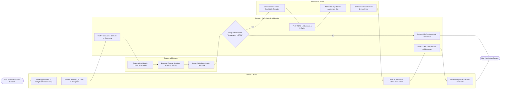

# Swimlane Diagram — Vaccination Management System

## Mermaid Code

## Flow Description | Mô tả luồng

| Lane | Actor / Subsystem | Role in Flow |
|------|-------------------|--------------|
| 1 | Patient / Parent | Books vaccination appointment, completes digital health declaration, presents QR token at clinic reception, waits in 30-minute observation room, and receives verifiable digital QR immunization passport. |
| 2 | Screening Physician | Measures recipient vitals/temperature, evaluates allergy/contraindication history against vaccine product guidelines, and issues formal electronic vaccination clearance. |
| 3 | System / Cold-Chain & QR Engine | Verifies appointment token, evaluates screening contraindication rules, enforces 2D barcode FEFO batch validation, manages automated 30-minute observation timer, and issues cryptographically signed QR passports. |
| 4 | Vaccination Nurse | Scans vaccine packaging 2D DataMatrix barcode to verify 5-Rights, injects vaccine at correct anatomical site, records dose details, and monitors recipient in the observation room. |
