# Action Tree — Vaccination Management System

## Mermaid Code

```mermaid
graph TD
    Root["Vaccination Management System"]

    Root --> M1["Appointment & Registration"]
    Root --> M2["Pre-Vaccination Screening"]
    Root --> M3["Cold-Chain & Inventory Control"]
    Root --> M4["Vaccine Administration BCMA"]
    Root --> M5["Post-Observation & AEFI"]
    Root --> M6["Digital QR Passport Issuance"]
    Root --> M7["Reminders & Multi-Dose Series"]
    Root --> M8["Analytics & Registry Sync"]

    M1 --> A11["Register Recipient Demographic Profile"]
    M1 --> A12["Select Vaccine Combo Package"]
    M1 --> A13["Reserve Clinic Date & Time Slot"]
    M1 --> A14["Generate Booking QR Token"]

    M2 --> A21["Measure Temperature & Vitals"]
    M2 --> A22["Check Allergy & Contraindications"]
    M2 --> A23["Verify Age & Interval Eligibility"]
    M2 --> A24["Issue Physician Digital Clearance"]

    M3 --> A31["Ingest IoT Freezer Temperature Sensor"]
    M3 --> A32["Enforce FEFO Batch Lot Picking"]
    M3 --> A33["Process Batch Receiving Inspection"]
    M3 --> A34["Lock Recalled Batch Quarantine"]

    M4 --> A41["Scan Vaccine Vial 2D DataMatrix"]
    M4 --> A42["Verify 5-Rights Dose Clearance"]
    M4 --> A43["Record Anatomical Injection Site"]
    M4 --> A44["Decrement Batch Inventory Count"]

    M5 --> A51["Start 30-Min Observation Timer"]
    M5 --> A52["Check Out Observation Recipient"]
    M5 --> A53["Log Immediate Anaphylaxis Event"]
    M5 --> A54["Transmit AEFI Report to VAERS"]

    M6 --> A61["Compile Vaccination Event Payload"]
    M6 --> A62["Apply Cryptographic Private Key"]
    M6 --> A63["Generate Offline Verifiable QR Code"]
    M6 --> A64["Sync QR Passport to Patient App"]

    M7 --> A71["Calculate Multi-Dose Due Dates"]
    M7 --> A72["Dispatch SMS & Zalo Reminders"]
    M7 --> A73["Auto-Schedule Booster Dose"]
    M7 --> A74["Track Dropout & Missed Doses"]

    M8 --> A81["Transmit Records to MOH Portal"]
    M8 --> A82["Calculate Vaccine Wastage Rates"]
    M8 --> A83["Monitor Population Coverage Metrics"]
    M8 --> A84["Export Inventory Financial Valuation"]
```

## Module Description | Mô tả Module

| # | Module | Description | Actions |
|---|--------|-------------|---------|
| 1 | Appointment & Registration | Manages recipient profile registration, vaccine product/package selection, clinic time slot booking, and QR token issuance. | Register Recipient Demographic Profile, Select Vaccine Combo Package, Reserve Clinic Date & Time Slot, Generate Booking QR Token |
| 2 | Pre-Vaccination Screening | Handles pre-injection physical examination, body temperature check, allergy/contraindication validation, and physician clearance. | Measure Temperature & Vitals, Check Allergy & Contraindications, Verify Age & Interval Eligibility, Issue Physician Digital Clearance |
| 3 | Cold-Chain & Inventory Control | Monitors IoT storage freezer temperatures (2°C–8°C), enforces FEFO lot picking, handles batch receiving, and executes recall quarantines. | Ingest IoT Freezer Temperature Sensor, Enforce FEFO Batch Lot Picking, Process Batch Receiving Inspection, Lock Recalled Batch Quarantine |
| 4 | Vaccine Administration BCMA | Verifies 5-Rights using GS1 2D DataMatrix packaging barcode scanning, records injection anatomical site, and decrements batch inventory. | Scan Vaccine Vial 2D DataMatrix, Verify 5-Rights Dose Clearance, Record Anatomical Injection Site, Decrement Batch Inventory Count |
| 5 | Post-Observation & AEFI | Tracks the 30-minute post-injection observation room countdown timer, manages check-outs, and files mandatory AEFI safety reports. | Start 30-Min Observation Timer, Check Out Observation Recipient, Log Immediate Anaphylaxis Event, Transmit AEFI Report to VAERS |
| 6 | Digital QR Passport Issuance | Encodes vaccination event payloads into cryptographically signed 2D QR codes compliant with WHO and MOH e-health passport standards. | Compile Vaccination Event Payload, Apply Cryptographic Private Key, Generate Offline Verifiable QR Code, Sync QR Passport to Patient App |
| 7 | Reminders & Multi-Dose Series | Calculates booster dose due dates, auto-dispatches SMS/Zalo reminders, schedules follow-up visits, and tracks series dropout rates. | Calculate Multi-Dose Due Dates, Dispatch SMS & Zalo Reminders, Auto-Schedule Booster Dose, Track Dropout & Missed Doses |
| 8 | Analytics & Registry Sync | Synchronizes immunization data with Ministry of Health / CDC national registries, analyzes vaccine wastage, and exports coverage reports. | Transmit Records to MOH Portal, Calculate Vaccine Wastage Rates, Monitor Population Coverage Metrics, Export Inventory Financial Valuation |
