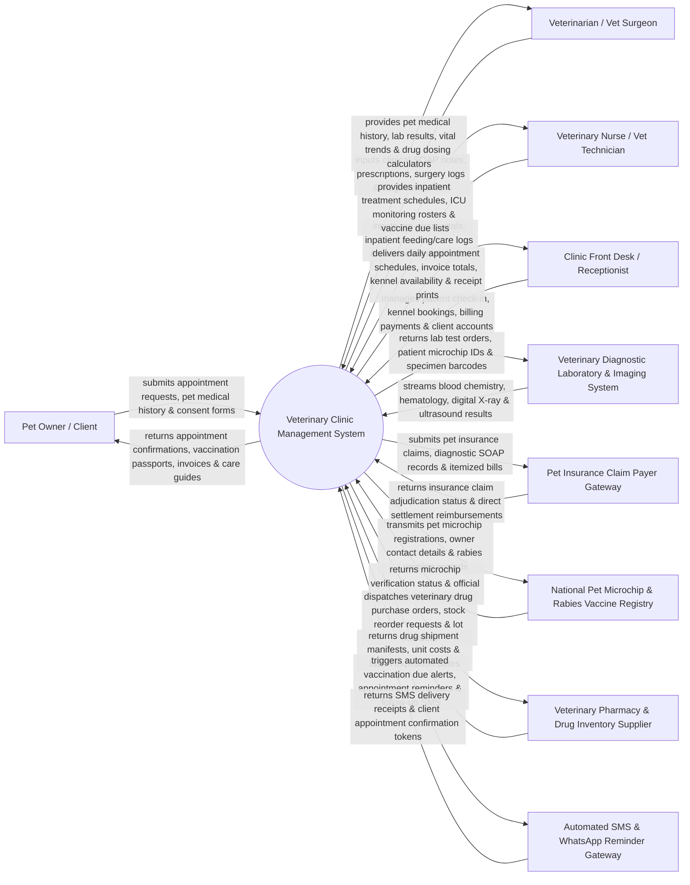

# Context Diagram — Veterinary Clinic Management System

## Mermaid Code

## Actor & Interaction Table | Bảng Actor & Tương tác

| # | Actor | Actor Type | Data Sent TO System | Data Received FROM System | Notes |
|---|-------|------------|---------------------|---------------------------|-------|
| 1 | Pet Owner / Client | Primary | Online appointment bookings, pet patient history (species, breed, age), surgical consents, invoice payments. | Appointment confirmations, digital vaccination passports, electronic invoices, discharge instructions. | Individual pet owners bringing dogs, cats, exotic pets, or livestock to the veterinary clinic for medical care. |
| 2 | Veterinarian / Vet Surgeon | Primary | Clinical SOAP examination notes, diagnostic test orders, prescription orders, surgical notes, anesthesia logs. | Complete pet medical history, lab test results, weight-based drug dosage calculations, historical vital trends. | Licensed veterinary doctors performing physical exams, diagnostics, surgeries, and prescribing treatments. |
| 3 | Veterinary Nurse / Technician | Primary | Pre-exam vital signs (temp, HR, weight), inpatient treatment logs, vaccine administration logs, kennel feeding updates. | Inpatient care treatment schedules, ICU monitoring rosters, vaccination due lists, lab sample tracking boards. | Vet nurses and technicians supporting examinations, administering treatments, and managing inpatient boarding. |
| 4 | Clinic Front Desk Receptionist | Primary | Patient check-ins, new client registrations, appointment scheduling, kennel/boarding reservations, payment processing. | Daily appointment schedules, room queues, itemized invoice summaries, boarding availability boards, billing receipts. | Reception staff handling client communications, scheduling, patient check-in, and cashiering. |
| 5 | Veterinary Diagnostic Lab | Supporting System | Automated hematology (CBC), blood chemistry panels, urinalysis, digital radiology (X-ray), and ultrasound images. | Digital lab test orders, pet microchip IDs, specimen tube barcode identifiers, diagnostic billing codes. | In-house or external commercial veterinary diagnostic laboratories and digital radiology equipment. |
| 6 | Pet Insurance Payer Gateway | Supporting System | Claim adjudication responses, coverage eligibility verifications, direct settlement reimbursement tokens. | Electronic insurance claims, itemized veterinary invoices, clinical SOAP medical records, diagnostic proof. | Commercial pet insurance providers (Trupanion, Nationwide, Petplan) settling veterinary medical claims. |
| 7 | National Pet Microchip Registry | Regulatory | Microchip ownership verification status, national pet registration tokens, official Rabies Certificate numbers. | Pet 15-digit ISO microchip IDs, owner contact information, rabies vaccination dates, vet license numbers. | Government or national animal health registries tracking microchipped pets and mandatory rabies immunizations. |
| 8 | Veterinary Pharmacy Supplier | Supporting System | Veterinary drug shipment manifests, wholesale unit costs, batch lot numbers, drug expiration dates. | Electronic drug purchase orders, inventory reorder requests, low-stock threshold notifications. | Pharmaceutical suppliers and veterinary distributors supplying vaccines, antibiotics, parasite preventatives. |
| 9 | Automated SMS & WhatsApp Gateway | Supporting System | Delivery confirmation receipts, client SMS reply tokens (Confirm/Cancel appointment), link click logs. | Automated annual vaccination due reminders, appointment confirmation SMS, post-surgery follow-up messages. | Communication gateway (Twilio, WhatsApp Business API) sending automated reminders and marketing alerts to pet owners. |

## System Boundary Description | Mô tả Phạm vi Hệ thống

The **Veterinary Clinic Management System (VCMS)** is an enterprise clinical medical records, practice management, pet identification, inventory control, and client portal platform. Operating across veterinary outpatient clinics, animal hospitals, emergency pet centers, and surgical suites, it manages pet patient registration, ISO 15-digit microchip tracking, clinical SOAP medical records, weight-based veterinary drug dosage calculation, vaccination passport management, inpatient boarding, inventory reordering, and pet insurance claim processing.

**Inside System Scope:**
- Pet patient demographic management (Species: Canine, Feline, Avian, Exotic; Breed, Weight, Neutered/Spayed status, Microchip ID).
- Appointment scheduling, surgical room booking, and multi-vet calendar management.
- Comprehensive veterinary SOAP (Subjective, Objective, Assessment, Plan) electronic medical record keeping.
- Automated weight-based drug dosage calculator ($mg/kg$) for veterinary pharmaceuticals.
- Vaccination tracking, rabies certificate generation, and automated annual reminder scheduling (SMS/WhatsApp).
- In-house and external veterinary diagnostic laboratory integration (CBC, Chemistry, Digital Radiography).
- Inpatient boarding management, kennel allocation, feeding logs, and ICU nursing treatment schedules.
- Billing, point-of-sale (POS), itemized invoicing, and direct pet insurance claim integration.
- Veterinary drug and retail inventory management with lot tracking, reorder thresholds, and expiration alerts.

**Outside System Scope:**
- General human medical record processing (handled by human hospital HIS / EMR systems).
- Commercial livestock farm management for large-scale agricultural breeding herds (handled by Livestock ERPs).
- Manufacturing and physical production of veterinary pharmaceuticals or surgical hardware.
