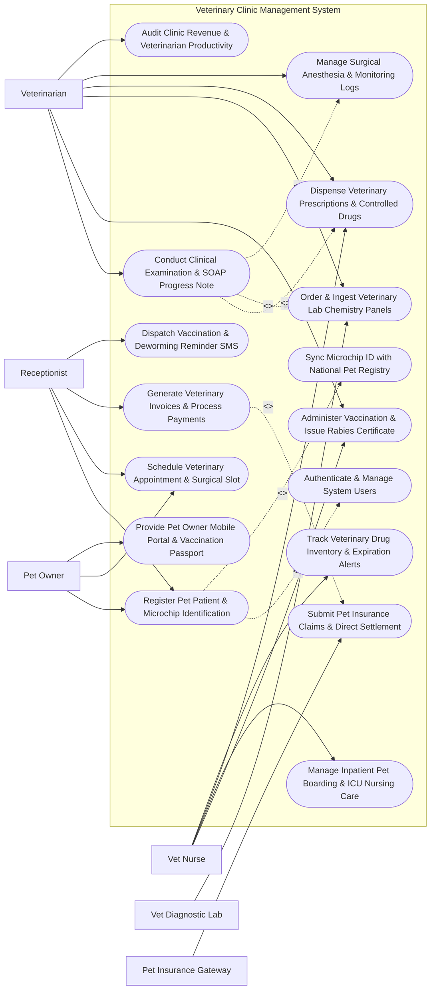

# Use Case Diagram — Veterinary Clinic Management System

## Mermaid Code

## Actor Table | Bảng Actor

| # | Actor | Actor Type | Role Description | Related Use Cases |
|---|-------|------------|------------------|-------------------|
| 1 | Pet Owner | Primary | Client owning one or more pets, booking appointments, viewing digital vaccination passports, and paying invoices. | UC01, UC02, UC14 |
| 2 | Receptionist | Primary | Clinic front desk staff registering new clients and pets, scheduling visits, checking in patients, and processing payments. | UC01, UC02, UC08, UC11 |
| 3 | Veterinarian | Primary | Licensed vet surgeon conducting clinical exams, recording SOAP notes, ordering labs, performing surgeries, and prescribing medications. | UC03, UC04, UC05, UC07, UC13, UC15 |
| 4 | Vet Nurse | Primary | Veterinary technician assisting with exams, administering vaccines, managing inpatient boarding/ICU, and dispensing drugs. | UC04, UC06, UC07, UC10 |
| 5 | Vet Diagnostic Lab | Secondary / System | External or in-house diagnostic lab equipment (CBC, Chemistry, Digital Radiography) returning diagnostic test results. | UC05 |
| 6 | Pet Insurance Gateway | Secondary / System | Third-party pet insurance provider processing electronic claim submissions and direct clinic settlements. | UC09 |

## Use Case Table | Bảng Use Case

| # | UC ID | Use Case Name | Primary Actor | Secondary Actor | Description | Priority |
|---|-------|---------------|---------------|-----------------|-------------|----------|
| 1 | UC01 | Register Pet Patient & Microchip Identification | Receptionist | Pet Owner | Register new pet patient record including species, breed, sex, spayed/neutered status, DOB, and 15-digit ISO microchip ID. | High |
| 2 | UC02 | Schedule Veterinary Appointment & Surgical Slot | Receptionist | Pet Owner | Book outpatient consultations, wellness checks, dental procedures, or orthopedic surgery slots across veterinarian calendars. | High |
| 3 | UC03 | Conduct Clinical Examination & SOAP Progress Note | Veterinarian | None | Perform physical examination (Temp, Pulse, Resp, Weight) and document SOAP (Subjective, Objective, Assessment, Plan) medical notes. | High |
| 4 | UC04 | Administer Vaccination & Issue Rabies Certificate | Veterinarian | Vet Nurse | Administer core/non-core pet vaccines (DHPP, Rabies, FVRCP), record batch lot numbers, and generate official Rabies Certificates. | High |
| 5 | UC05 | Order & Ingest Veterinary Lab Chemistry Panels | Veterinarian | Vet Diagnostic Lab | Dispatch blood chemistry (ALT, BUN, Creatinine) and hematology lab orders, ingesting diagnostic results into pet EMR. | High |
| 6 | UC06 | Manage Inpatient Pet Boarding & ICU Nursing Care | Vet Nurse | None | Assign kennel rooms for surgical recovery or boarding, manage feeding/medication schedules, and log nursing care progress. | Medium |
| 7 | UC07 | Dispense Veterinary Prescriptions & Controlled Drugs | Veterinarian | Vet Nurse | Calculate weight-based drug doses ($mg/kg$), generate prescription labels, dispense veterinary pharmaceuticals, and log controlled drugs. | High |
| 8 | UC08 | Generate Veterinary Invoices & Process Payments | Receptionist | Pet Owner | Aggregate exam fees, lab tests, surgery charges, and retail supplies into an itemized invoice, processing cash/card payments. | High |
| 9 | UC09 | Submit Pet Insurance Claims & Direct Settlement | Receptionist | Pet Insurance Gateway | Submit electronic claims with clinical SOAP attachments to pet insurance providers for immediate pre-authorization or direct settlement. | High |
| 10 | UC10 | Track Veterinary Drug Inventory & Expiration Alerts | Vet Nurse | None | Monitor pharmaceutical stock levels, track batch expiration dates, manage reorder thresholds, and issue purchase orders. | High |
| 11 | UC11 | Dispatch Vaccination & Deworming Reminder SMS | Receptionist | None | Send automated SMS/WhatsApp reminders for upcoming annual booster vaccinations, heartworm preventatives, and deworming. | Medium |
| 12 | UC12 | Sync Microchip ID with National Pet Registry | Receptionist | None | Synchronize 15-digit ISO microchip registration and owner contact details with the national pet microchip registry database. | Medium |
| 13 | UC13 | Manage Surgical Anesthesia & Monitoring Logs | Veterinarian | None | Log pre-anesthetic bloodwork, anesthesia induction drugs, intra-operative vital signs (SpO2, Capnography, BP), and recovery status. | High |
| 14 | UC14 | Provide Pet Owner Mobile Portal & Vaccination Passport | Pet Owner | None | Provide pet owners with a mobile app portal to access digital vaccination passports, view medical records, and request refills. | Medium |
| 15 | UC15 | Audit Clinic Revenue & Veterinarian Productivity | Veterinarian | None | Generate business intelligence reports on clinic revenue, vet doctor productivity, product sales, and client retention metrics. | Medium |
| 16 | UC16 | Authenticate & Manage System Users | All Users | None | Enforce multi-factor authentication, role-based access control (Vet, Nurse, Receptionist), and audit logging. | High |

## Use Case Specification | Đặc tả Use Case

---

### UC01 — Register Pet Patient & Microchip Identification

| Field | Detail |
|-------|--------|
| **UC ID** | UC01 |
| **Use Case Name** | Register Pet Patient & Microchip Identification |
| **Actor(s)** | Primary: Receptionist   Secondary: Pet Owner |
| **Description** | Registers a new pet patient record linked to a client owner account, capturing pet species (Canine, Feline, Avian, Exotic), breed, coat color, date of birth, neutered/spayed status, microchip 15-digit ISO number (`985141000991823`), and syncing details with the National Pet Microchip Registry. |
| **Precondition** | 1. Receptionist is authenticated in VCMS.   2. Client Owner profile is created or selected. |
| **Main Flow** | 1. The Receptionist selects "Add New Pet Patient" under Client Profile `CLI-2026-88912` (Owner: *Sarah Jenkins*).   2. The Receptionist inputs **Pet Demographics**:   &nbsp;&nbsp;&nbsp;&nbsp;- Pet Name: *Buddy*   &nbsp;&nbsp;&nbsp;&nbsp;- Species: Canine (Dog)   &nbsp;&nbsp;&nbsp;&nbsp;- Breed: Golden Retriever   &nbsp;&nbsp;&nbsp;&nbsp;- Gender: Male (Neutered / Castrated)   &nbsp;&nbsp;&nbsp;&nbsp;- Date of Birth: `2022-04-15` (Age: 4 Years)   &nbsp;&nbsp;&nbsp;&nbsp;- Coat Color: Golden.   3. The Receptionist scans the pet's RFID microchip using an external USB scanner:   &nbsp;&nbsp;&nbsp;&nbsp;- **Microchip ID**: `985141000991823` (15-digit ISO 11784/11785 format).   4. The System executes a duplicate check on the Microchip ID.   5. The System dispatches a sync payload to the **National Pet Microchip Registry** (UC12), registering *Buddy* under Owner *Sarah Jenkins*.   6. The System initializes Pet EMR `PET-2026-77812` and prints a barcode collar tag. |
| **Alternative Flow** | **AF1** — Microchip Implantation During Visit: Pet does not have a microchip; Vet implants a new 15-digit RFID microchip during the exam, and Nurse updates the EMR record post-implantation.   **AF2** — Exotic Animal Registration: Receptionist registers an exotic pet (e.g., Green Iguana); System adjusts default vitals template (Temperature range: 29-35°C, Weight in grams). |
| **Exception Flow** | **EX1** — Duplicate Microchip ID Warning: Scanned Microchip ID `985141000991823` is already assigned to another pet in the database; System blocks registration with alert "Microchip ID Already Registered to Patient PET-2024-1102 — Verify Identity".   **EX2** — National Registry Connection Error: National Microchip API is offline; System buffers registration locally and marks sync status as "Pending Registry Sync". |
| **Postcondition** | Pet record PET-2026-77812 (Buddy, Golden Retriever) is created, linked to Owner Sarah Jenkins, 15-digit ISO microchip registered, and EMR initialized. |
| **Business Rule** | **BR1**: Microchip IDs MUST strictly validate against 15-digit ISO 11784/11785 international standards.   **BR2**: Spayed/Neutered surgical status MUST be confirmed during initial registration to prevent inaccurate breeding or surgical recommendations. |

---

### UC02 — Schedule Veterinary Appointment & Surgical Slot

| Field | Detail |
|-------|--------|
| **UC ID** | UC02 |
| **Use Case Name** | Schedule Veterinary Appointment & Surgical Slot |
| **Actor(s)** | Primary: Receptionist   Secondary: Pet Owner |
| **Description** | Schedules outpatient veterinary consultations, wellness vaccinations, dental prophylaxis, or sterile surgical procedures (e.g., Canine ACL Repair, Ovariohysterectomy) across multi-veterinarian calendars, reserving exam rooms or surgical suites and managing appointment reminders. |
| **Precondition** | 1. Pet Patient `PET-2026-77812` (Buddy) is registered in VCMS.   2. Veterinarian work schedules and room availability templates are configured. |
| **Main Flow** | 1. The Receptionist opens the "VCMS Appointment Master Scheduler".   2. The Receptionist selects Patient *Buddy* (`PET-2026-77812`).   3. The Receptionist selects **Appointment Type**: *Annual Wellness Exam & DHPP Vaccination Booster*.   4. The Receptionist views available slots for **Dr. Michael Ross (DVM)**:   &nbsp;&nbsp;&nbsp;&nbsp;- Date: `2026-07-28` at `10:30 AM`   &nbsp;&nbsp;&nbsp;&nbsp;- Exam Room: `Room 02 (Canine Exam Room)`.   5. The System reserves the 30-minute slot and verifies no double-booking conflict.   6. The System logs pre-appointment instructions: *"Bring fresh stool sample for annual fecal parasite screening"*.   7. The System dispatches an automated SMS & WhatsApp appointment confirmation with a calendar link to Owner *Sarah Jenkins* (UC11).   8. The System sets appointment status to `CONFIRMED`. |
| **Alternative Flow** | **AF1** — Sterile Surgical Suite Booking: Booking a major surgery (e.g., Spay); System reserves 2-hour Surgical Suite 01 slot, assigns Vet Surgeon and Anesthetist Nurse, and attaches pre-surgical NPO (fasting) instructions.   **AF2** — Emergency Walk-In Triage: Client arrives with emergency trauma case; Receptionist clicks "Emergency Walk-In", immediately overriding schedule and placing patient at top of ER Triage Queue. |
| **Exception Flow** | **EX1** — Veterinarian Schedule Conflict: Dr. Ross is scheduled for emergency surgery at 10:30 AM; System alerts "Doctor Unavailable — Surgical Conflict", suggesting Dr. Emma Watson at 11:00 AM.   **EX2** — Overdue Rabies Vaccine Block for Grooming/Boarding: Client requests boarding booking but Rabies vaccine is expired; System flags "Rabies Booster Required Prior to Boarding Admission". |
| **Postcondition** | Appointment `APP-2026-99182` is booked for July 28 at 10:30 AM with Dr. Ross in Room 02, SMS confirmation sent, and pre-exam instructions logged. |
| **Business Rule** | **BR1**: Sterile surgical procedures MUST reserve both a surgical suite and assigned veterinary anesthetist in addition to the primary surgeon.   **BR2**: Pets admitted for inpatient boarding or surgical procedures MUST have verified, up-to-date core vaccinations (Rabies, DHPP/FVRCP). |

---

### UC03 — Conduct Clinical Examination & SOAP Progress Note

| Field | Detail |
|-------|--------|
| **UC ID** | UC03 |
| **Use Case Name** | Conduct Clinical Examination & SOAP Progress Note |
| **Actor(s)** | Primary: Veterinarian |
| **Description** | Conducts physical clinical examination on pet patient, records physical vital signs (Body Temperature °C, Heart Rate bpm, Respiratory Rate, Body Condition Score 1-9, Weight kg), documents structured SOAP (Subjective, Objective, Assessment, Plan) medical notes, and establishes clinical diagnosis. |
| **Precondition** | 1. Patient *Buddy* (`PET-2026-77812`) is checked in for appointment `APP-2026-99182`.   2. Pre-exam vitals have been entered by Vet Nurse. |
| **Main Flow** | 1. Dr. Michael Ross (DVM) opens Clinical EMR for Patient *Buddy*.   2. The Doctor reviews **Objective Physical Vitals**:   &nbsp;&nbsp;&nbsp;&nbsp;- Weight: **$31.4\text{ kg}$** (Previous: $30.2\text{ kg}$)   &nbsp;&nbsp;&nbsp;&nbsp;- Rectal Temperature: **$38.6^\circ\text{C}$** (Normal Range: $37.8 - 39.2^\circ\text{C}$)   &nbsp;&nbsp;&nbsp;&nbsp;- Heart Rate: **$92\text{ bpm}$** (Normal)   &nbsp;&nbsp;&nbsp;&nbsp;- Respiratory Rate: **$24\text{ breaths/min}$**   &nbsp;&nbsp;&nbsp;&nbsp;- Body Condition Score (BCS): **5/9** (Ideal Body Weight)   &nbsp;&nbsp;&nbsp;&nbsp;- Capillary Refill Time (CRT): **< 2 seconds**, Mucous Membranes: Pink.   3. The Doctor documents **SOAP Clinical Medical Record**:   &nbsp;&nbsp;&nbsp;&nbsp;- **Subjective**: Owner reports mild scratching at right ear for 3 days.   &nbsp;&nbsp;&nbsp;&nbsp;- **Objective**: Otoscopic exam shows moderate erythematous exudate in right ear canal. Left ear clean. Dental tartar Grade 1.   &nbsp;&nbsp;&nbsp;&nbsp;- **Assessment**: *Acute Right Otitis Externa (ICD-Vet)*.   &nbsp;&nbsp;&nbsp;&nbsp;- **Plan**: Cytology swab, ear cleaning, prescribe topical otic drops (Posatex), routine annual DHPP vaccine booster.   4. The Doctor orders ear cytology lab test (UC05) and prescribes medication (UC07).   5. The Doctor signs the SOAP medical record with digital signature key. |
| **Alternative Flow** | **AF1** — Equine / Large Animal Field Exam: Vet performs field exam on horse at stable, recording vitals via mobile tablet app offline and syncing SOAP notes upon returning to clinic.   **AF2** — Pre-Anesthetic Surgical Clearance Exam: Vet performs pre-op assessment, evaluating cardiac auscultation (checking for heart murmur Grade 0-6) and approving patient for anesthesia. |
| **Exception Flow** | **EX1** — Critical High Fever Alert: Pet temperature is $40.8^\circ\text{C}$ (Severe Hyperthermia / Pyrexia); System flashes "CRITICAL FEVER ALERT — Immediate Active Cooling Protocol Recommended".   **EX2** — Unsigned SOAP Note Lock Warning: Vet attempts to navigate away without saving SOAP note; System prompts "Unsaved Clinical Record — Save Changes Before Exit". |
| **Postcondition** | SOAP Medical Record `SOAP-2026-44102` (Otitis Externa diagnosis, vitals, plan) is completed, digitally signed, and linked to patient EMR. |
| **Business Rule** | **BR1**: Veterinary clinical records MUST include Body Condition Score (BCS 1-9 scale) and accurate weight (kg) to enable weight-based pharmaceutical dosing calculations.   **BR2**: Completed clinical SOAP notes MUST be digitally signed within 24 hours of examination to maintain veterinary legal compliance. |

---

### UC04 — Administer Vaccination & Issue Rabies Certificate

| Field | Detail |
|-------|--------|
| **UC ID** | UC04 |
| **Use Case Name** | Administer Vaccination & Issue Rabies Certificate |
| **Actor(s)** | Primary: Veterinarian   Secondary: Vet Nurse |
| **Description** | Administers core/non-core immunizations (Canine DHPP, Rabies 3-Yr, Bordetella, Feline FVRCP, FeLV), records vaccine manufacturer, serial lot number, expiration date, and administration site, automatically updates the digital Vaccination Passport, and generates an official Rabies Vaccination Certificate. |
| **Precondition** | 1. Patient *Buddy* (`PET-2026-77812`) has passed physical exam (UC03) with no fever.   2. Vaccine inventory lot `LOT-RAB-2026-88` is active in inventory. |
| **Main Flow** | 1. Dr. Michael Ross selects "Administer Immunization" in Patient *Buddy*'s EMR.   2. The Doctor selects **Vaccines Administered**:   &nbsp;&nbsp;&nbsp;&nbsp;- Vaccine 1: **Rabies 3-Year Vaccine (Killed Virus)**   &nbsp;&nbsp;&nbsp;&nbsp;- Vaccine 2: **Canine DHPP (Distemper, Hepatitis, Parvovirus, Parainfluenza)**.   3. The System scans vaccine vial barcode, capturing:   &nbsp;&nbsp;&nbsp;&nbsp;- Manufacturer: *Zoetis Defensor 3*   &nbsp;&nbsp;&nbsp;&nbsp;- Lot Serial Number: `LOT-RAB-2026-88`   &nbsp;&nbsp;&nbsp;&nbsp;- Expiration Date: `2028-03-31`   &nbsp;&nbsp;&nbsp;&nbsp;- Route / Site: Subcutaneous Right Hind Limb (`SQ-RHL`).   4. The Doctor administers the injections; Vet Nurse records completion.   5. The System calculates **Next Due Dates**:   &nbsp;&nbsp;&nbsp;&nbsp;- Rabies Booster Due: `2029-07-28` (3-Year Duration)   &nbsp;&nbsp;&nbsp;&nbsp;- DHPP Booster Due: `2027-07-28` (1-Year Duration).   6. The System generates official **Rabies Vaccination Certificate `CERT-RAB-2026-99182`**:   &nbsp;&nbsp;&nbsp;&nbsp;- Includes Pet Microchip ID `985141000991823`, Vet License # `VET-LIC-4412`, Tag # `TAG-2026-88`.   7. The System updates Pet Owner Mobile App Vaccination Passport (UC14) and schedules automated reminder SMS for 2027 (UC11). |
| **Alternative Flow** | **AF1** — Feline Leukemia (FeLV) Pre-Vaccine Testing: Vet performs SNAP FeLV/FIV blood test prior to vaccine administration; test is Negative, proceeding with FeLV immunization.   **AF2** — Vaccine Adverse Reaction Reaction Logging: Pet displays mild facial edema 15 mins post-vaccine; Vet administers Diphenhydramine (Benadryl) and logs "Vaccine Adverse Event — Facial Swelling (MILD)" in EMR. |
| **Exception Flow** | **EX1** — Expired Vaccine Batch Warning: System detects selected vaccine lot expired 5 days ago; System blocks administration entry with error "EXPIRED VACCINE LOT — Select Valid Batch".   **EX2** — Duplicate Vaccine Administration Warning: Pet received DHPP vaccine 2 weeks ago at another clinic; System alerts "DHPP Vaccine Administered Recently — Verify Immunization Interval". |
| **Postcondition** | Vaccines recorded with lot numbers, Rabies Certificate CERT-RAB-2026-99182 issued, next booster dates set, and mobile passport updated. |
| **Business Rule** | **BR1**: Official Rabies Certificates MUST display the pet's verified 15-digit ISO microchip ID, vaccine lot number, vet license number, and official tag serial number.   **BR2**: Vaccine administration records MUST deduct stock from pharmaceutical inventory in real-time and capture lot expiration dates. |

---

### UC05 — Order & Ingest Veterinary Lab Chemistry Panels

| Field | Detail |
|-------|--------|
| **UC ID** | UC05 |
| **Use Case Name** | Order & Ingest Veterinary Lab Chemistry Panels |
| **Actor(s)** | Primary: Veterinarian   Secondary: Vet Diagnostic Lab |
| **Description** | Orders in-house or external commercial laboratory diagnostic panels (Complete Blood Count CBC, Serum Blood Chemistry, Electrolytes, Ear Cytology, Urinalysis, Digital Radiography), prints barcode tube labels, and ingests structured lab results directly into the pet patient's EMR. |
| **Precondition** | 1. Patient *Buddy* (`PET-2026-77812`) is undergoing examination (UC03).   2. In-house lab analyzers (IDEXX / Abaxis) or external lab portal APIs are online. |
| **Main Flow** | 1. Dr. Michael Ross orders **In-House Diagnostic Panel**:   &nbsp;&nbsp;&nbsp;&nbsp;- Test 1: *Ear Cytology Swab (Right Ear)*   &nbsp;&nbsp;&nbsp;&nbsp;- Test 2: *Comprehensive Blood Chemistry (VetTest 16-Panel)*.   2. The System prints Specimen Barcode Label `LAB-BAR-2026-9918`.   3. Vet Nurse collects blood and ear swab, loading blood tube into IDEXX VetTest Analyzer.   4. The Analyzer runs blood chemistry and transmits structured results via HL7 interface:   &nbsp;&nbsp;&nbsp;&nbsp;- **ALT (Liver)**: $42\text{ U/L}$ (Normal: $10-125\text{ U/L}$)   &nbsp;&nbsp;&nbsp;&nbsp;- **BUN (Kidney)**: $18\text{ mg/dL}$ (Normal: $7-27\text{ mg/dL}$)   &nbsp;&nbsp;&nbsp;&nbsp;- **Creatinine**: $1.1\text{ mg/dL}$ (Normal: $0.5-1.8\text{ mg/dL}$)   &nbsp;&nbsp;&nbsp;&nbsp;- **Blood Glucose**: $5.4\text{ mmol/L}$ (Normal).   5. Dr. Ross performs microscopic ear cytology: identifies *Malassezia pachydermatis* (Yeast Organisms 3+).   6. The System attaches lab results and cytology images to Medical Record `SOAP-2026-44102`.   7. The System flags Ear Cytology result as "Abnormal — Yeast Infection Confirmed", prompting targeted otic drop prescription (UC07). |
| **Alternative Flow** | **AF1** — External Commercial Lab Courier Order: Ordering specialized histopathology biopsy to reference lab (IDEXX Reference Lab); System generates electronic requisition, prints courier shipping manifest, and notifies client when results arrive 48 hours later.   **AF2** — Digital X-Ray / Radiography DICOM Ingestion: Vet takes 2-view chest radiographs; X-ray machine pushes DICOM images directly to VCMS PACS viewer. |
| **Exception Flow** | **EX1** — Hemolyzed Blood Sample Rejection: Lab analyzer detects severe hemolysis in blood sample; System flags "Sample Hemolyzed — Re-collection Required", notifying Vet Nurse.   **EX2** — Critical Kidney Biomarker Alert: Creatinine is $6.8\text{ mg/dL}$ (Severe Azotemia / Acute Renal Failure); System flashes Urgent Red Alert on Vet workstation. |
| **Postcondition** | Lab order `LAB-2026-9918` is executed, blood chemistry (Normal) and cytology (Malassezia 3+) ingested, attached to EMR, and diagnosis finalized. |
| **Business Rule** | **BR1**: Veterinary diagnostic lab reference ranges MUST automatically adjust based on pet species (Canine vs Feline vs Equine) and age group.   **BR2**: Diagnostic lab results received from external analyzers MUST be stored in structured format linked to the specific clinical SOAP examination record. |
