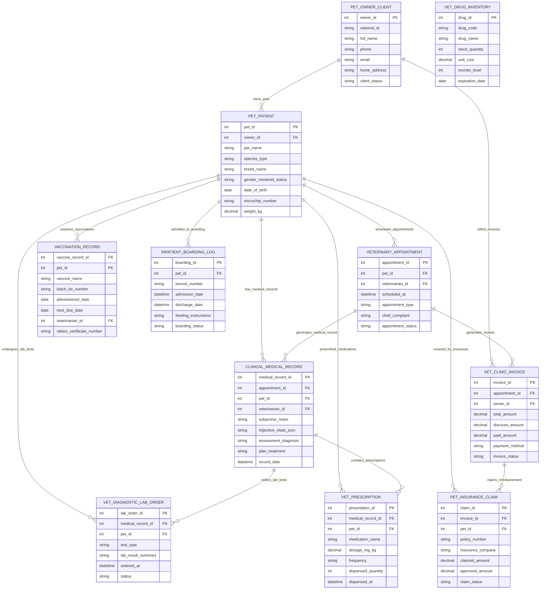

# Conceptual ERD — Veterinary Clinic Management System

## Mermaid Code

## Entity Description Table | Bảng mô tả Entity

| # | Entity Name | Vietnamese Name | Description | Key Attributes | Main Relationships |
|---|-------------|-----------------|-------------|----------------|-------------------|
| 1 | PET_OWNER_CLIENT | Chủ Thú cưng / Khách hàng | Master record of pet owner client storing national ID, full name, phone number, email, address, and client account status. | owner_id, national_id, full_name, phone, email, home_address, client_status | Has PET_PATIENT and VET_CLINIC_INVOICE. |
| 2 | PET_PATIENT | Bệnh nhân Thú cưng | Pet patient record storing owner ID, pet name, species (Canine, Feline), breed, sex/neutered status, DOB, microchip ID, and weight. | pet_id, owner_id, pet_name, species_type, breed_name, gender_neutered_status, date_of_birth, microchip_number, weight_kg | Belongs to PET_OWNER_CLIENT; Has APPOINTMENT, MEDICAL_RECORD, VACCINATION, LAB_ORDER, BOARDING, PRESCRIPTION, CLAIM. |
| 3 | VETERINARY_APPOINTMENT | Lịch hẹn Kám Thú y | Outpatient appointment or surgical slot reservation record storing pet ID, vet ID, scheduled time, appointment type, complaint, and status. | appointment_id, pet_id, veterinarian_id, scheduled_at, appointment_type, chief_complaint, appointment_status | Belongs to PET_PATIENT; Generates CLINICAL_MEDICAL_RECORD and VET_CLINIC_INVOICE. |
| 4 | CLINICAL_MEDICAL_RECORD | Hồ sơ Bệnh án Thu y SOAP | Structured clinical SOAP medical record storing appointment ID, pet ID, vet ID, Subjective, Objective vitals, Assessment, Plan, and timestamp. | medical_record_id, appointment_id, pet_id, veterinarian_id, subjective_notes, objective_vitals_json, assessment_diagnosis, plan_treatment | Belongs to VETERINARY_APPOINTMENT and PET_PATIENT; Generates LAB_ORDER and PRESCRIPTION. |
| 5 | VACCINATION_RECORD | Hồ sơ Tiêm chủng Thú y | Immunization administration record storing pet ID, vaccine name, batch lot number, administered date, next due date, vet ID, and rabies cert number. | vaccine_record_id, pet_id, vaccine_name, batch_lot_number, administered_date, next_due_date, veterinarian_id, rabies_certificate_number | Belongs to PET_PATIENT. |
| 6 | VET_DIAGNOSTIC_LAB_ORDER | Đơn Xét nghiệm Chẩn đoán Thú y | Diagnostic lab test order record storing medical record ID, pet ID, test type (CBC, Chemistry, Cytology), result summary, order time, and status. | lab_order_id, medical_record_id, pet_id, test_type, lab_result_summary, ordered_at, status | Belongs to CLINICAL_MEDICAL_RECORD and PET_PATIENT. |
| 7 | INPATIENT_BOARDING_LOG | Nhật ký Nội trú & Lưu chuồng | Inpatient boarding and ICU nursing log tracking pet ID, kennel room number, admission/discharge dates, feeding rules, and status. | boarding_id, pet_id, kennel_number, admission_date, discharge_date, feeding_instructions, boarding_status | Belongs to PET_PATIENT. |
| 8 | VET_PRESCRIPTION | Đơn Thuốc Thú y | Veterinary drug prescription record tracking medical record ID, pet ID, medication name, dosage ($mg/kg$), frequency, quantity, and timestamp. | prescription_id, medical_record_id, pet_id, medication_name, dosage_mg_kg, frequency, dispensed_quantity, dispensed_at | Belongs to CLINICAL_MEDICAL_RECORD and PET_PATIENT. |
| 9 | VET_CLINIC_INVOICE | Hóa đơn Phòng khám Thú y | Itemized financial invoice record storing appointment ID, owner ID, total amount, discount, paid amount, payment method, and status. | invoice_id, appointment_id, owner_id, total_amount, discount_amount, paid_amount, payment_method, invoice_status | Belongs to VETERINARY_APPOINTMENT and PET_OWNER_CLIENT; Generates PET_INSURANCE_CLAIM. |
| 10 | PET_INSURANCE_CLAIM | Yêu cầu Bồi thường Bảo hiểm Thú cưng | Electronic pet insurance claim record tracking invoice ID, pet ID, policy number, insurance company, claimed amount, approved amount, and status. | claim_id, invoice_id, pet_id, policy_number, insurance_company, claimed_amount, approved_amount, claim_status | Belongs to VET_CLINIC_INVOICE and PET_PATIENT. |
| 11 | VET_DRUG_INVENTORY | Kho Thuốc & Dược phẩm Thú y | Veterinary pharmaceutical and vaccine inventory record tracking drug code, name, stock quantity, unit cost, reorder level, and expiration date. | drug_id, drug_code, drug_name, stock_quantity, unit_cost, reorder_level, expiration_date | Independent inventory master record. |

## Relationship Description | Mô tả Quan hệ

| # | From Entity | Cardinality | To Entity | Relationship Label | Business Explanation |
|---|-------------|-------------|-----------|-------------------|----------------------|
| 1 | PET_OWNER_CLIENT | one-to-many | PET_PATIENT | owns_pets | One pet owner client owns one or more pet patients. |
| 2 | PET_OWNER_CLIENT | one-to-many | VET_CLINIC_INVOICE | billed_invoices | One pet owner client is billed itemized clinic invoices. |
| 3 | PET_PATIENT | one-to-many | VETERINARY_APPOINTMENT | schedules_appointments | One pet patient schedules veterinary appointments and surgical slots. |
| 4 | PET_PATIENT | one-to-many | CLINICAL_MEDICAL_RECORD | has_medical_records | One pet patient accumulates clinical SOAP medical records over time. |
| 5 | PET_PATIENT | one-to-many | VACCINATION_RECORD | receives_vaccinations | One pet patient receives immunizations recorded in their vaccination history. |
| 6 | PET_PATIENT | one-to-many | VET_DIAGNOSTIC_LAB_ORDER | undergoes_lab_tests | One pet patient undergoes diagnostic blood chemistry and cytology tests. |
| 7 | PET_PATIENT | one-to-many | INPATIENT_BOARDING_LOG | admitted_to_boarding | One pet patient is admitted to kennel boarding or ICU nursing care. |
| 8 | PET_PATIENT | one-to-many | VET_PRESCRIPTION | prescribed_medications | One pet patient is prescribed weight-based veterinary pharmaceuticals. |
| 9 | PET_PATIENT | one-to-many | PET_INSURANCE_CLAIM | covered_by_insurance | One pet patient is covered by pet insurance claims for medical reimbursement. |
| 10 | VETERINARY_APPOINTMENT | one-to-many | CLINICAL_MEDICAL_RECORD | generates_medical_record | One veterinary appointment generates a clinical SOAP medical record. |
| 11 | VETERINARY_APPOINTMENT | one-to-many | VET_CLINIC_INVOICE | generates_invoice | One veterinary appointment generates an itemized billing invoice. |
| 12 | CLINICAL_MEDICAL_RECORD | one-to-many | VET_DIAGNOSTIC_LAB_ORDER | orders_lab_tests | One clinical medical record contains orders for diagnostic lab tests. |
| 13 | CLINICAL_MEDICAL_RECORD | one-to-many | VET_PRESCRIPTION | contains_prescriptions | One clinical medical record contains prescribed veterinary medications. |
| 14 | VET_CLINIC_INVOICE | one-to-many | PET_INSURANCE_CLAIM | claims_reimbursement | One clinic invoice generates electronic pet insurance claims. |
