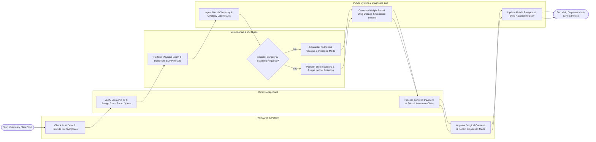

# Swimlane Diagram — Veterinary Clinic Management System

## Mermaid Code

## Flow Description | Mô tả luồng

| Lane | Actor / Subsystem | Role in Flow |
|------|-------------------|--------------|
| 1 | Pet Owner & Patient | Checks in at clinic desk, provides pet medical history, approves surgical consent forms, collects dispensed pharmaceuticals, and receives discharge instructions. |
| 2 | Clinic Receptionist | Verifies pet 15-digit microchip ID, manages exam room queues, generates itemized clinic invoices, collects payments, and submits electronic pet insurance claims. |
| 3 | Veterinarian & Vet Nurse | Conducts physical exams (Temp, HR, Weight), documents SOAP notes, performs in-house lab tests/cytology, executes sterile surgeries, and administers vaccines. |
| 4 | VCMS System & Diagnostic Lab | Ingests diagnostic lab results, calculates weight-based drug doses ($mg/kg$), updates mobile vaccination passports, and syncs microchip IDs with national registries. |
