# Action Tree — Veterinary Clinic Management System

## Mermaid Code

```mermaid
graph TD
    Root["Veterinary Clinic Management System"]

    Root --> M1["Pet Registration & Microchip Tracking"]
    Root --> M2["Appointment & Surgical Suite Scheduling"]
    Root --> M3["Veterinary Clinical EMR & SOAP Notes"]
    Root --> M4["Immunization & Rabies Certification"]
    Root --> M5["Veterinary Diagnostic Lab & Radiology"]
    Root --> M6["Inpatient Boarding & ICU Nursing Care"]
    Root --> M7["Pharmacy Dispensing & Drug Inventory"]
    Root --> M8["Invoicing POS & Pet Insurance Claims"]

    M1 --> A11["Register Pet Patient & Species Breed Info"]
    M1 --> A12["Scan & Verify 15-Digit ISO Microchip ID"]
    M1 --> A13["Sync Microchip Data to National Pet Registry"]
    M1 --> A14["Link Pet Profiles to Client Owner Accounts"]

    M2 --> A21["Schedule Outpatient Consultations & Wellness"]
    M2 --> A22["Reserve Surgical Suites & Anesthetist Teams"]
    M2 --> A23["Manage Multi-Vet Master Calendar Schedules"]
    M2 --> A24["Triage Emergency Walk-In Trauma Arrivals"]

    M3 --> A31["Record Objective Physical Vitals Temp HR Weight"]
    M3 --> A32["Document Structured SOAP Examination Notes"]
    M3 --> A33["Calculate Body Condition Scores BCS 1 to 9"]
    M3 --> A34["Log Pre-Anesthetic Surgical Clearance Exams"]

    M4 --> A41["Administer Core & Non-Core Pet Immunizations"]
    M4 --> A42["Record Vaccine Batch Lot Numbers & Expiration"]
    M4 --> A43["Issue Official Rabies Vaccination Certificates"]
    M4 --> A44["Dispatch Automated Annual Vaccine Reminder SMS"]

    M5 --> A51["Order In-House Blood Chemistry CBC & Cytology"]
    M5 --> A52["Ingest Automated Lab Results via HL7 Interfaces"]
    M5 --> A53["Upload Digital X-Ray Radiology DICOM Images"]
    M5 --> A54["Dispatch Histopathology Requisitions to Lab"]

    M6 --> A61["Assign Inpatient Kennel Rooms & Boarding Beds"]
    M6 --> A62["Manage Special Dietary & Feeding Schedules"]
    M6 --> A63["Log Inpatient Nursing Care Vitals & Treatments"]
    M6 --> A64["Generate Inpatient Discharge Summaries"]

    M7 --> A71["Calculate Weight-Based Drug Doses mg per kg"]
    M7 --> A72["Print Prescription Labels & Warning Directions"]
    M7 --> A73["Log Controlled Substances & Narcotics Vault"]
    M7 --> A74["Monitor Drug Reorder Levels & Expiration Dates"]

    M8 --> A81["Generate Itemized Clinic Invoices & POS Receipts"]
    M8 --> A82["Submit Electronic Pet Insurance Claims"]
    M8 --> A83["Process Credit Card Cash & Client Credits"]
    M8 --> A84["Audit Clinic Revenue & Vet Doctor Productivity"]
```

## Module Description | Mô tả Module

| # | Module | Description | Actions |
|---|--------|-------------|---------|
| 1 | Pet Registration & Microchip Tracking | Registers pet patient demographics, scans 15-digit ISO microchip IDs, syncs with national registries, and links pets to owner profiles. | Register Pet Patient & Species Breed Info, Scan & Verify 15-Digit ISO Microchip ID, Sync Microchip Data to National Pet Registry, Link Pet Profiles to Client Owner Accounts |
| 2 | Appointment & Surgical Suite Scheduling | Schedules outpatient consults, reserves sterile surgical suites and anesthetist teams, manages vet calendars, and triages emergency arrivals. | Schedule Outpatient Consultations & Wellness, Reserve Surgical Suites & Anesthetist Teams, Manage Multi-Vet Master Calendar Schedules, Triage Emergency Walk-In Trauma Arrivals |
| 3 | Veterinary Clinical EMR & SOAP Notes | Records physical vitals (Temp, HR, Weight), documents structured SOAP notes, calculates Body Condition Scores (BCS), and logs pre-op exams. | Record Objective Physical Vitals Temp HR Weight, Document Structured SOAP Examination Notes, Calculate Body Condition Scores BCS 1 to 9, Log Pre-Anesthetic Surgical Clearance Exams |
| 4 | Immunization & Rabies Certification | Administers core vaccines, records lot numbers, generates official Rabies Certificates, and dispatches automated annual vaccine reminder SMS/WhatsApp messages. | Administer Core & Non-Core Pet Immunizations, Record Vaccine Batch Lot Numbers & Expiration, Issue Official Rabies Vaccination Certificates, Dispatch Automated Annual Vaccine Reminder SMS |
| 5 | Veterinary Diagnostic Lab & Radiology | Orders blood chemistry/CBC and cytology tests, ingests automated lab results via HL7, uploads digital X-ray DICOM images, and dispatches biopsy requisitions. | Order In-House Blood Chemistry CBC & Cytology, Ingest Automated Lab Results via HL7 Interfaces, Upload Digital X-Ray Radiology DICOM Images, Dispatch Histopathology Requisitions to Lab |
| 6 | Inpatient Boarding & ICU Nursing Care | Assigns kennel rooms, manages special feeding schedules, logs nursing treatment vitals, and generates inpatient discharge summaries. | Assign Inpatient Kennel Rooms & Boarding Beds, Manage Special Dietary & Feeding Schedules, Log Inpatient Nursing Care Vitals & Treatments, Generate Inpatient Discharge Summaries |
| 7 | Pharmacy Dispensing & Drug Inventory | Calculates weight-based drug doses ($mg/kg$), prints prescription labels, logs controlled narcotics, and monitors inventory expiration dates. | Calculate Weight-Based Drug Doses mg per kg, Print Prescription Labels & Warning Directions, Log Controlled Substances & Narcotics Vault, Monitor Drug Reorder Levels & Expiration Dates |
| 8 | Invoicing POS & Pet Insurance Claims | Generates itemized invoices, submits electronic pet insurance claims, processes POS payments, and audits clinic revenue and vet doctor productivity. | Generate Itemized Clinic Invoices & POS Receipts, Submit Electronic Pet Insurance Claims, Process Credit Card Cash & Client Credits, Audit Clinic Revenue & Vet Doctor Productivity |
