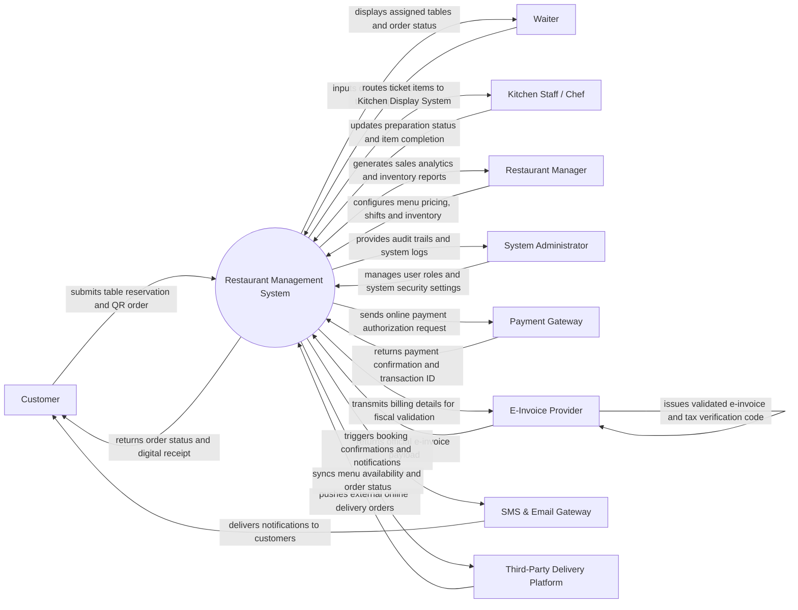

# Context Diagram — Restaurant Management System

## Mermaid Code

## Actor & Interaction Table | Bang Actor & Tuong tac

| # | Actor | Actor Type | Data Sent TO System | Data Received FROM System | Notes |
|---|-------|------------|---------------------|---------------------------|-------|
| 1 | Customer | Primary | Reservation request, QR code order items, payment authorization, feedback | Table booking confirmation, real-time order status, digital receipt | Interacts via guest mobile web/app or table QR code portal. |
| 2 | Waiter | Primary | Dine-in orders, table status updates, order modifications, bill split requests | Assigned table map, order item status, pending bill requests | Uses handheld POS terminal or tablet. |
| 3 | Kitchen Staff / Chef | Primary | Preparation status (In Prep, Ready to Serve), ingredient shortage alerts | Live kitchen tickets, special prep instructions, order priority queues | Interacts through Kitchen Display System (KDS). |
| 4 | Restaurant Manager | Primary | Menu configurations, recipe costs, staff schedules, table layout, promotion rules | Real-time revenue reports, inventory stock level alerts, staff attendance summaries | Accesses web-based administrative dashboard. |
| 5 | System Administrator | Primary | User credentials, role permissions, system configuration, backup parameters | Audit logs, system health metrics, security alerts | Manages system-wide maintenance and security. |
| 6 | Payment Gateway | Supporting | Payment authorization status, payment token, transaction ID | Payment charge request, order total, merchant identifier | Integrates via secure API for credit cards, e-wallets, and QR payments. |
| 7 | E-Invoice Provider | Regulatory | Validated tax e-invoice payload, invoice reference number, digital signature | Raw invoice financial data, seller/buyer details, VAT breakdowns | Complies with national tax authority e-invoicing laws. |
| 8 | SMS & Email Gateway | Supporting | Delivery delivery status, notification error logs | SMS/Email template payloads, recipient phone numbers/emails | Sends automated SMS notifications and email receipts. |
| 9 | Third-Party Delivery Platform | Supporting | External delivery orders, customer address, courier assignment status | Menu item availability, order acceptance status, order ready alert | Integrates with platforms like GrabFood, Foodpanda, ShopeeFood. |

## System Boundary Description | Mo ta Pham vi He thong

The **Restaurant Management System** encompasses all internal operations necessary to run a full-service or quick-service restaurant enterprise. Inside its boundary, the system manages table reservations, table layout maps, floor order dispatching, Kitchen Display System (KDS) workflows, billing and multi-payment settlement, recipe and ingredient inventory tracking, staff scheduling, and business intelligence reporting. 

The system explicitly excludes physical food preparation execution, external logistics shipping by third-party delivery riders, actual credit card/bank settlement processing (delegated to external Payment Gateways), and official tax ledger maintenance (handled by government-certified E-Invoice Providers).
