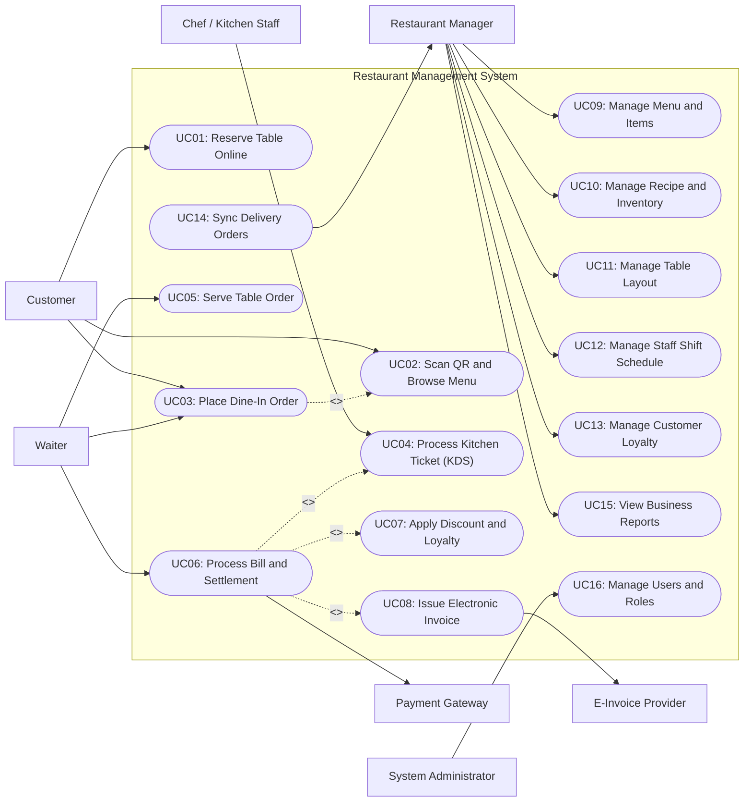

# Use Case Diagram — Restaurant Management System

## Mermaid Code

## Actor Table | Bang Actor

| # | Actor | Actor Type | Role Description | Related Use Cases |
|---|-------|------------|------------------|-------------------|
| 1 | Customer | Primary | Restaurant guest who books tables, scans QR codes to view digital menus, and places orders. | UC01, UC02, UC03 |
| 2 | Waiter | Primary | Service staff responsible for taking orders, assisting guests, serving food, and closing bills. | UC03, UC05, UC06 |
| 3 | Chef / Kitchen Staff | Primary | Culinary team member who receives orders via KDS, prepares food, and marks dishes as ready. | UC04 |
| 4 | Restaurant Manager | Primary | Operational lead overseeing menu configurations, inventory stock, shift schedules, and sales performance. | UC09, UC10, UC11, UC12, UC13, UC14, UC15 |
| 5 | System Administrator | Primary | Technical administrator maintaining user access controls, system backups, and application settings. | UC16 |
| 6 | Payment Gateway | Secondary System | Third-party financial system handling credit card, e-wallet, and bank transfer authorizations. | UC06 |
| 7 | E-Invoice Provider | Secondary System | Official tax service validating billing details and generating legal electronic tax invoices. | UC08 |

## Use Case Table | Bang Use Case

| # | UC ID | Use Case Name | Primary Actor | Secondary Actor | Description | Priority |
|---|-------|---------------|---------------|-----------------|-------------|----------|
| 1 | UC01 | Reserve Table Online | Customer | SMS/Email Gateway | Allows guests to select party size, date, time, and table preferences to book a dining table online. | High |
| 2 | UC02 | Scan QR and Browse Menu | Customer | None | Enables guests to scan a table QR code to view live digital menu items, prices, and allergen details. | High |
| 3 | UC03 | Place Dine-In Order | Customer / Waiter | None | Submits food and beverage items to the active table order session for kitchen processing. | High |
| 4 | UC04 | Process Kitchen Ticket (KDS) | Chef / Kitchen Staff | None | Displays order items on kitchen screens, tracks prep timers, and alerts staff when dishes are ready. | High |
| 5 | UC05 | Serve Table Order | Waiter | None | Updates item status to served once food is delivered to the guest table. | Medium |
| 6 | UC06 | Process Bill and Settlement | Waiter | Payment Gateway | Calculates table bill totals, applies taxes/service fees, accepts payments, and completes checkout. | High |
| 7 | UC07 | Apply Discount and Loyalty | Waiter | None | Redeems promotional vouchers or customer reward points to deduct from the order bill total. | Medium |
| 8 | UC08 | Issue Electronic Invoice | Waiter | E-Invoice Provider | Transmits finalized invoice data to government tax system and prints official e-invoices. | High |
| 9 | UC09 | Manage Menu and Items | Restaurant Manager | None | Creates, updates, or disables menu categories, dishes, prices, modifier options, and combo deals. | High |
| 10 | UC10 | Manage Recipe and Inventory | Restaurant Manager | None | Maps menu items to raw ingredients, tracks stock levels, and records inventory depletion/waste. | High |
| 11 | UC11 | Manage Table Layout | Restaurant Manager | None | Configures floor plans, table numbers, seating capacities, and active dining zones. | Medium |
| 12 | UC12 | Manage Staff Shift Schedule | Restaurant Manager | None | Schedules waiter and kitchen staff work shifts, assigns table sections, and tracks attendance. | Medium |
| 13 | UC13 | Manage Customer Loyalty | Restaurant Manager | None | Configures membership tier benefits, point accumulation rules, and promotional campaigns. | Low |
| 14 | UC14 | Sync Delivery Orders | Restaurant Manager | Delivery Platform | Receives online orders from third-party food apps and synchronizes item availability status. | Medium |
| 15 | UC15 | View Business Reports | Restaurant Manager | None | Generates analytical insights on daily revenue, top-selling dishes, labor costs, and table turnover rate. | High |
| 16 | UC16 | Manage Users and Roles | System Administrator | None | Configures user accounts, assigns system security roles (POS, Manager, Kitchen), and audits logs. | High |

## Use Case Specification | Dac ta Use Case

---

### UC01 — Reserve Table Online

| Field | Detail |
|-------|--------|
| **UC ID** | UC01 |
| **Use Case Name** | Reserve Table Online |
| **Actor(s)** | Primary: Customer   Secondary: SMS & Email Gateway |
| **Description** | Allows a customer to reserve a table at the restaurant for a specified date, time, and party size via the online web portal or mobile app. |
| **Precondition** | 1. The online booking service is online and operational.   2. The restaurant operating hours and table availability matrix are updated in the system. |
| **Main Flow** | 1. Customer accesses the online reservation portal and selects the desired dining date, arrival time, and number of guests.   2. System queries active table inventory and displays available seating areas (e.g., Main Dining, VIP Room, Outdoor Terrace).   3. Customer selects a preferred seating zone and enters contact details (Full Name, Phone Number, Email, Special Requests).   4. System validates table availability for the selected time slot and holds the reservation slot temporarily.   5. Customer reviews booking summary and confirms reservation.   6. System creates a new reservation record with status `Confirmed` and generates a unique Booking Reference Code.   7. System triggers the SMS/Email Gateway to send a confirmation notification containing reservation details and QR code to the customer. |
| **Alternative Flow** | **AF1** — No tables available for selected time:   1. At step 2, if no single table matches party size, System suggests nearest available time slots (+/- 30 minutes) or option to join an online waiting list.   2. Customer selects an alternative time slot and proceeds to step 3.    **AF2** — Deposit required for large party:   1. At step 4, if party size exceeds 8 guests, System indicates that a booking deposit is required.   2. Customer pays deposit via online Payment Gateway.   3. Upon successful deposit authorization, System marks reservation as `Deposit Paid` and resumes step 6. |
| **Exception Flow** | **EX1** — Session timeout during reservation:   1. If Customer fails to confirm reservation within 10 minutes, System releases the temporary table lock.   2. System displays a warning message "Reservation session expired" and redirects Customer to step 1.    **EX2** — Notification gateway failure:   1. If SMS/Email Gateway fails to send notification at step 7, System logs a delivery warning.   2. System displays the reservation details and downloadable QR code directly on screen for the customer. |
| **Postcondition** | Table reservation record is stored with status `Confirmed` and table inventory is updated. |
| **Business Rule** | **BR1**: Online table reservations must be made at least 2 hours prior to arrival time.   **BR2**: Reserved tables are held for a maximum of 15 minutes past reservation time before being automatically released to walk-in guests. |

---

### UC03 — Place Dine-In Order

| Field | Detail |
|-------|--------|
| **UC ID** | UC03 |
| **Use Case Name** | Place Dine-In Order |
| **Actor(s)** | Primary: Customer / Waiter   Secondary: None |
| **Description** | Allows a customer (via table QR code) or waiter (via handheld POS) to select items from the digital menu, customize options, and submit an order to the active table session. |
| **Precondition** | 1. Table status must be `Seated / Active`.   2. Digital menu items and active pricing must be loaded into memory. |
| **Main Flow** | 1. Customer scans table QR code or Waiter opens the active table ordering interface on handheld POS.   2. System displays digital menu categories, dish items, prices, and real-time item stock status.   3. User selects menu items, specifies quantities, and chooses item modifiers (e.g., spice level, side options, add-ons, allergy notes).   4. User adds selected items to the table order cart and reviews order summary.   5. User taps "Submit Order to Kitchen".   6. System validates menu item availability against inventory stock.   7. System appends confirmed items to the active table order record, updates total bill estimation, and routes ticket items to kitchen KDS. |
| **Alternative Flow** | **AF1** — Order modification by Waiter:   1. At step 3, Waiter applies a custom discount or custom item note requested by guest.   2. System verifies Waiter permission level and records modification reason in audit log.   3. Waiter proceeds to step 5.    **AF2** — Repeat ordering round:   1. During an active dining session, User re-opens ordering interface for additional drinks/desserts.   2. User selects new items and submits order (steps 2-5).   3. System appends new items as Round 2 ticket without altering existing served items. |
| **Exception Flow** | **EX1** — Item out of stock during submission:   1. At step 6, if an ordered item became sold out, System highlights the item in red and blocks submission.   2. System prompts User to remove or replace the out-of-stock item before resubmitting.    **EX2** — Table session locked or closed:   1. If table status was changed to `Billed` or `Closed` by cashier while user was browsing, System rejects order.   2. System displays error message "Table session closed. Please contact staff." |
| **Postcondition** | Order items are saved to table order record with status `Submitted` and KDS tickets are generated. |
| **Business Rule** | **BR1**: Orders submitted via QR code automatically lock out item changes once sent to kitchen unless modified by a authorized Waiter.   **BR2**: Alcohol menu items require waiter confirmation for guest age verification before submission. |

---

### UC04 — Process Kitchen Ticket (KDS)

| Field | Detail |
|-------|--------|
| **UC ID** | UC04 |
| **Use Case Name** | Process Kitchen Ticket (KDS) |
| **Actor(s)** | Primary: Chef / Kitchen Staff   Secondary: None |
| **Description** | Manages the workflow of incoming food and beverage tickets on Kitchen Display System (KDS) screens, tracking prep status from ticket arrival to dish completion. |
| **Precondition** | 1. Order ticket has been submitted from POS or QR ordering module.   2. Kitchen Display System screens (Hot Kitchen, Cold Kitchen, Bar) are active. |
| **Main Flow** | 1. System receives new order ticket and dispatches items to designated station screens (e.g., Grill items to Hot Kitchen, Drinks to Bar).   2. KDS screen displays new ticket card with table number, order round, item list, modifier details, and elapsed time counter.   3. Kitchen Staff taps ticket card to change status from `New` to `In Preparation`.   4. Kitchen Staff prepares food according to recipe specifications and special customer instructions.   5. Kitchen Staff completes cooking and taps individual items or full ticket to mark as `Ready to Serve`.   6. System updates ticket item status to `Ready` and triggers audio chime and notification on Waiter handheld POS. |
| **Alternative Flow** | **AF1** — Item bump/recall on KDS:   1. Kitchen Staff accidentally marks a ticket as ready at step 5.   2. Staff accesses KDS "Recent Tickets" history tab and taps "Recall Ticket".   3. System restores ticket card to active KDS screen in `In Preparation` state.    **AF2** — Out-of-ingredient mark from kitchen:   1. Kitchen Staff discovers raw ingredient shortage while preparing item at step 4.   2. Staff selects item on KDS and taps "86 / Mark Sold Out".   3. System instantly disables item availability across all POS terminals and QR menus, notifying front-of-house staff. |
| **Exception Flow** | **EX1** — Kitchen ticket preparation timeout:   1. If ticket preparation time exceeds target threshold (e.g., 20 minutes), System changes ticket card color to blinking Red.   2. System logs delayed ticket event in kitchen performance metrics for manager review.    **EX2** — KDS screen network disconnect:   1. If KDS display loses network connectivity, System automatically redirects ticket queue to backup print station.   2. Physical kitchen ticket is printed on paper thermal printer to prevent order loss. |
| **Postcondition** | Kitchen ticket status is updated to `Ready to Serve` and notification is sent to floor waiters. |
| **Business Rule** | **BR1**: Food items must be prepared and prioritized based on FIFO (First-In, First-Out) ticket arrival order unless flagged as Urgent VIP.   **BR2**: Marking an item as sold out ("86ed") on KDS immediately propagates item lock across all client interfaces within 2 seconds. |

---

### UC06 — Process Bill and Settlement

| Field | Detail |
|-------|--------|
| **UC ID** | UC06 |
| **Use Case Name** | Process Bill and Settlement |
| **Actor(s)** | Primary: Waiter   Secondary: Payment Gateway, E-Invoice Provider |
| **Description** | Calculates final table bill summary, applies taxes, service fees, discounts, and vouchers, processes customer payment, and closes dining session. |
| **Precondition** | 1. All ordered items for the table are marked as `Served` or canceled.   2. POS cashier module and payment device terminals are connected. |
| **Main Flow** | 1. Customer requests bill and Waiter opens table bill calculation screen on POS.   2. System retrieves all order items, calculates subtotal, applies configured VAT (e.g., 8-10%) and Service Charge (e.g., 5%).   3. Waiter reviews itemized bill summary with guest.   4. Customer chooses payment method (Cash, Credit Card, E-Wallet QR, or Room Charge).   5. Waiter selects chosen payment method on POS and initiates settlement transaction.   6. System sends charge request to Payment Gateway (if card/QR) or prompts cash entry.   7. Payment Gateway processes authorization and returns transaction confirmation code.   8. System records payment transaction, updates order status to `Paid`, and releases table status to `Dirty/Needs Cleaning`.   9. System prints thermal receipt for customer and automatically queues electronic invoice data for tax authority registration (UC08). |
| **Alternative Flow** | **AF1** — Split bill payment:   1. At step 4, customer requests to split bill (by seat or equal divide).   2. Waiter selects "Split Bill" option on POS and defines split count or assigns specific items per person.   3. System creates sub-bills and Waiter processes settlement for each sub-bill sequentially (steps 5-8).    **AF2** — Voucher & Loyalty point redemption:   1. At step 2, guest presents discount voucher or loyalty membership card.   2. Waiter scans voucher/card code (executing UC07).   3. System validates discount rules, recalculates subtotal, and updates final payment amount before step 4. |
| **Exception Flow** | **EX1** — Payment Gateway decline:   1. At step 7, Payment Gateway returns `Declined / Insufficient Funds`.   2. System displays error popup on POS screen.   3. Waiter requests alternative payment method from customer and retries from step 4.    **EX2** — Cash register change calculation error:   1. Waiter inputs tender amount less than total bill at step 5.   2. System blocks transaction completion, displaying message "Tender amount insufficient". |
| **Postcondition** | Table bill status is `Paid`, transaction records are logged, inventory stock is decremented, and table status becomes available. |
| **Business Rule** | **BR1**: Bill settlement cannot be processed if any ticket item remains in `In Preparation` status on KDS without explicit manager void override.   **BR2**: All cash transactions must trigger cash drawer pop and update cashier shift float audit logs. |

---

### UC10 — Manage Recipe and Inventory

| Field | Detail |
|-------|--------|
| **UC ID** | UC10 |
| **Use Case Name** | Manage Recipe and Inventory |
| **Actor(s)** | Primary: Restaurant Manager   Secondary: None |
| **Description** | Allows restaurant managers to define Bill of Materials (BOM) recipes for menu items, track raw ingredient stock levels, record purchase receipts, and audit inventory variance. |
| **Precondition** | 1. User is authenticated as Restaurant Manager with inventory management privileges.   2. Raw ingredient master catalogue and unit of measures (kg, g, L, ml, pcs) are configured. |
| **Main Flow** | 1. Restaurant Manager accesses Inventory & Recipe Management module on administration dashboard.   2. Manager selects a menu item and configures its standard recipe standard yield and ingredient list (e.g., 200g Beef Patty, 1 Bun, 20g Cheese for Cheeseburger).   3. Manager inputs incoming purchase orders and supplier delivery receipts into system stock inventory.   4. System updates raw ingredient stock balance and calculates weighted average unit cost.   5. As sales orders are completed at POS/KDS, System automatically decrements ingredient stock based on defined recipes (real-time perpetual inventory depletion).   6. System compares theoretical stock against periodic physical stock count to calculate variance and waste cost.   7. Manager reviews stock alert dashboard for items falling below safety reorder threshold. |
| **Alternative Flow** | **AF1** — Record raw ingredient waste:   1. Manager or head chef notes spoiled or damaged raw ingredients in kitchen.   2. Manager enters "Stock Wastage Entry" screen, inputs ingredient item, quantity, unit, and waste reason (Spoilage, Expiration, Preparation Error).   3. System deducts stock balance and records waste cost to financial expense audit logs.    **AF2** — Batch stock transfer between locations:   1. Manager transfers ingredients from central storage warehouse to kitchen pantry.   2. Manager creates "Stock Transfer Document" specifying item quantities and target storage location.   3. System updates location-specific inventory balances upon transfer receipt. |
| **Exception Flow** | **EX1** — Negative inventory stock warning:   1. If sales volume causes calculated ingredient balance to drop below zero (due to unrecorded stock delivery), System logs negative stock flag.   2. System sends high-priority stock audit alert to Manager's dashboard.    **EX2** — Recipe conversion unit mismatch:   1. If Manager inputs recipe ingredient with invalid conversion unit (e.g., purchasing in Kilograms but recipe in Ounces without conversion factor), System blocks save.   2. System prompts Manager to define valid Unit of Measure conversion ratio. |
| **Postcondition** | Ingredient recipes are bound to menu items, real-time stock balances are updated, and inventory depletion costs are calculated. |
| **Business Rule** | **BR1**: Ingredient stock depletion is calculated automatically upon POS bill closure based on active recipe BOM versions.   **BR2**: Stock reorder alerts are triggered automatically via email/dashboard whenever inventory levels fall below defined Minimum Safety Stock thresholds. |
