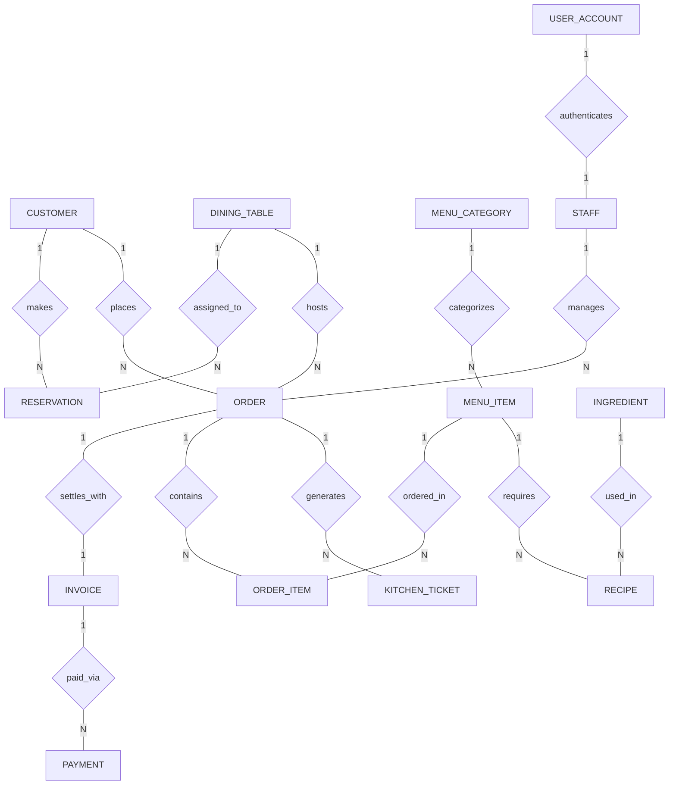

# Conceptual ERD — Restaurant Management System

## Mermaid Code

## Entity Description Table | Bang mo ta Entity

| # | Entity Name | Vietnamese Name | Description | Key Attributes | Main Relationships |
|---|-------------|-----------------|-------------|----------------|-------------------|
| 1 | CUSTOMER | Khach hang | Stores customer personal profile data, contact details, and reward program points. | customer_id, full_name, phone_number, loyalty_points | One-to-Many with RESERVATION, ORDER |
| 2 | RESERVATION | Dat ban | Holds online table booking details including time slot, party size, and table allocation. | reservation_id, customer_id, table_id, reservation_time | Belongs to CUSTOMER, DINING_TABLE |
| 3 | DINING_TABLE | Ban an | Represents physical restaurant tables, floor zones, seating capacities, and real-time statuses. | table_id, table_number, seating_capacity, status | One-to-Many with RESERVATION, ORDER |
| 4 | MENU_CATEGORY | Danh muc thuc don | Defines logical groupings for menu dishes (Appetizers, Main Course, Beverages, Desserts). | category_id, category_name, display_order | One-to-Many with MENU_ITEM |
| 5 | MENU_ITEM | Mon an / Do uong | Stores individual food and beverage catalog items, pricing, and availability states. | item_id, category_id, item_name, unit_price | Belongs to MENU_CATEGORY; One-to-Many with ORDER_ITEM, RECIPE |
| 6 | ORDER | Don hang | Tracks active dine-in table ordering sessions, financial subtotal estimations, and overall status. | order_id, table_id, customer_id, staff_id, total_amount | Belongs to DINING_TABLE, CUSTOMER, STAFF; One-to-Many with ORDER_ITEM, KITCHEN_TICKET; One-to-One with INVOICE |
| 7 | ORDER_ITEM | Chi tiet don hang | Represents specific dishes ordered within an active table session, including modifiers and prep status. | order_item_id, order_id, item_id, quantity, unit_price | Belongs to ORDER, MENU_ITEM |
| 8 | KITCHEN_TICKET | Phieu bep (KDS) | Manages kitchen preparation tickets dispatched to KDS station screens or thermal printers. | ticket_id, order_id, station_id, ticket_status | Belongs to ORDER |
| 9 | INVOICE | Hoa don thanh toan | Stores final billing summary, tax calculations, discounts, and fiscal registration data. | invoice_id, order_id, invoice_number, final_amount | One-to-One with ORDER; One-to-Many with PAYMENT |
| 10 | PAYMENT | Giao dịch thanh toán | Logs monetary payment transactions processed via cash, credit cards, or digital wallets. | payment_id, invoice_id, payment_method, amount_paid | Belongs to INVOICE |
| 11 | RECIPE | Cong thuc che bien | Defines Bill of Materials (BOM) linking menu dishes to required raw ingredient quantities. | recipe_id, item_id, ingredient_id, quantity_required | Belongs to MENU_ITEM, INGREDIENT |
| 12 | INGREDIENT | Nguyen lieu ton kho | Tracks raw inventory stock levels, reorder thresholds, and unit purchasing costs. | ingredient_id, ingredient_name, current_stock, reorder_level | One-to-Many with RECIPE |
| 13 | STAFF | Nhan vien | Represents employee personal profiles, job roles, assigned shift schedules, and POS access. | staff_id, user_id, full_name, job_title | Belongs to USER_ACCOUNT; One-to-Many with ORDER |
| 14 | USER_ACCOUNT | Tai khoan nguoi dung | Holds system login credentials, security password hashes, role policies, and audit timestamps. | user_id, username, password_hash, role_name | One-to-One with STAFF |

## Relationship Description | Mo ta Quan he

| # | From Entity | Cardinality | To Entity | Relationship Label | Business Explanation |
|---|-------------|-------------|-----------|-------------------|----------------------|
| 1 | CUSTOMER | One-to-Many | RESERVATION | makes | Mot khach hang co the thuc hien nhieu luot dat ban truoc theo thoi gian. |
| 2 | DINING_TABLE | One-to-Many | RESERVATION | assigned_to | Mot ban an co the duoc phan cong cho nhieu luot dat ban o cac khung gio khac nhau. |
| 3 | DINING_TABLE | One-to-Many | ORDER | hosts | Mot ban an phuc vu nhieu phien don hang qua cac ca hoat dong. |
| 4 | CUSTOMER | One-to-Many | ORDER | places | Mot khach hang co the tao nhieu don hang trong mot hoac nhieu lan den nha hang. |
| 5 | STAFF | One-to-Many | ORDER | manages | Mot nhan vien phuc vu/thu ngan co the phu trách quan ly nhieu don hang. |
| 6 | MENU_CATEGORY | One-to-Many | MENU_ITEM | categorizes | Mot danh muc (Vi du: Do uong) chua nhieu mon an/mon uong cu the. |
| 7 | ORDER | One-to-Many | ORDER_ITEM | contains | Mot don hang bao gom nhieu dong chi tiet mon an duoc goi. |
| 8 | MENU_ITEM | One-to-Many | ORDER_ITEM | ordered_in | Mot mon an trong thuc don co me duoc dat nhieu lan trong cac don hang khac nhau. |
| 9 | ORDER | One-to-Many | KITCHEN_TICKET | generates | Mot don hang phat sinh nhieu phieu che bien cho cac tram bep (Bep nong, Bep lanh, Bar). |
| 10 | ORDER | One-to-One | INVOICE | settles_with | Mot don hang hoan thanh duoc quyet toan thanh mot hoa don thanh toan duy nhat. |
| 11 | INVOICE | One-to-Many | PAYMENT | paid_via | Mot hoa don co thể duoc thanh toan qua mot hoac nhieu luot (tách hoa don/thanh toan ket hop cash + card). |
| 12 | MENU_ITEM | One-to-Many | RECIPE | requires | Mot mon an duoc cau thanh tu nhieu dinh muc nguyen lieu theo cong thuc (BOM). |
| 13 | INGREDIENT | One-to-Many | RECIPE | used_in | Mot nguyen lieu (Vi du: Duong, Thit bo) duoc su dung trong cong thuc cua nhieu mon an. |
| 14 | USER_ACCOUNT | One-to-One | STAFF | authenticates | Mot tai khoan dang nhap he thong xac thuc va dinh danh mot nhan vien cu the. |
