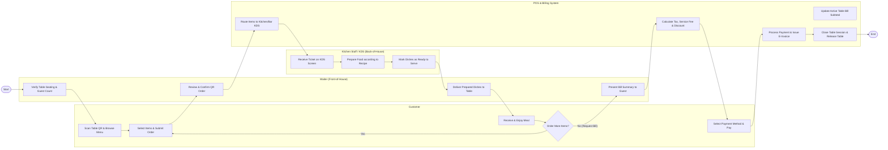

# Swimlane Diagram — Restaurant Management System

## Mermaid Code

## Flow Description | Mo ta luong

| Lane | Actor | Role in Flow |
|------|-------|-------------|
| **Lane 1** | Customer | Scans table QR code, selects menu items, submits dine-in order, consumes meal, decides on repeat orders or bill settlement, and completes payment. |
| **Lane 2** | Waiter (Front-of-House) | Verifies guest table assignment, confirms order details on handheld POS, picks up ready food from kitchen pass counter, serves dishes, and presents final bill summary. |
| **Lane 3** | Kitchen Staff / KDS | Receives routed order tickets on Kitchen Display System, prepares food according to standard recipes, and flags ticket status as ready for server pickup. |
| **Lane 4** | POS & Billing System | Dispatches ticket items to designated kitchen stations, maintains real-time table bill subtotals, computes VAT and service fees, processes payment authorizations, and releases table inventory upon session closure. |

### Process Execution Steps | Cac buoc thuc hien quy trinh

1. **Table Setup & Menu Access**: Waiter seats guests and verifies table seating (`W1`). Customer scans table QR code to open live digital menu (`C1`).
2. **Order Submission & Verification**: Customer selects menu options and submits order (`C2`). Waiter reviews order on POS and confirms dispatch (`W2`).
3. **Kitchen Processing**: POS System routes ticket items to KDS screens (`S1`). Kitchen Staff accepts ticket (`K1`), cooks food (`K2`), and marks dishes ready (`K3`).
4. **Food Delivery & Dining**: Waiter picks up prepared dishes and serves customer table (`W3`). Customer receives food and dines (`C3`).
5. **Decision Point**: Customer decides whether to add additional food/drink rounds (`C4`).
   - If **Yes**: Customer submits additional items (`C2`), repeating kitchen processing.
   - If **No**: Customer requests bill settlement (`W4`).
6. **Billing & Settlement**: POS System calculates taxes, service charges, and vouchers (`S3`). Customer completes payment via chosen tender method (`C5`). System records payment, issues tax e-invoice payload (`S4`), and closes table session (`S5`), ending the workflow (`Finish`).
