# Action Tree — Restaurant Management System

## Mermaid Code

```mermaid
graph TD
    Root["Restaurant Management System"]

    Root --> M1["Table & Reservation Management"]
    Root --> M2["Order & Menu Management"]
    Root --> M3["Kitchen Display System KDS"]
    Root --> M4["Billing & Payment Processing"]
    Root --> M5["Recipe & Inventory Control"]
    Root --> M6["Staff & Shift Scheduling"]
    Root --> M7["Analytics & Reporting"]

    M1 --> A11["Book Online Reservation"]
    M1 --> A12["Assign Guest Seating"]
    M1 --> A13["Configure Floor Plan Layout"]
    M1 --> A14["Track Real-Time Table Status"]

    M2 --> A21["Create & Price Menu Items"]
    M2 --> A22["Configure Item Modifiers"]
    M2 --> A23["Process QR Code Dine-In Order"]
    M2 --> A24["Modify Active Table Order"]

    M3 --> A31["Receive Dispatched Station Tickets"]
    M3 --> A32["Update Dish Prep Status"]
    M3 --> A33["Mark Item Sold Out 86ed"]
    M3 --> A34["Recall Bumped Ticket Card"]

    M4 --> A41["Calculate Bill Subtotal & Fees"]
    M4 --> A42["Apply Vouchers & Loyalty Points"]
    M4 --> A43["Process Card & QR Settlements"]
    M4 --> A44["Issue Government Tax E-Invoice"]

    M5 --> A51["Define Recipe BOM Mapping"]
    M5 --> A52["Record Purchase Stock Delivery"]
    M5 --> A53["Audit Inventory Spoilage & Waste"]
    M5 --> A54["Configure Safety Reorder Alerts"]

    M6 --> A61["Schedule Staff Shift Roster"]
    M6 --> A62["Track Time & Attendance Clock-In"]
    M6 --> A63["Assign Server Floor Sections"]
    M6 --> A64["Manage User Roles & Access Rights"]

    M7 --> A71["Generate Real-Time Sales Summary"]
    M7 --> A72["Analyze Menu Dish Profitability"]
    M7 --> A73["Track Food Cost & Inventory Variance"]
    M7 --> A74["Export Tax & Financial Audit Logs"]
```

## Module Description | Mo ta Module

| # | Module | Description | Actions |
|---|--------|-------------|---------|
| 1 | Table & Reservation Management | Handles guest table bookings, floor plan configurations, party seating allocations, and real-time occupancy state tracking (Available, Reserved, Seated, Dirty). | Book Online Reservation, Assign Guest Seating, Configure Floor Plan Layout, Track Real-Time Table Status |
| 2 | Order & Menu Management | Controls digital menu catalog setup, dish modifier options (spice levels, add-ons), QR code customer ordering, and waiter order updates. | Create & Price Menu Items, Configure Item Modifiers, Process QR Code Dine-In Order, Modify Active Table Order |
| 3 | Kitchen Display System KDS | Manages kitchen order ticket routing to hot/cold/bar stations, prep timing tracking, dish completion notifications, and out-of-stock alerts. | Receive Dispatched Station Tickets, Update Dish Prep Status, Mark Item Sold Out 86ed, Recall Bumped Ticket Card |
| 4 | Billing & Payment Processing | Computes table order totals, applies VAT/service fees, processes discounts/loyalty points, accepts multi-tender payments, and registers official e-invoices. | Calculate Bill Subtotal & Fees, Apply Vouchers & Loyalty Points, Process Card & QR Settlements, Issue Government Tax E-Invoice |
| 5 | Recipe & Inventory Control | Maps food recipes to raw ingredients, tracks perpetual stock depletion, logs purchase receipts, audits wastage, and triggers reorder notifications. | Define Recipe BOM Mapping, Record Purchase Stock Delivery, Audit Inventory Spoilage & Waste, Configure Safety Reorder Alerts |
| 6 | Staff & Shift Scheduling | Manages employee rosters, floor section assignments, POS access security credentials, and clock-in/clock-out attendance records. | Schedule Staff Shift Roster, Track Time & Attendance Clock-In, Assign Server Floor Sections, Manage User Roles & Access Rights |
| 7 | Analytics & Reporting | Provides business intelligence dashboards on daily revenue, peak sales hours, food cost percentages, dish popularity, and tax compliance logs. | Generate Real-Time Sales Summary, Analyze Menu Dish Profitability, Track Food Cost & Inventory Variance, Export Tax & Financial Audit Logs |
