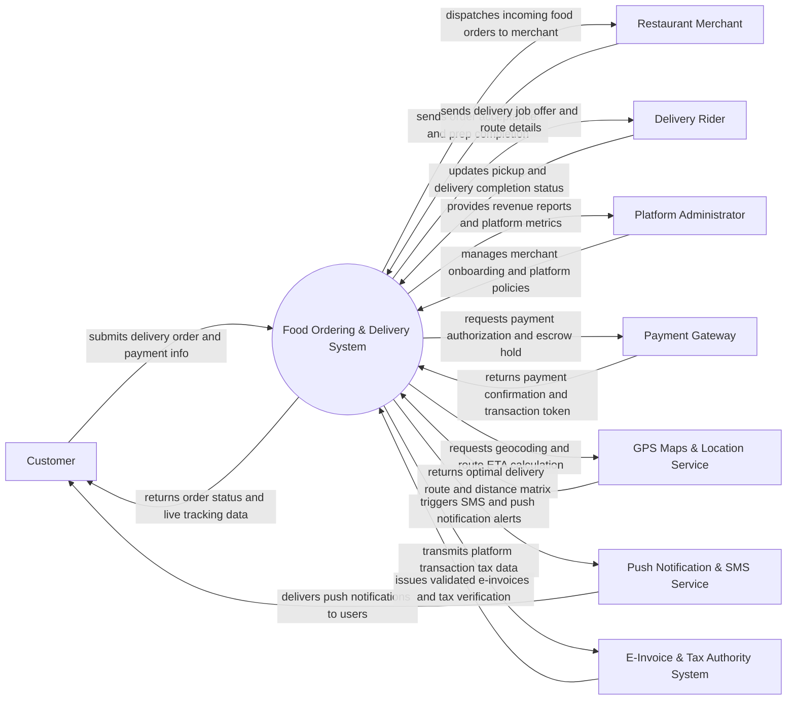

# Context Diagram — Food Ordering & Delivery System

## Mermaid Code

## Actor & Interaction Table | Bang Actor & Tuong tac

| # | Actor | Actor Type | Data Sent TO System | Data Received FROM System | Notes |
|---|-------|------------|---------------------|---------------------------|-------|
| 1 | Customer | Primary | Search queries, delivery address, food orders, online payments, reviews | Menu catalogs, real-time order status, live rider GPS location, digital receipts | Uses consumer mobile app (iOS/Android) or web portal. |
| 2 | Merchant | Primary | Menu items, prices, operating hours, order acceptance/rejection, cooking status | incoming food orders, courier arrival notifications, payout balance summaries | Uses dedicated merchant tablet app or web portal. |
| 3 | Delivery Rider | Primary | Job acceptance, real-time GPS coordinates, pickup status, delivery completion proof | Delivery offers, restaurant/customer pickup locations, navigation routes, trip earnings | Uses driver mobile application. |
| 4 | Platform Administrator | Primary | Merchant onboarding approvals, rider accounts, commission rates, promotion campaigns | Platform sales reports, dispute logs, fleet activity metrics, audit trails | Accesses web-based central management console. |
| 5 | Payment Gateway | Supporting | Payment authorization, charge success, refund approvals, payout settlements | Charge requests, payout transfers, transaction tokens | Integrates via APIs for e-wallets, credit cards, and instant bank transfers. |
| 6 | GPS Maps & Location Service | Supporting | Geocoding data, route distance matrix, turn-by-turn navigation, estimated travel time | Coordinate queries, address lookup requests, route optimization requests | Integrates with services such as Google Maps API, Mapbox, or OpenStreetMap. |
| 7 | Push Notification & SMS Service | Supporting | Message delivery status, SMS delivery receipts | Push notification payloads, recipient tokens, SMS templates | Uses Firebase Cloud Messaging (FCM), Apple APNs, or Twilio SMS. |
| 8 | E-Invoice & Tax Authority System | Regulatory | Validated tax invoice payloads, official tax verification codes | Merchant sales records, platform commission breakdowns, VAT audit data | Ensures fiscal compliance with national digital platform tax laws. |

## System Boundary Description | Mo ta Pham vi He thong

The **Food Ordering & Delivery System** manages end-to-end online food marketplace ordering, restaurant dispatching, delivery fleet routing, real-time GPS tracking, and financial settlements. Within its boundary, the system handles customer digital storefronts, menu catalog customization, checkout and payment processing, merchant kitchen order acceptance, dynamic delivery rider dispatch matching, live order tracking, rating and review aggregation, and commission accounting.

The system boundary excludes physical food preparation by restaurant kitchens, physical transportation of meals by delivery riders, raw payment clearing execution (handled by external Payment Gateways), map tile rendering (handled by third-party Location APIs), and direct tax ledger registration (handled by government E-Invoice Systems).
