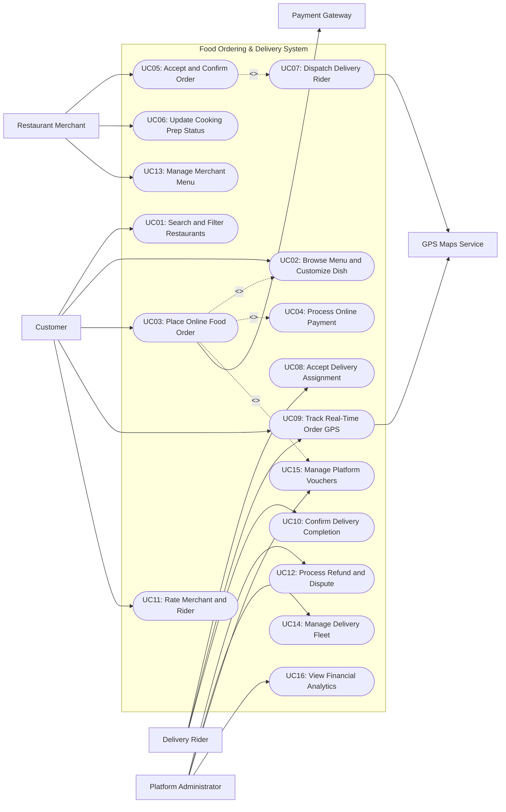

# Use Case Diagram — Food Ordering & Delivery System

## Mermaid Code

## Actor Table | Bang Actor

| # | Actor | Actor Type | Role Description | Related Use Cases |
|---|-------|------------|------------------|-------------------|
| 1 | Customer | Primary | Consumer using the mobile app to search for restaurants, customize dishes, place delivery orders, and track deliveries. | UC01, UC02, UC03, UC09, UC11 |
| 2 | Restaurant Merchant | Primary | Restaurant partner managing food menus, accepting orders, preparing food, and notifying order readiness. | UC05, UC06, UC13 |
| 3 | Delivery Rider | Primary | Independent courier receiving order assignments, picking up food from restaurants, and delivering to customers. | UC08, UC09, UC10 |
| 4 | Platform Administrator | Primary | Operations manager managing user accounts, resolving delivery disputes, creating promo campaigns, and auditing platform metrics. | UC12, UC14, UC15, UC16 |
| 5 | Payment Gateway | Secondary System | Third-party payment provider handling online credit card, e-wallet, and bank transfer authorizations. | UC03, UC04 |
| 6 | GPS Maps Service | Secondary System | External geospatial service providing geocoding, distance matrix calculations, and turn-by-turn navigation data. | UC07, UC09 |

## Use Case Table | Bang Use Case

| # | UC ID | Use Case Name | Primary Actor | Secondary Actor | Description | Priority |
|---|-------|---------------|---------------|-----------------|-------------|----------|
| 1 | UC01 | Search and Filter Restaurants | Customer | GPS Maps Service | Allows customers to discover nearby restaurant merchants by cuisine type, distance, rating, and price. | High |
| 2 | UC02 | Browse Menu and Customize Dish | Customer | None | Enables customers to view dish photos, select portion sizes, pick add-ons/toppings, and add dietary notes. | High |
| 3 | UC03 | Place Online Food Order | Customer | Payment Gateway | Submits the customer's food cart, delivery address, voucher code, and payment method for fulfillment. | High |
| 4 | UC04 | Process Online Payment | Customer | Payment Gateway | Authorizes funds hold or payment charge via credit card, e-wallet, or digital payment channels. | High |
| 5 | UC05 | Accept and Confirm Order | Restaurant Merchant | None | Allows merchants to accept incoming delivery orders and estimate preparation time on the merchant tablet. | High |
| 6 | UC06 | Update Cooking Prep Status | Restaurant Merchant | None | Updates food preparation stage (In Cooking, Food Ready) to notify dispatch service and courier. | Medium |
| 7 | UC07 | Dispatch Delivery Rider | System | GPS Maps Service | Algorithmically matches and dispatches the optimal nearby delivery rider based on location and workload. | High |
| 8 | UC08 | Accept Delivery Assignment | Delivery Rider | None | Allows riders to review delivery earnings/route and accept or reject the job offer within a timer limit. | High |
| 9 | UC09 | Track Real-Time Order GPS | Customer | GPS Maps Service | Displays live map tracking of rider location, current delivery status, and calculated ETA. | High |
| 10 | UC10 | Confirm Delivery Completion | Delivery Rider | None | Marks the delivery order as completed upon handing food to customer (with photo proof/PIN code). | High |
| 11 | UC11 | Rate Merchant and Rider | Customer | None | Allows customers to leave 1-5 star ratings and reviews for food quality and delivery performance. | Medium |
| 12 | UC12 | Process Refund and Dispute | Platform Administrator | Payment Gateway | Reviews customer complaints (missing item, cold food, late delivery) and issues partial/full refunds. | Medium |
| 13 | UC13 | Manage Merchant Menu | Restaurant Merchant | None | Allows merchants to add/edit menu items, toggle out-of-stock statuses, and update operating hours. | High |
| 14 | UC14 | Manage Delivery Fleet | Platform Administrator | None | Manages courier onboarding, document verification, performance metrics, and weekly payout runs. | Medium |
| 15 | UC15 | Manage Platform Vouchers | Platform Administrator | None | Configures discount campaigns, free delivery vouchers, promo codes, and minimum basket rules. | Medium |
| 16 | UC16 | View Financial Analytics | Platform Administrator | None | Generates platform commission metrics, GMV (Gross Merchandise Value), delivery fees, and tax reports. | High |

## Use Case Specification | Dac ta Use Case

---

### UC03 — Place Online Food Order

| Field | Detail |
|-------|--------|
| **UC ID** | UC03 |
| **Use Case Name** | Place Online Food Order |
| **Actor(s)** | Primary: Customer   Secondary: Payment Gateway |
| **Description** | Allows a customer to finalize their food cart selection, select a delivery address, apply promotional vouchers, choose a payment method, and submit the delivery order. |
| **Precondition** | 1. Customer is logged into a valid account on the mobile app.   2. Cart contains valid menu items from an active, open restaurant merchant. |
| **Main Flow** | 1. Customer opens cart checkout screen and verifies selected food items, quantities, and dish customizations.   2. Customer selects or enters delivery destination address.   3. System calculates delivery fee based on GPS distance between merchant and delivery address.   4. Customer applies an eligible promotion voucher code.   5. System recalculates item total, delivery fee, platform service fee, applied voucher discount, and final payment total.   6. Customer selects preferred payment method (E-Wallet, Credit Card, Cash on Delivery).   7. Customer taps "Place Order".   8. System validates payment via Payment Gateway (or authorizes COD limit).   9. System creates a new order record with status `Pending Merchant Confirmation` and dispatches notification to Merchant (executing UC05). |
| **Alternative Flow** | **AF1** — Applied promo voucher invalid or expired:   1. At step 4, if voucher code fails criteria (e.g., minimum basket size not met), System displays warning reason.   2. Customer selects alternative voucher or proceeds without voucher.    **AF2** — Cash on Delivery (COD) order placement:   1. At step 6, Customer chooses Cash on Delivery payment option.   2. System verifies Customer COD eligibility threshold (e.g., total < $50 and user rating > 4.5).   3. System skips online payment gateway charge and sets order payment status to `Pending COD Settlement`. |
| **Exception Flow** | **EX1** — Restaurant closed during checkout:   1. If merchant closes operating hours while Customer is reviewing cart at step 7, System rejects order.   2. System displays popup "Merchant is currently closed" and clears active cart.    **EX2** — Online Payment Authorization Failed:   1. At step 8, Payment Gateway returns authorization decline (e.g., insufficient funds).   2. System notifies Customer "Payment authorization failed", maintaining cart items for payment retry. |
| **Postcondition** | Order record is created with status `Pending Merchant Confirmation` and payment authorization hold is secured. |
| **Business Rule** | **BR1**: Delivery fee calculation must use dynamic distance matrix rates based on real-time traffic and weather surcharge tiers.   **BR2**: Orders above $100 require pre-authorized digital payment and cannot be placed via Cash on Delivery. |

---

### UC05 — Accept and Confirm Order

| Field | Detail |
|-------|--------|
| **UC ID** | UC05 |
| **Use Case Name** | Accept and Confirm Order |
| **Actor(s)** | Primary: Restaurant Merchant   Secondary: None |
| **Description** | Allows a restaurant merchant to receive incoming food orders on their tablet device, review item specifications, accept the order, and estimate kitchen prep time. |
| **Precondition** | 1. Order status is `Pending Merchant Confirmation`.   2. Merchant tablet app is logged in and operating status is `Online / Accepting Orders`. |
| **Main Flow** | 1. System sends high-priority audible order alert and displays new order card on Merchant tablet app.   2. Merchant reviews ordered items, customer special dietary notes, delivery address, and total order value.   3. Merchant selects estimated food preparation duration (e.g., 15 minutes, 25 minutes).   4. Merchant taps "Accept & Start Cooking".   5. System updates order status to `Merchant Accepted & In Cooking`.   6. System notifies Customer that order is accepted and being prepared.   7. System sends auto-dispatch job request to Delivery Rider dispatch queue (executing UC07). |
| **Alternative Flow** | **AF1** — Merchant rejects incoming order:   1. At step 3, Merchant determines kitchen cannot fulfill order (e.g., ingredients sold out or kitchen overloaded).   2. Merchant selects rejection reason (e.g., Item Sold Out, Kitchen Too Busy) and taps "Reject Order".   3. System updates order status to `Canceled by Merchant`.   4. System automatically triggers Payment Gateway refund/release to Customer (executing UC12). |
| **Exception Flow** | **EX1** — Merchant acceptance timeout (No Response):   1. If Merchant fails to respond to order alert within 3 minutes, System automatically marks order as `Auto-Canceled (Merchant Unresponsive)`.   2. System notifies Customer, releases payment hold, and temporarily sets Merchant status to `Auto-Offline` to prevent further missed orders. |
| **Postcondition** | Order status changes to `Merchant Accepted & In Cooking` and dispatch algorithm initiates rider matching. |
| **Business Rule** | **BR1**: Merchants must accept or reject incoming delivery orders within 180 seconds before auto-cancellation occurs.   **BR2**: Repeated merchant auto-cancellations (>= 3 per day) trigger automated platform penalty flags and temporary store suspension. |

---

### UC07 — Dispatch Delivery Rider

| Field | Detail |
|-------|--------|
| **UC ID** | UC07 |
| **Use Case Name** | Dispatch Delivery Rider |
| **Actor(s)** | Primary: System   Secondary: GPS Maps Service |
| **Description** | Algorithmically evaluates active delivery rider locations, calculates proximity to restaurant merchant, predicts cooking completion time, and dispatches job offers to the optimal rider. |
| **Precondition** | 1. Order status is `Merchant Accepted & In Cooking`.   2. Available online delivery riders are active within the merchant geofence radius. |
| **Main Flow** | 1. System dispatch engine queries active riders in `Online / Idle` status within 5 km radius of restaurant merchant.   2. System calls GPS Maps Service to calculate route travel time from rider current position to restaurant, aligned with estimated food prep completion.   3. System ranks candidate riders using multi-factor matching score (distance, rider rating, vehicle type, current route direction).   4. System sends delivery job offer notification (pickup store, delivery distance, guaranteed payout earnings) to top-ranked rider mobile app.   5. System starts a 30-second acceptance countdown timer for the targeted rider.   6. Rider accepts delivery job offer (executing UC08).   7. System locks rider to order, updates order status to `Rider Assigned`, and displays rider details to Customer and Merchant. |
| **Alternative Flow** | **AF1** — Target rider declines or times out:   1. At step 5, targeted rider taps "Decline" or 30-second timer expires.   2. System immediately dispatches job offer to the second-ranked candidate rider in queue.   3. Steps 4-6 repeat until a rider accepts. |
| **Exception Flow** | **EX1** — No available riders in merchant area:   1. If no online riders accept job after 3 dispatch broadcast cycles (within 10 minutes), System flags order as `High Surge / Unassigned`.   2. System expands search radius to 10 km and offers incentive surge pay bonus to riders.   3. If still unassigned after 15 minutes, System notifies Customer and Merchant, offering option to cancel with full refund. |
| **Postcondition** | A delivery rider is assigned to the order and status changes to `Rider Assigned`. |
| **Business Rule** | **BR1**: Dispatch matching priority must favor riders within 2 km of the restaurant to minimize restaurant wait times.   **BR2**: Riders cannot be offered new single delivery assignments if they already carry 2 active stacked orders. |

---

### UC09 — Track Real-Time Order GPS

| Field | Detail |
|-------|--------|
| **UC ID** | UC09 |
| **Use Case Name** | Track Real-Time Order GPS |
| **Actor(s)** | Primary: Customer   Secondary: GPS Maps Service |
| **Description** | Provides real-time interactive map tracking of the assigned delivery rider's location, current milestone stage, and dynamic Estimated Time of Arrival (ETA) to the customer. |
| **Precondition** | 1. Order status is in progress (`Rider Assigned`, `Rider at Restaurant`, or `On the Way / Delivering`).   2. Delivery rider's mobile app is transmitting live GPS telemetry data. |
| **Main Flow** | 1. Customer opens "Track Order" screen in consumer mobile application.   2. System retrieves latest order status stage (e.g., Cooking, Picked Up, Delivering) and rider GPS coordinates (latitude/longitude).   3. System requests map tile rendering and route path data from GPS Maps Service.   4. System calculates remaining travel distance and dynamically updates Estimated Time of Arrival (ETA) in minutes.   5. System renders interactive map showing restaurant location icon, destination pin, and moving rider icon.   6. As rider moves, rider app pushes GPS location updates every 5 seconds, refreshing map display for customer.   7. System provides direct call/chat communication buttons connecting Customer and Rider. |
| **Alternative Flow** | **AF1** — Rider arrives at merchant store:   1. Rider arrives within 50 meters of restaurant GPS coordinates.   2. System updates order stage to `Rider at Merchant` and notifies Merchant to prepare food handoff.    **AF2** — Food picked up by rider:   1. Rider collects food bag, verifies order item receipt, and taps "Picked Up Food" on app.   2. System changes order status to `On the Way / Delivering` and sends push notification to Customer: "Your food is on the way!". |
| **Exception Flow** | **EX1** — Rider mobile GPS signal loss:   1. If rider app fails to transmit location coordinates for > 3 minutes (poor cellular coverage), System displays notification on Customer map: "Updating rider location...".   2. System uses last known location waypoint to estimate progress until GPS signal resumes. |
| **Postcondition** | Customer receives continuous real-time visual tracking updates and accurate arrival time predictions. |
| **Business Rule** | **BR1**: Rider location GPS polling frequency must adjust to 5-second intervals when rider is within 1 km of destination.   **BR2**: Customer-Rider direct phone calls must route through anonymized virtual phone numbers to protect user privacy. |

---

### UC10 — Confirm Delivery Completion

| Field | Detail |
|-------|--------|
| **UC ID** | UC10 |
| **Use Case Name** | Confirm Delivery Completion |
| **Actor(s)** | Primary: Delivery Rider   Secondary: None |
| **Description** | Manages the final delivery handoff, verifies delivery receipt (via photo proof or PIN code), marks order as completed, and triggers financial payout allocation. |
| **Precondition** | 1. Order status is `On the Way / Delivering`.   2. Delivery rider has arrived at customer delivery address coordinates. |
| **Main Flow** | 1. Delivery Rider arrives at destination address and contacts Customer to hand over food.   2. Rider opens order details on Driver app and taps "Arrived at Destination".   3. Customer receives food package and presents 4-digit Delivery PIN code (or Rider captures photo proof of delivery for contactless option).   4. Rider inputs PIN code / uploads delivery photo proof in app and taps "Complete Delivery".   5. System validates PIN code (or photo payload).   6. System updates order status to `Delivered / Completed`.   7. System triggers automated push notification to Customer: "Enjoy your meal! Please rate your experience."   8. System updates rider wallet with delivery trip earnings and updates merchant balance with food net revenue. |
| **Alternative Flow** | **AF1** — Contactless delivery proof:   1. Customer selected "Leave at door / Contactless Delivery" option during checkout.   2. At step 3, Rider places food package at door, captures photo proof via app camera, and leaves note.   3. Rider submits photo proof and completes delivery (steps 4-8). |
| **Exception Flow** | **EX1** — Customer unreachable at delivery location:   1. Rider arrives but Customer does not answer door or phone after 3 call attempts.   2. Rider taps "Customer Unreachable" on driver app, starting a 10-minute automated countdown timer while System sends emergency SMS alerts.   3. If Customer remains unresponsive when timer expires, System authorizes Rider to leave food at safe location or return package, marking order as `Undeliverable (Customer No-Show)` with full charge retained. |
| **Postcondition** | Order status is set to `Delivered / Completed`, financial accounts are settled, and rating request prompt is unlocked for customer. |
| **Business Rule** | **BR1**: Delivery confirmation via PIN code is mandatory for all orders with basket value exceeding $50 or paid via Cash on Delivery.   **BR2**: Completed delivery earnings must instantly credit to rider wallet balance upon valid PIN/photo verification. |
