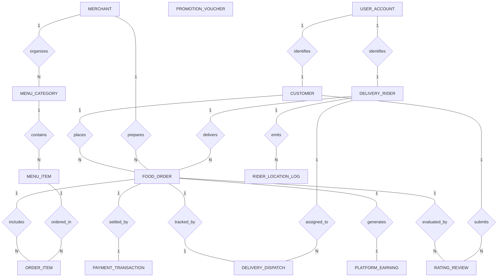

# Conceptual ERD — Food Ordering & Delivery System

## Mermaid Code

## Entity Description Table | Bang mo ta Entity

| # | Entity Name | Vietnamese Name | Description | Key Attributes | Main Relationships |
|---|-------------|-----------------|-------------|----------------|-------------------|
| 1 | CUSTOMER | Khach hang dat mon | Represents consumer profile details, primary delivery address, and accumulated reward points. | customer_id, user_id, full_name, delivery_address | Belongs to USER_ACCOUNT; One-to-Many with FOOD_ORDER, RATING_REVIEW |
| 2 | MERCHANT | Doi tac Nha hang | Stores restaurant partner store profiles, cuisine categories, physical locations, and overall star ratings. | merchant_id, store_name, cuisine_type, rating_score | One-to-Many with MENU_CATEGORY, FOOD_ORDER, RATING_REVIEW |
| 3 | DELIVERY_RIDER | Tai xai giao hang | Represents courier profiles, vehicle registration plates, current status (Online/Busy), and wallet balances. | rider_id, user_id, vehicle_plate, current_status, wallet_balance | Belongs to USER_ACCOUNT; One-to-Many with FOOD_ORDER, DELIVERY_DISPATCH, RIDER_LOCATION_LOG |
| 4 | MENU_CATEGORY | Danh muc thuc don | Logical grouping of dishes offered by a restaurant (e.g., Combo Meals, Drinks, Desserts). | category_id, merchant_id, category_name | Belongs to MERCHANT; One-to-Many with MENU_ITEM |
| 5 | MENU_ITEM | Mon an thuc don | Specific dish/beverage items listed by merchants, including prices and stock availability. | item_id, category_id, item_name, unit_price, is_available | Belongs to MENU_CATEGORY; One-to-Many with ORDER_ITEM |
| 6 | FOOD_ORDER | Don hang thuc pham | Stores customer food delivery order records, financial subtotal, fees, discounts, and current status. | order_id, customer_id, merchant_id, rider_id, grand_total | Belongs to CUSTOMER, MERCHANT, DELIVERY_RIDER; One-to-Many with ORDER_ITEM; One-to-One with PAYMENT_TRANSACTION, DELIVERY_DISPATCH, PLATFORM_EARNING |
| 7 | ORDER_ITEM | Chi tiet mon order | Line items ordered within a delivery order, capturing dish choices, quantities, and customization notes. | order_item_id, order_id, item_id, quantity, customization_notes | Belongs to FOOD_ORDER, MENU_ITEM |
| 8 | PAYMENT_TRANSACTION | Giao dich thanh toan | Captures payment authorization records, transaction tokens, payment methods, and settlement statuses. | payment_id, order_id, payment_method, amount_charged, payment_status | One-to-One with FOOD_ORDER |
| 9 | DELIVERY_DISPATCH | Nhiem vu giao hang | Tracks rider dispatch matching, pickup times, delivery arrival times, and courier trip compensation. | dispatch_id, order_id, rider_id, dispatch_time, rider_earning | One-to-One with FOOD_ORDER; Belongs to DELIVERY_RIDER |
| 10 | RIDER_LOCATION_LOG | Nhat ky toan do GPS | Stores periodic GPS coordinate telemetry points broadcast by rider mobile applications. | log_id, rider_id, latitude, longitude, recorded_at | Belongs to DELIVERY_RIDER |
| 11 | RATING_REVIEW | Danh gia & Binh luan | Stores post-delivery 1-5 star ratings and written reviews for food quality and courier service. | review_id, order_id, customer_id, merchant_id, rider_id, food_rating | Belongs to FOOD_ORDER, CUSTOMER, MERCHANT, DELIVERY_RIDER |
| 12 | PROMOTION_VOUCHER | Ma giam gia khuyen mai | Stores promotional discount campaigns, promo codes, minimum spend thresholds, and expiration dates. | voucher_id, voucher_code, discount_value, min_basket_amount | Applied to FOOD_ORDER |
| 13 | USER_ACCOUNT | Tai khoan nguoi dung | Holds core login credentials, security hashes, role types (Customer, Rider, Admin), and registration timestamps. | user_id, email, password_hash, role_type | One-to-One with CUSTOMER, DELIVERY_RIDER |
| 14 | PLATFORM_EARNING | Doanh thu san | Logs platform business commission revenue derived from merchant orders and customer service fees. | earning_id, order_id, merchant_commission, net_platform_revenue | One-to-One with FOOD_ORDER |

## Relationship Description | Mo ta Quan he

| # | From Entity | Cardinality | To Entity | Relationship Label | Business Explanation |
|---|-------------|-------------|-----------|-------------------|----------------------|
| 1 | USER_ACCOUNT | One-to-One | CUSTOMER | identifies | Tai khoan nguoi dung xac thuc va lien ket voi thong tin ho so khach hang. |
| 2 | USER_ACCOUNT | One-to-One | DELIVERY_RIDER | identifies | Tai khoan nguoi dung xac thuc va dinh danh ho so taixai giao hang. |
| 3 | MERCHANT | One-to-Many | MENU_CATEGORY | organizes | Mot doi tac nha hang quan ly nhieu danh muc mon an tren thuc don. |
| 4 | MENU_CATEGORY | One-to-Many | MENU_ITEM | contains | Mot danh muc thuc don chua nhieu mon an va do uong cu the. |
| 5 | CUSTOMER | One-to-Many | FOOD_ORDER | places | Mot khach hang co the dat nhieu don hang giao thuc pham qua thoi gian. |
| 6 | MERCHANT | One-to-Many | FOOD_ORDER | prepares | Mot nha hang tiep nhan va che bien nhieu don hang tu khach hang. |
| 7 | DELIVERY_RIDER | One-to-Many | FOOD_ORDER | delivers | Mot tai xai nhan thuc hien va giao nhieu don hang den khach hang. |
| 8 | FOOD_ORDER | One-to-Many | ORDER_ITEM | includes | Mot don hang thuc pham bao gom nhieu dong chi tiet mon an va tuy chon. |
| 9 | MENU_ITEM | One-to-Many | ORDER_ITEM | ordered_in | Mot mon an co the duoc dat nhieu lan trong nhieu don hang khac nhau. |
| 10 | FOOD_ORDER | One-to-One | PAYMENT_TRANSACTION | settled_by | Mot don hang đuoc thanh toan qua mot giao dich thanh toan duy nhat. |
| 11 | FOOD_ORDER | One-to-One | DELIVERY_DISPATCH | tracked_by | Mot don hang đuoc phan cong va dieu hanh boi mot nhiem vu giao hang cu the. |
| 12 | DELIVERY_RIDER | One-to-Many | RIDER_LOCATION_LOG | emits | Mot tai xai giao hang phat toan do GPS dinh ky ghi vao nhat ky hanh trình. |
| 13 | FOOD_ORDER | One-to-One | RATING_REVIEW | evaluated_by | Mot don hang hoan thanh tao dieu kien cho khach hang gui mot danh gia phan hoi. |
| 14 | FOOD_ORDER | One-to-One | PLATFORM_EARNING | generates | Mot don hang hoan thanh phat sinh chi phi hoa hong va phi dich vu cho san. |
