# Swimlane Diagram — Food Ordering & Delivery System

## Mermaid Code

```mermaid
flowchart LR
    Start(["Start"])

    subgraph Lane1["Customer (Consumer App)"]
        C1["Search Merchant & Customize Cart"]
        C2["Submit Order & Authorize Payment"]
        C3["Track Rider GPS Location Live"]
        C4["Receive Food & Verify PIN Code"]
        C5["Rate Merchant and Rider Service"]
    end

    subgraph Lane2["Restaurant Merchant (Partner App)"]
        M1["Receive Order Alert on Tablet"]
        M2["Accept Order & Set Cooking Time"]
        M3["Prepare Food & Mark Packaged"]
    end

    subgraph Lane3["Delivery Rider (Driver App)"]
        R1["Receive Dispatch Job Offer"]
        R2["Accept Job & Navigate to Store"]
        R3["Pick Up Food Bag & Confirm Order"]
        R4["Drive to Destination & Complete Order"]
    end

    subgraph Lane4["Platform Backend (Dispatch & Settlement)"]
        S1["Verify Payment & Dispatch to Merchant"]
        S2["Match & Dispatch Nearest Rider"]
        S3{"Is Rider Available?"}
        S4["Stream Real-Time GPS Tracking"]
        S5["Release Payout to Merchant & Rider"]
    end

    Finish(["End"])

    Start --> C1 --> C2 --> S1 --> M1 --> M2 --> M3
    M2 --> S2 --> R1 --> S3
    S3 -->|"Yes"| R2 --> R3 --> S4 --> C3 --> R4 --> C4 --> S5 --> C5 --> Finish
    S3 -->|"No (Rider Decline/Busy)"| S2
```

## Flow Description | Mo ta luong

| Lane | Actor | Role in Flow |
|------|-------|-------------|
| **Lane 1** | Customer (Consumer App) | Searches nearby restaurants, adds dishes to cart, places order with payment pre-authorization, tracks rider route on live map, receives food, and submits rating review. |
| **Lane 2** | Restaurant Merchant | Receives order notifications on tablet, confirms order acceptance with estimated prep time, cooks food according to specs, and packages order for pickup. |
| **Lane 3** | Delivery Rider | Receives delivery job offer, accepts assignment, navigates to restaurant, verifies order contents upon pickup, delivers food package to customer address, and verifies completion. |
| **Lane 4** | Platform Backend | Validates payment funds hold, routes order to merchant, algorithmically selects optimal nearby rider, streams live GPS telemetry data, settles merchant payouts, and updates courier wallet. |

### Process Execution Steps | Cac buoc thuc hien quy trinh

1. **Ordering & Payment**: Customer searches food options, customizes items, and submits checkout order (`C1`, `C2`). Platform Backend validates payment hold and alerts merchant (`S1`).
2. **Kitchen Order Processing**: Merchant receives order alert on tablet (`M1`), accepts order with prep timer (`M2`), cooks meals, and marks packaging complete (`M3`).
3. **Automated Rider Dispatch**: System dispatch engine evaluates nearby available riders (`S2`). Targeted Rider receives job offer notification (`R1`).
4. **Dispatch Decision Loop**: System checks rider job acceptance status (`S3`).
   - If **No**: System reroutes job offer to next best candidate rider (`S2`).
   - If **Yes**: Rider accepts job and drives to restaurant (`R2`).
5. **Pickup & Transit**: Rider arrives at merchant store, verifies order items, and marks picked up (`R3`). Backend activates dynamic GPS stream for customer map (`S4`, `C3`).
6. **Delivery Completion & Payout**: Rider drives to customer address and completes delivery verification via PIN (`R4`, `C4`). Platform Backend releases payouts to merchant balance and rider wallet (`S5`). Customer submits rating review (`C5`), finishing the workflow (`Finish`).
