# Action Tree — Food Ordering & Delivery System

## Mermaid Code

```mermaid
graph TD
    Root["Food Ordering & Delivery System"]

    Root --> M1["Customer Ordering & Discovery"]
    Root --> M2["Merchant Order Fulfillment"]
    Root --> M3["Rider Dispatch & Logistics"]
    Root --> M4["Real-Time Tracking & Maps"]
    Root --> M5["Payment, Escrow & Settlements"]
    Root --> M6["Promotions, Reviews & Customer Care"]
    Root --> M7["Platform Administration & Analytics"]

    M1 --> A11["Search & Filter Restaurants"]
    M1 --> A12["Customize Dish Options"]
    M1 --> A13["Select Delivery Address"]
    M1 --> A14["Submit Checkout Cart"]

    M2 --> A21["Accept Incoming Orders"]
    M2 --> A22["Update Food Prep Timer"]
    M2 --> A23["Manage Menu Availability"]
    M2 --> A24["Configure Store Operating Hours"]

    M3 --> A31["Match Rider Algorithmically"]
    M3 --> A32["Broadcast Delivery Job Offer"]
    M3 --> A33["Confirm Pickup at Merchant"]
    M3 --> A34["Verify Delivery via PIN Code"]

    M4 --> A41["Stream Rider GPS Coordinates"]
    M4 --> A42["Calculate Route ETA"]
    M4 --> A43["Render Interactive Map Paths"]
    M4 --> A44["Mask Contact Phone Numbers"]

    M5 --> A51["Authorize Payment Hold"]
    M5 --> A52["Settle Cash on Delivery"]
    M5 --> A53["Release Merchant Payout"]
    M5 --> A54["Credit Rider Wallet Balance"]

    M6 --> A61["Apply Discount Promo Vouchers"]
    M6 --> A62["Submit Merchant & Rider Reviews"]
    M6 --> A63["Process Dispute Refund Requests"]
    M6 --> A64["Award Loyalty Reward Points"]

    M7 --> A71["Onboard Merchants & Riders"]
    M7 --> A72["Set Platform Commission Rates"]
    M7 --> A73["Monitor Delivery Fleet Metrics"]
    M7 --> A74["Export GMV & Tax Audit Reports"]
```

## Module Description | Mo ta Module

| # | Module | Description | Actions |
|---|--------|-------------|---------|
| 1 | Customer Ordering & Discovery | Handles consumer restaurant searches, filter criteria (cuisine, rating, speed), cart item customization, delivery location selection, and order submission. | Search & Filter Restaurants, Customize Dish Options, Select Delivery Address, Submit Checkout Cart |
| 2 | Merchant Order Fulfillment | Manages partner tablet alerts, incoming order acceptances/rejections, kitchen prep timers, live menu stock toggles, and store opening hours. | Accept Incoming Orders, Update Food Prep Timer, Manage Menu Availability, Configure Store Operating Hours |
| 3 | Rider Dispatch & Logistics | Controls algorithmic courier matching, delivery job offer broadcasts, merchant pickup verifications, and PIN/photo delivery completions. | Match Rider Algorithmically, Broadcast Delivery Job Offer, Confirm Pickup at Merchant, Verify Delivery via PIN Code |
| 4 | Real-Time Tracking & Maps | Streams high-frequency GPS coordinate telemetry, calculates dynamic route ETAs, renders map paths, and protects user privacy via virtual phone masking. | Stream Rider GPS Coordinates, Calculate Route ETA, Render Interactive Map Paths, Mask Contact Phone Numbers |
| 5 | Payment, Escrow & Settlements | Manages pre-authorization payment holds, Cash on Delivery limits, merchant order payout releases, rider wallet earnings, and e-wallet transfers. | Authorize Payment Hold, Settle Cash on Delivery, Release Merchant Payout, Credit Rider Wallet Balance |
| 6 | Promotions, Reviews & Customer Care | Manages promo voucher campaigns, post-delivery star rating reviews, customer service dispute resolution, refund processing, and loyalty points. | Apply Discount Promo Vouchers, Submit Merchant & Rider Reviews, Process Dispute Refund Requests, Award Loyalty Reward Points |
| 7 | Platform Administration & Analytics | Controls merchant and rider onboarding verification, platform commission rate configuration, live fleet tracking, Gross Merchandise Value (GMV) reports, and tax audits. | Onboard Merchants & Riders, Set Platform Commission Rates, Monitor Delivery Fleet Metrics, Export GMV & Tax Audit Reports |
