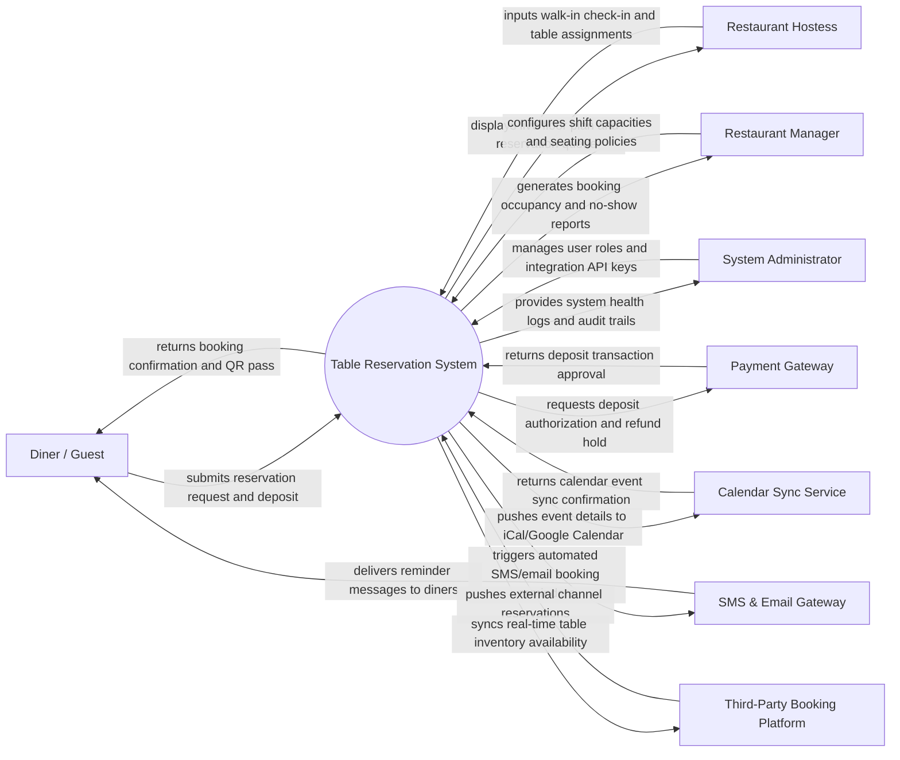

# Context Diagram — Table Reservation System

## Mermaid Code

## Actor & Interaction Table | Bang Actor & Tuong tac

| # | Actor | Actor Type | Data Sent TO System | Data Received FROM System | Notes |
|---|-------|------------|---------------------|---------------------------|-------|
| 1 | Diner / Guest | Primary | Preferred date/time, party size, seating zone preference, dietary notes, deposit payment | Reservation confirmation code, digital booking pass, reminder alerts | Interacts via restaurant website, mobile booking app, or guest portal. |
| 2 | Hostess | Primary | Walk-in arrival check-ins, table assignments, table status updates (Seated, Cleared), waitlist additions | Live floor map, arrival schedule, guest dining history, active waitlist queue | Uses receptionist tablet or host station computer. |
| 3 | Restaurant Manager | Primary | Shift capacities, meal slot durations, cancellation policies, VIP rules, special holiday layouts | Occupancy analytics, table turnover rates, no-show statistics, revenue metrics | Accesses web administrative management dashboard. |
| 4 | System Administrator | Primary | User credentials, role security policies, integration API keys, backup parameters | Audit trail logs, system health indicators, integration error logs | Manages platform IT infrastructure and access permissions. |
| 5 | Payment Gateway | Supporting | Deposit authorization status, refund approval tokens, transaction IDs | Deposit charge requests, cancellation fee penalties, refund processing | Integrates via secure API for credit card pre-authorizations and e-wallets. |
| 6 | SMS & Email Gateway | Supporting | Message delivery receipts, SMS error logs | Notification templates, recipient phone numbers/emails, booking details | Sends automated confirmation texts, 24h reminders, and cancellation alerts. |
| 7 | Calendar Sync Service | Supporting | Calendar sync confirmation status, calendar entry IDs | Booking event payloads, event titles, dining time slots, location details | Integrates with Google Calendar, Apple iCal, and Outlook via API. |
| 8 | Third-Party Booking Platform | Supporting | External booking records, guest details, channel booking source | Real-time table inventory matrix, slot availability, booking confirmation codes | Integrates with platforms like OpenTable, Resy, or SevenRooms. |

## System Boundary Description | Mo ta Pham vi He thong

The **Table Reservation System** manages online and offline table booking operations, floor plan seating allocations, shift capacity limits, hostess reception check-ins, and digital waitlist management. Inside its boundary, the system handles booking availability searches, automated deposit payment collection, table turnover timing, guest preference logging, automated SMS/email reminders, and no-show fee enforcement.

The system boundary excludes physical food and beverage ordering (handled by POS/KDS systems), physical table setup by waitstaff, direct credit card clearing (delegated to external Payment Gateways), and external channel marketing (managed by Third-Party Booking Platforms).
