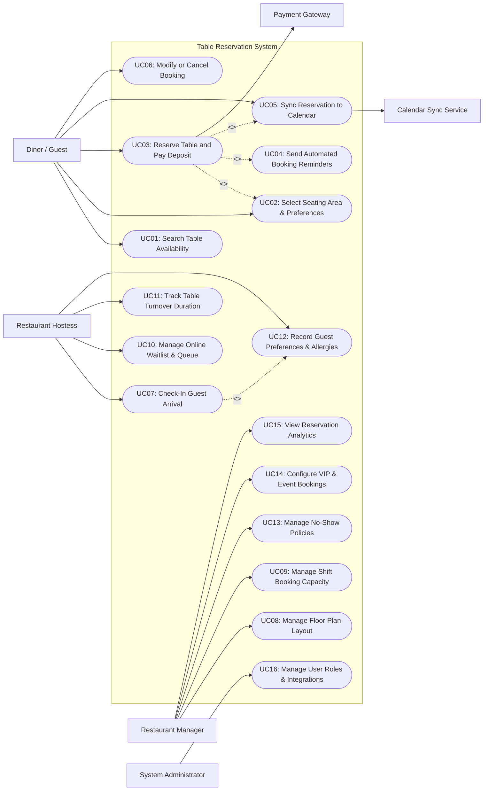

# Use Case Diagram — Table Reservation System

## Mermaid Code

## Actor Table | Bang Actor

| # | Actor | Actor Type | Role Description | Related Use Cases |
|---|-------|------------|------------------|-------------------|
| 1 | Diner / Guest | Primary | Customer who searches table availability, books dining reservations, pays deposits, and manages personal bookings. | UC01, UC02, UC03, UC05, UC06 |
| 2 | Restaurant Hostess | Primary | Front-desk staff managing guest arrivals, assigning tables on the floor plan, tracking dining duration, and handling waitlists. | UC07, UC10, UC11, UC12 |
| 3 | Restaurant Manager | Primary | Operational manager configuring seating layouts, shift slot limits, no-show penalty rules, VIP events, and occupancy reports. | UC08, UC09, UC13, UC14, UC15 |
| 4 | System Administrator | Primary | Technical admin managing user accounts, security roles, system configurations, and API integrations. | UC16 |
| 5 | Payment Gateway | Secondary System | External service provider handling credit card pre-authorizations, deposit holds, and penalty charges. | UC03, UC06 |
| 6 | Calendar Sync Service | Secondary System | Third-party service integrating booking confirmations with Google Calendar, Apple iCal, or Outlook. | UC05 |

## Use Case Table | Bang Use Case

| # | UC ID | Use Case Name | Primary Actor | Secondary Actor | Description | Priority |
|---|-------|---------------|---------------|-----------------|-------------|----------|
| 1 | UC01 | Search Table Availability | Diner / Guest | None | Queries table inventory by requested date, dining time slot, and guest party size. | High |
| 2 | UC02 | Select Seating Area & Preferences | Diner / Guest | None | Allows guests to pick seating zones (Indoor, Outdoor Terrace, VIP Room) and add dietary notes. | Medium |
| 3 | UC03 | Reserve Table and Pay Deposit | Diner / Guest | Payment Gateway | Confirms table booking details and collects credit card deposit authorization (if required). | High |
| 4 | UC04 | Send Automated Booking Reminders | System | SMS/Email Gateway | Automatically sends SMS and email booking reminder notifications 24 hours and 2 hours prior to reservation. | High |
| 5 | UC05 | Sync Reservation to Calendar | Diner / Guest | Calendar Sync Service | Exports confirmed booking event payload to guest's Google Calendar or Apple iCal. | Low |
| 6 | UC06 | Modify or Cancel Booking | Diner / Guest | Payment Gateway | Allows guests to update party size/time or cancel booking within policy limits (releasing deposits). | High |
| 7 | UC07 | Check-In Guest Arrival | Hostess | None | Marks reservation as checked-in upon guest arrival and assigns a specific physical table number. | High |
| 8 | UC08 | Manage Floor Plan Layout | Restaurant Manager | None | Configures interactive floor plan zones, table numbers, seating capacities, and table combining rules. | High |
| 9 | UC09 | Manage Shift Booking Capacity | Restaurant Manager | None | Sets maximum booking covers and slot intervals per shift (Lunch, Dinner) to prevent kitchen overload. | High |
| 10 | UC10 | Manage Online Waitlist & Queue | Hostess | SMS/Email Gateway | Manages walk-in waitlists, tracks estimated wait times, and sends SMS alerts when tables are ready. | High |
| 11 | UC11 | Track Table Turnover Duration | Hostess | None | Monitors live table dining duration timers (Seated, Appetizer, Main Course, Dessert, Cleaning). | Medium |
| 12 | UC12 | Record Guest Preferences & Allergies | Hostess | None | Logs guest dining tags (VIP, Frequent Diner, Wine Enthusiast, Peanut Allergy) to profile history. | Medium |
| 13 | UC13 | Manage No-Show Policies | Restaurant Manager | Payment Gateway | Configures cancellation deadlines, late arrival grace periods, and no-show deposit forfeiture rules. | High |
| 14 | UC14 | Configure VIP & Event Bookings | Restaurant Manager | None | Reserves entire dining zones or tables for corporate events, private parties, or VIP guests. | Medium |
| 15 | UC15 | View Reservation Analytics | Restaurant Manager | None | Generates reports on booking channel sources, peak occupancy hours, table turnover, and no-show rates. | High |
| 16 | UC16 | Manage User Roles & Integrations | System Administrator | None | Configures hostess/manager user accounts, role permissions, and third-party channel API keys. | High |

## Use Case Specification | Dac ta Use Case

---

### UC03 — Reserve Table and Pay Deposit

| Field | Detail |
|-------|--------|
| **UC ID** | UC03 |
| **Use Case Name** | Reserve Table and Pay Deposit |
| **Actor(s)** | Primary: Diner / Guest   Secondary: Payment Gateway |
| **Description** | Allows a diner to select a dining time slot, specify party size and seating zone, input contact information, pay a booking deposit (if required), and receive a confirmed reservation pass. |
| **Precondition** | 1. Requested date, time, and party size have available capacity in the system.   2. Payment Gateway service is online. |
| **Main Flow** | 1. Diner initiates booking process, selecting date, arrival time, and number of guests.   2. System queries table inventory matrix and displays available time slots and seating zones (Main Hall, Terrace, Private Room).   3. Diner selects preferred seating zone and enters contact details (Full Name, Mobile Number, Email, Special Occasion, Dietary Notes).   4. System checks if party size or time slot requires a booking deposit based on manager policy rules.   5. System calculates required deposit amount (e.g., $10 per person for parties >= 6).   6. Diner enters credit card/e-wallet details and confirms deposit payment.   7. System sends charge authorization request to Payment Gateway.   8. Payment Gateway processes transaction and returns authorization approval code.   9. System reserves table slot, updates shift capacity, creates booking record with status `Confirmed`, and generates a unique Booking Reference Code and QR pass.   10. System triggers automated confirmation email and SMS to the diner (executing UC04). |
| **Alternative Flow** | **AF1** — No deposit required for small party:   1. At step 4, System determines party size is under deposit threshold (< 6 guests).   2. System skips deposit collection (steps 5-8) and proceeds directly to step 9 to confirm reservation.    **AF2** — Table slot temporarily locked during checkout:   1. At step 4, System places a 10-minute temporary hold on the selected table slot while diner enters payment info.   2. If checkout completes within 10 minutes, hold converts to permanent `Confirmed` status. |
| **Exception Flow** | **EX1** — Deposit Payment Declined:   1. At step 8, Payment Gateway returns card decline response.   2. System displays error message "Deposit authorization failed" and maintains temporary hold for 3 minutes to allow credit card retry.    **EX2** — Time slot capacity filled during payment:   1. If temporary hold expires before payment confirmation and another user books the final slot, System alerts diner "Selected time slot no longer available".   2. System offers nearest available time slots (+/- 30 minutes). |
| **Postcondition** | Reservation record is created with status `Confirmed`, shift capacity is updated, and deposit transaction is logged. |
| **Business Rule** | **BR1**: Deposits are mandatory for all weekend dinner slots and for any group booking exceeding 5 guests.   **BR2**: Temporary table holds automatically expire after 10 minutes of inactivity on the checkout screen. |

---

### UC06 — Modify or Cancel Booking

| Field | Detail |
|-------|--------|
| **UC ID** | UC06 |
| **Use Case Name** | Modify or Cancel Booking |
| **Actor(s)** | Primary: Diner / Guest   Secondary: Payment Gateway |
| **Description** | Enables a diner to modify reservation details (party size, arrival time) or cancel a booking, with automated deposit refund processing based on cancellation deadline policies. |
| **Precondition** | 1. Booking record exists in status `Confirmed`.   2. Diner enters valid Booking Reference Code and matching phone number/email. |
| **Main Flow** | 1. Diner accesses "Manage Booking" link from confirmation SMS/email or guest portal.   2. System displays current booking summary (Date, Time, Party Size, Seated Zone, Deposit Paid).   3. Diner selects action: "Modify Booking" or "Cancel Booking".   4. Diner selects "Cancel Booking".   5. System checks current time against restaurant cancellation policy deadline (e.g., 24 hours prior to booking time).   6. System determines cancellation is before policy deadline and qualifies for full deposit refund.   7. System prompts Diner to confirm cancellation.   8. Diner confirms cancellation.   9. System sends refund request to Payment Gateway.   10. Payment Gateway releases deposit authorization hold / issues refund.   11. System updates booking status to `Canceled by Guest`, restores table capacity inventory, and sends cancellation confirmation SMS/email to Diner. |
| **Alternative Flow** | **AF1** — Modify reservation details:   1. At step 3, Diner selects "Modify Booking" and requests new party size or time slot.   2. System checks table inventory availability for requested change.   3. If available, System updates booking details, adjusts deposit requirement if party size changed, and issues updated confirmation pass.    **AF2** — Late cancellation within penalty window:   1. At step 5, System calculates current time is within 24-hour cancellation penalty window.   2. System alerts Diner: "Canceling now forfeits your $50 deposit per policy rules".   3. If Diner confirms, System cancels booking, retains deposit as penalty fee, and updates status to `Canceled (Deposit Forfeited)`. |
| **Exception Flow** | **EX1** — Booking modification unavailable:   1. At AF1 step 2, requested new time slot or party size is fully booked.   2. System alerts Diner "Requested modification unavailable" and maintains original confirmed booking.    **EX2** — Refund transaction failure:   1. If Payment Gateway refund fails at step 10, System flags booking as `Refund Pending Manual Review` and notifies restaurant manager. |
| **Postcondition** | Booking status is updated, table capacity inventory is released, and deposit refund/forfeiture is processed. |
| **Business Rule** | **BR1**: Full deposit refunds are only issued for cancellations submitted at least 24 hours prior to reserved dining time.   **BR2**: Modifications to increase party size are subject to real-time table availability constraints. |

---

### UC07 — Check-In Guest Arrival

| Field | Detail |
|-------|--------|
| **UC ID** | UC07 |
| **Use Case Name** | Check-In Guest Arrival |
| **Actor(s)** | Primary: Restaurant Hostess   Secondary: None |
| **Description** | Allows the front-desk hostess to look up arriving guest reservations, verify booking passes, assign a specific physical table on the floor plan, and mark the table as `Seated`. |
| **Precondition** | 1. Hostess is logged into Host Station tablet app.   2. Interactive floor plan layout is active. |
| **Main Flow** | 1. Guest arrives at host podium and provides name or scans booking QR code.   2. Hostess searches guest name or scans QR pass on Host Station app.   3. System retrieves matching reservation record, displaying party size, seating zone preference, special occasion notes, and guest dining history tag (e.g., VIP, Allergen Alert).   4. Hostess views interactive floor plan map showing table statuses (Available, Seated, Reserved, Dirty).   5. System highlights recommended open tables matching party size and zone preference.   6. Hostess selects physical table number (e.g., Table 14) on floor plan and taps "Assign & Seat Guest".   7. System updates booking status to `Checked-In / Seated`, updates table status on floor plan to `Seated (Occupied)`, and starts dining timer counter.   8. Hostess escorts guest to assigned table. |
| **Alternative Flow** | **AF1** — Guest arrives early or late:   1. At step 3, System detects guest arrived 40 minutes early or 20 minutes past booking time.   2. If early, Hostess offers guest option to wait at bar or seats early if table is clean.   3. If late within grace period (15 mins), Hostess seats guest immediately.    **AF2** — Walk-in guest without reservation:   1. Guest arrives without booking.   2. Hostess opens "Walk-In Entry" screen, inputs guest name, party size, and phone number.   3. System checks immediate floor availability and Hostess assigns open table (steps 4-7). |
| **Exception Flow** | **EX1** — Assigned table not yet cleaned:   1. Hostess selects table at step 6, but table status is `Dirty / Needs Bussing`.   2. System displays alert "Table 14 is currently dirty". Hostess sends busboy cleanup alert on app and temporarily holds guest at reception.    **EX2** — No-show auto-release:   1. If guest fails to check in within 15 minutes past reservation time, System automatically marks booking as `No-Show`.   2. System releases table hold on floor plan and flags guest profile for no-show penalty tracking. |
| **Postcondition** | Booking status changes to `Checked-In / Seated`, table status becomes occupied, and dining timer starts. |
| **Business Rule** | **BR1**: Reserved tables are held for a maximum 15-minute grace period past reservation time before auto-flagging as No-Show.   **BR2**: Seating assignments must strictly respect guest dietary/allergy warning flags displayed on the hostess screen. |

---

### UC08 — Manage Floor Plan Layout

| Field | Detail |
|-------|--------|
| **UC ID** | UC08 |
| **Use Case Name** | Manage Floor Plan Layout |
| **Actor(s)** | Primary: Restaurant Manager   Secondary: None |
| **Description** | Allows restaurant managers to design, edit, and configure interactive graphical floor plans, defining seating zones, table dimensions, capacities, and table combination rules. |
| **Precondition** | 1. User is authenticated with Restaurant Manager privileges.   2. Floor Plan Editor module is open. |
| **Main Flow** | 1. Manager opens Floor Plan Layout Editor on administration console.   2. System displays graphical canvas of restaurant floor sections (Main Dining, Outdoor Patio, Private VIP Room, Bar Counter).   3. Manager adds, moves, or rotates table objects on canvas using drag-and-drop tools.   4. For each table, Manager configures table ID/number, minimum seating capacity, maximum seating capacity, shape (Square, Round, Booth), and assigned service section.   5. Manager defines table join/combine rules (e.g., Table 12 and Table 13 can be combined for party of 8).   6. Manager saves updated floor plan layout configuration.   7. System validates table layout data, checks for duplicate table IDs, and publishes active floor plan to Host Station app. |
| **Alternative Flow** | **AF1** — Create seasonal/event floor plan template:   1. Manager wants to create a special layout template for Valentine's Day or holiday banquets.   2. Manager selects "Save as New Template", names template (e.g., "Holiday Event Layout"), and edits canvas.   3. Manager sets schedule rule for template auto-activation on specific event dates.    **AF2** — Deactivate damaged/out-of-service table:   1. A physical table is broken or undergoing maintenance.   2. Manager taps table object on floor plan and toggles status to `Out of Service`.   3. System removes table from online booking availability inventory immediately. |
| **Exception Flow** | **EX1** — Unsaved layout conflict:   1. Manager attempts to delete a table that has active future confirmed reservations.   2. System blocks table deletion and displays warning "Table 22 has 3 upcoming confirmed bookings. Reassign bookings before deleting." |
| **Postcondition** | Floor plan layout configuration is saved, table inventory matrix is updated, and changes sync to Host Station apps. |
| **Business Rule** | **BR1**: Floor plan changes take effect immediately for new bookings but cannot alter existing active seated table sessions.   **BR2**: Combined table rules must satisfy safety egress pathway width requirements configured in system settings. |

---

### UC10 — Manage Online Waitlist & Queue

| Field | Detail |
|-------|--------|
| **UC ID** | UC10 |
| **Use Case Name** | Manage Online Waitlist & Queue |
| **Actor(s)** | Primary: Restaurant Hostess   Secondary: SMS / Email Gateway |
| **Description** | Manages walk-in guests when restaurant is at full capacity, estimating wait times, queuing entries, broadcasting SMS "Table Ready" alerts, and seating guests from the queue. |
| **Precondition** | 1. All physical tables matching guest party size are currently `Seated` or `Reserved`.   2. Digital Waitlist module is active on Host Station tablet. |
| **Main Flow** | 1. Walk-in guest arrives at full-capacity restaurant requesting a table.   2. Hostess opens "Add to Waitlist" interface on Host Station app.   3. Hostess inputs guest name, mobile phone number, party size, seating zone preference, and special requests.   4. System calculates estimated wait time based on active table dining timers and historical turnover rates.   5. System adds entry to active waitlist queue and generates a dynamic web queue status link.   6. System triggers SMS to guest: "You are #4 in line. Estimated wait time: 25 mins. Track live queue here: [link]".   7. Guest steps away from reception, monitoring live queue position on mobile browser.   8. As physical table becomes clean and available, Hostess selects top waitlist entry on app and taps "Notify Table Ready".   9. System sends automated high-priority SMS alert to guest: "Your table is ready! Please return to host stand within 5 minutes."   10. Guest returns to host stand, Hostess verifies waitlist pass, and seats guest (executing UC07). |
| **Alternative Flow** | **AF1** — Guest cancels or leaves queue remotely:   1. Guest decides not to wait and taps "Leave Queue" on mobile web link.   2. System updates waitlist status to `Canceled by Guest`, adjusts queue positions for remaining guests, and notifies Hostess.    **AF2** — Direct online waitlist join via QR code:   1. Guest scans restaurant entry QR poster to join waitlist from smartphone without standing in host line.   2. System captures phone number, assigns queue position, and executes steps 4-7. |
| **Exception Flow** | **EX1** — Guest unresponsive to "Table Ready" alert:   1. At step 9, guest fails to report to host stand within 5-minute threshold.   2. System alerts Hostess "Guest unresponsive (5 mins elapsed)".   3. Hostess taps "Mark No-Show / Skip", System updates status to `Expired`, and notifies next guest in line. |
| **Postcondition** | Waitlist queue position is updated, guest receives automated SMS alerts, and table turnover efficiency is maximized. |
| **Business Rule** | **BR1**: Waitlist queue priority is calculated based on FIFO (First-In, First-Out) arrival within party size categories.   **BR2**: Guests have a maximum of 5 minutes to report to the host stand after receiving a "Table Ready" SMS before being skipped. |
