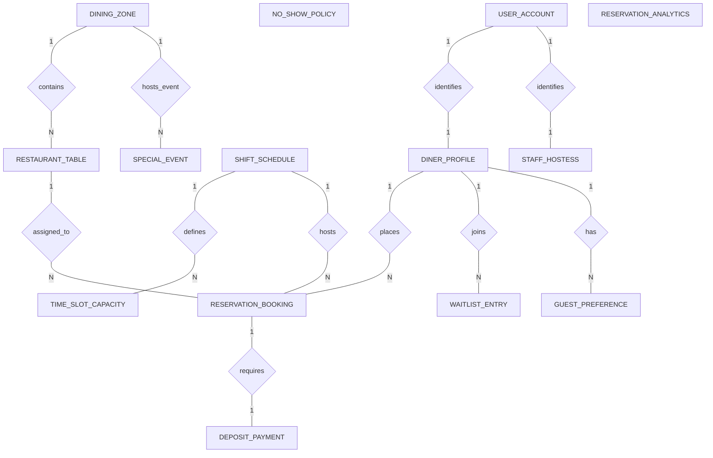

# Conceptual ERD — Table Reservation System

## Mermaid Code

## Entity Description Table | Bang mo ta Entity

| # | Entity Name | Vietnamese Name | Description | Key Attributes | Main Relationships |
|---|-------------|-----------------|-------------|----------------|-------------------|
| 1 | DINER_PROFILE | Ho so Khach dat ban | Stores diner profile details, contact info, total completed bookings, and no-show history. | diner_id, user_id, full_name, phone_number, no_show_count | Belongs to USER_ACCOUNT; One-to-Many with RESERVATION_BOOKING, WAITLIST_ENTRY, GUEST_PREFERENCE |
| 2 | RESERVATION_BOOKING | Don dat ban | Represents table reservation bookings, arrival times, party sizes, status states, and unique reference codes. | booking_id, diner_id, table_id, shift_id, reservation_time, booking_status | Belongs to DINER_PROFILE, RESTAURANT_TABLE, SHIFT_SCHEDULE; One-to-One with DEPOSIT_PAYMENT |
| 3 | DINING_ZONE | Khu vuc ban an | Logical layout sections within the restaurant (Main Hall, Outdoor Patio, Private VIP Room, Bar). | zone_id, zone_name, total_tables | One-to-Many with RESTAURANT_TABLE, SPECIAL_EVENT |
| 4 | RESTAURANT_TABLE | Ban an nha hang | Physical tables on the floor plan, seating capacity limits, shapes, and active statuses (Available, Seated, Dirty). | table_id, zone_id, table_number, min_capacity, max_capacity, current_status | Belongs to DINING_ZONE; One-to-Many with RESERVATION_BOOKING |
| 5 | TIME_SLOT_CAPACITY | Khung thoi gian slot | Configures time interval booking limits (e.g., 18:00 - 18:30) and tracks booked guest cover counts. | slot_id, shift_id, start_time, max_covers, booked_covers | Belongs to SHIFT_SCHEDULE |
| 6 | DEPOSIT_PAYMENT | Tien coc dat ban | Stores pre-authorization deposit charges, payment gateway transaction tokens, and refund statuses. | payment_id, booking_id, deposit_amount, payment_status | One-to-One with RESERVATION_BOOKING |
| 7 | WAITLIST_ENTRY | Hang cho walk-in | Manages walk-in guest queue entries, arrival timestamps, queue numbers, and live queue statuses. | waitlist_id, diner_id, party_size, queue_number, queue_status | Belongs to DINER_PROFILE |
| 8 | GUEST_PREFERENCE | So thich khach hang | Logs guest special tags (VIP, High Spender, Window Seat, Food Allergy) attached to guest profile history. | preference_id, diner_id, tag_name, preference_details | Belongs to DINER_PROFILE |
| 9 | NO_SHOW_POLICY | Quy tac bùng ban | Defines booking rules, deposit rules per party size, cancellation cutoff windows, and grace periods. | policy_id, min_party_size, deposit_per_head, cancellation_cutoff_hours | Standalone configuration table |
| 10 | SHIFT_SCHEDULE | Ca phuc vu nha hang | Defines restaurant operational service shifts (Lunch, Dinner, Late Night) and overall max cover limits. | shift_id, shift_name, open_time, close_time, total_max_covers | One-to-Many with TIME_SLOT_CAPACITY, RESERVATION_BOOKING |
| 11 | STAFF_HOSTESS | Nhan vien le tan | Represents hostess user accounts, staff names, and assigned host reception station roles. | hostess_id, user_id, full_name, assigned_station | Belongs to USER_ACCOUNT |
| 12 | SPECIAL_EVENT | Su kien dac biet | Manages private dining room closures, holiday banquet schedules, and exclusive corporate event bookings. | event_id, zone_id, event_name, event_date | Belongs to DINING_ZONE |
| 13 | USER_ACCOUNT | Tai khoan he thong | Holds login credentials, password security hashes, and role definitions (Diner, Hostess, Manager, Admin). | user_id, username, password_hash, role_name | One-to-One with DINER_PROFILE, STAFF_HOSTESS |
| 14 | RESERVATION_ANALYTICS | Thong ke dat ban | Stores aggregated daily metrics on total bookings, guest covers, no-show rates, and floor occupancy rates. | analytics_id, metric_date, total_reservations, total_covers, occupancy_rate | Aggregated metrics table |

## Relationship Description | Mo ta Quan he

| # | From Entity | Cardinality | To Entity | Relationship Label | Business Explanation |
|---|-------------|-------------|-----------|-------------------|----------------------|
| 1 | USER_ACCOUNT | One-to-One | DINER_PROFILE | identifies | Tai khoan he thong xac thuc va dinh danh ho so nguoi dung dat ban. |
| 2 | USER_ACCOUNT | One-to-One | STAFF_HOSTESS | identifies | Tai khoan he thong xac thuc nhan vien le tan va phan quyen truy cap. |
| 3 | DINER_PROFILE | One-to-Many | RESERVATION_BOOKING | places | Mot khach hang co the thuc hien nhieu luot dat ban qua thoi gian. |
| 4 | DINING_ZONE | One-to-Many | RESTAURANT_TABLE | contains | Mot khu vuc (Main Hall, Patio) chua nhieu ban an cu the. |
| 5 | RESTAURANT_TABLE | One-to-Many | RESERVATION_BOOKING | assigned_to | Mot ban an co the duoc phan cong cho nhieu luot dat ban o cac khung gio khac nhau. |
| 6 | SHIFT_SCHEDULE | One-to-Many | TIME_SLOT_CAPACITY | defines | Mot ca phuc vu (Dinner) chia thanh nhieu khung slot 30 phut co gioi han capacity. |
| 7 | SHIFT_SCHEDULE | One-to-Many | RESERVATION_BOOKING | hosts | Mot ca phuc vu tiep nhan va phuc vu nhieu don dat ban cua khach. |
| 8 | RESERVATION_BOOKING | One-to-One | DEPOSIT_PAYMENT | requires | Mot don dat ban co the yeu cau mot giao dich dat coc thanh toan tuong ung. |
| 9 | DINER_PROFILE | One-to-Many | WAITLIST_ENTRY | joins | Mot khach hang walk-in co the dang ky nhieu lan vao hang cho khi het ban. |
| 10 | DINER_PROFILE | One-to-Many | GUEST_PREFERENCE | has | Mot khach hang co the co nhieu ghi chu so thich va di ung duoc luu lai. |
| 11 | DINING_ZONE | One-to-Many | SPECIAL_EVENT | hosts_event | Mot khu vuc co the duoc bao tron de to chuc cac su kien dac biet theo ngay. |
