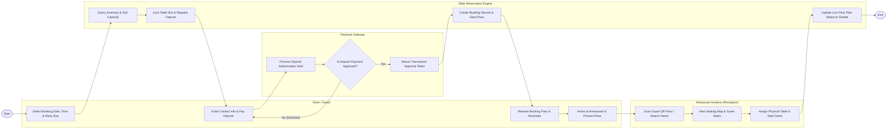

# Swimlane Diagram — Table Reservation System

## Mermaid Code

## Flow Description | Mo ta luong

| Lane | Actor | Role in Flow |
|------|-------|-------------|
| **Lane 1** | Diner / Guest | Searches table availability by date/time/party size, enters contact details, authorizes credit card booking deposit, receives confirmation pass, arrives at restaurant, and presents pass to hostess. |
| **Lane 2** | Restaurant Hostess (Reception) | Scans guest booking QR pass, views interactive floor plan and guest dietary tags, assigns physical table, and seats guests upon arrival. |
| **Lane 3** | Payment Gateway | Receives pre-authorization deposit charge requests, validates card funds, and returns payment approval tokens. |
| **Lane 4** | Table Reservation Engine | Checks real-time time slot cover limits, holds table inventory, creates confirmed booking records, triggers automated SMS/email passes, and updates floor map status to seated. |

### Process Execution Steps | Cac buoc thuc hien quy trinh

1. **Search & Inventory Query**: Diner inputs desired date, arrival time, and party size (`C1`). Reservation Engine queries real-time time slot cover availability (`S1`).
2. **Deposit & Hold**: Engine holds table inventory temporarily (`S2`). Diner inputs payment details (`C2`). Payment Gateway processes pre-authorization charge (`P1`).
3. **Payment Authorization Loop**: Payment Gateway checks transaction status (`P2`).
   - If **No (Declined)**: System prompts Diner to retry with a valid card (`C2`).
   - If **Yes (Approved)**: Payment Gateway returns transaction token (`P3`).
4. **Booking Confirmation**: Reservation Engine generates confirmed booking record, locks slot capacity, and sends SMS/Email digital QR pass (`S3`, `C3`).
5. **Guest Arrival & Reception Check-In**: Guest arrives at restaurant (`C4`). Hostess scans QR pass on tablet (`H1`), checks floor map recommendation and guest dietary preferences (`H2`), and seats guest at table (`H3`).
6. **Session Activation**: Reservation Engine marks table status as `Seated (Occupied)` on live floor plan (`S4`), ending the reservation process (`Finish`).
