# Action Tree — Table Reservation System

## Mermaid Code

```mermaid
graph TD
    Root["Table Reservation System"]

    Root --> M1["Online Booking & Slot Search"]
    Root --> M2["Floor Plan & Table Management"]
    Root --> M3["Hostess Reception & Seating"]
    Root --> M4["Digital Waitlist & Queueing"]
    Root --> M5["Deposits, Refunds & No-Show Policies"]
    Root --> M6["Guest Profiles & Preferences"]
    Root --> M7["Occupancy Analytics & Admin"]

    M1 --> A11["Search Slot Availability"]
    M1 --> A12["Select Seating Zone"]
    M1 --> A13["Submit Contact Details"]
    M1 --> A14["Generate Digital QR Pass"]

    M2 --> A21["Design Floor Plan Canvas"]
    M2 --> A22["Configure Table Capacities"]
    M2 --> A23["Define Table Join Rules"]
    M2 --> A24["Set Out-of-Service Status"]

    M3 --> A31["Scan Booking QR Pass"]
    M3 --> A32["Assign Table & Seat Guest"]
    M3 --> A33["Track Table Dining Duration"]
    M3 --> A34["Mark Table Bussed & Clean"]

    M4 --> A41["Add Walk-In to Waitlist"]
    M4 --> A42["Calculate Estimated Wait Time"]
    M4 --> A43["Send SMS Table Ready Alert"]
    M4 --> A44["Track Live Mobile Queue Position"]

    M5 --> A51["Authorize Deposit Pre-Payment"]
    M5 --> A52["Process Policy Refunds"]
    M5 --> A53["Enforce No-Show Fee Penalty"]
    M5 --> A54["Configure Grace Period Limits"]

    M6 --> A61["Record Dietary & Allergy Tags"]
    M6 --> A62["Track Guest Booking History"]
    M6 --> A63["Flag VIP & High-Spender Tags"]
    M6 --> A64["Sync Personal Calendar Events"]

    M7 --> A71["Monitor Peak Occupancy Rates"]
    M7 --> A72["Analyze No-Show Percentages"]
    M7 --> A73["Track Channel Booking Sources"]
    M7 --> A74["Manage User Roles & Security"]
```

## Module Description | Mo ta Module

| # | Module | Description | Actions |
|---|--------|-------------|---------|
| 1 | Online Booking & Slot Search | Handles real-time inventory searches, time slot cover availability queries, seating zone selections, contact detail collection, and digital QR booking pass generation. | Search Slot Availability, Select Seating Zone, Submit Contact Details, Generate Digital QR Pass |
| 2 | Floor Plan & Table Management | Controls graphical layout design tools, table seating capacity limits, table combining rules, floor section mapping, and table maintenance toggles. | Design Floor Plan Canvas, Configure Table Capacities, Define Table Join Rules, Set Out-of-Service Status |
| 3 | Hostess Reception & Seating | Manages guest arrival QR scans, table assignments on interactive floor maps, dining duration timers, and table bussing/cleaning alerts. | Scan Booking QR Pass, Assign Table & Seat Guest, Track Table Dining Duration, Mark Table Bussed & Clean |
| 4 | Digital Waitlist & Queueing | Controls walk-in queue registrations, algorithmic wait time calculations, SMS "Table Ready" alerts, and live mobile web queue position tracking. | Add Walk-In to Waitlist, Calculate Estimated Wait Time, Send SMS Table Ready Alert, Track Live Mobile Queue Position |
| 5 | Deposits, Refunds & No-Show Policies | Manages credit card deposit authorizations, policy-based refund processing, no-show penalty fee forfeitures, and arrival grace period configurations. | Authorize Deposit Pre-Payment, Process Policy Refunds, Enforce No-Show Fee Penalty, Configure Grace Period Limits |
| 6 | Guest Profiles & Preferences | Tracks guest dining history, dietary allergy tags, VIP high-spender flags, special occasion notes, and calendar event synchronization. | Record Dietary & Allergy Tags, Track Guest Booking History, Flag VIP & High-Spender Tags, Sync Personal Calendar Events |
| 7 | Occupancy Analytics & Admin | Provides analytical dashboards on peak occupancy hours, table turnover rates, channel booking sources (Direct vs OpenTable), no-show rates, and user security permissions. | Monitor Peak Occupancy Rates, Analyze No-Show Percentages, Track Channel Booking Sources, Manage User Roles & Security |
