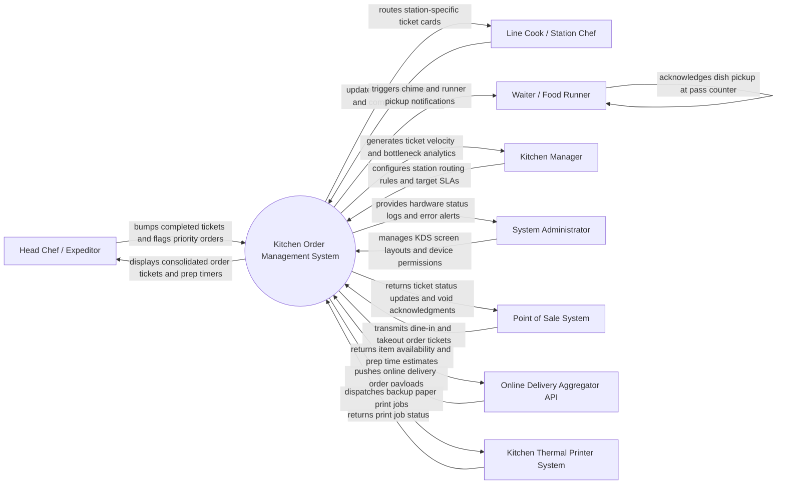

# Context Diagram — Kitchen Order Management System

## Mermaid Code

## Actor & Interaction Table | Bang Actor & Tuong tac

| # | Actor | Actor Type | Data Sent TO System | Data Received FROM System | Notes |
|---|-------|------------|---------------------|---------------------------|-------|
| 1 | Head Chef / Expeditor | Primary | Ticket priority overrides, ticket bump/recall commands, item 86ing, pass counter approvals | Consolidated kitchen ticket view, station prep timers, bottleneck alerts, special dietary notes | Uses central expeditor KDS display touch screen at kitchen pass. |
| 2 | Line Cook / Station Chef | Primary | Dish preparation stage updates (In Prep, Cooking, Ready), ingredient shortage alerts | Station-specific item tickets, recipe assembly guides, quantity consolidations | Uses station KDS display monitors (e.g., Grill, Fryer, Salad Bar). |
| 3 | Waiter / Food Runner | Primary | Dish pickup confirmations, order priority requests | Food ready audio alerts, table pickup ticket notifications, pass station locations | Receives alerts on handheld POS tablets or runner station displays. |
| 4 | Kitchen Manager | Primary | Target preparation SLAs, station routing rules, menu recipe mapping, shift staffing targets | Ticket prep speed reports, station load analytics, waste tracking metrics | Accesses web-based kitchen analytics dashboard. |
| 5 | System Administrator | Primary | Device IP bindings, display layout configurations, user security permissions, backup settings | KDS screen health metrics, hardware disconnect logs, error audit trails | Manages kitchen IT network and KDS device hardware settings. |
| 6 | Point of Sale (POS) System | Supporting | Dine-in orders, table numbers, seat numbers, item modifications, order cancellations | Real-time order prep stage, item 86ing status, kitchen prep delay alerts | Integrates via local network WebSocket or REST API. |
| 7 | Online Delivery Aggregator API | Supporting | Third-party online orders, delivery channel tags, target pickup times | Item availability locks, store busy mode status, prep duration estimates | Integrates with delivery aggregator platforms. |
| 8 | Kitchen Thermal Printer System | Supporting | Physical print job execution status, paper jam error logs | Backup paper chit print jobs, station routing failover prints | Connects via ESC/POS network thermal printers. |

## System Boundary Description | Mo ta Pham vi He thong

The **Kitchen Order Management System** controls back-of-house culinary order routing, preparation timing, Kitchen Display System (KDS) screen interactions, and expeditor workflow execution. Inside its boundary, the system handles ticket ingestion from POS and online channels, intelligent item routing to specialized kitchen stations (Grill, Saute, Pantry, Bar), color-coded prep timing alerts, item quantity consolidation, bump/recall operations, recipe plating guides, and food runner pickup alerts.

The system boundary excludes front-of-house order taking and guest payment processing (managed by POS Systems), physical cooking execution by line cooks, and external delivery rider dispatching (handled by Food Delivery Systems).
