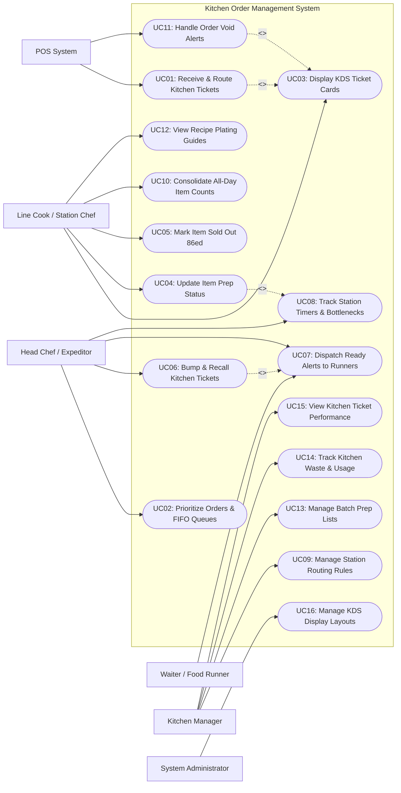

# Use Case Diagram — Kitchen Order Management System

## Mermaid Code

## Actor Table | Bang Actor

| # | Actor | Actor Type | Role Description | Related Use Cases |
|---|-------|------------|------------------|-------------------|
| 1 | Point of Sale (POS) System | Secondary System | External ordering system sending incoming order tickets, order modifications, and item voids to the kitchen. | UC01, UC11 |
| 2 | Line Cook / Station Chef | Primary | Kitchen team member preparing specific menu items at station displays, marking prep completion, and checking recipes. | UC03, UC04, UC05, UC10, UC12 |
| 3 | Head Chef / Expeditor | Primary | Kitchen supervisor overseeing pass assembly, managing order priority queues, bumping completed tickets, and tracking prep timers. | UC02, UC06, UC07, UC08 |
| 4 | Waiter / Food Runner | Primary | Service staff alerted when kitchen tickets are ready for pickup and delivery to guest tables. | UC07 |
| 5 | Kitchen Manager | Primary | Administrative manager managing station routing rules, batch prep lists, waste tracking, and ticket speed reports. | UC09, UC13, UC14, UC15 |
| 6 | System Administrator | Primary | Technical manager configuring KDS device IP bindings, display card layouts, font sizes, and alert thresholds. | UC16 |

## Use Case Table | Bang Use Case

| # | UC ID | Use Case Name | Primary Actor | Secondary Actor | Description | Priority |
|---|-------|---------------|---------------|-----------------|-------------|----------|
| 1 | UC01 | Receive & Route Kitchen Tickets | POS System | None | Ingests incoming orders from POS/delivery apps and routes specific items to designated station screens. | High |
| 2 | UC02 | Prioritize Orders & FIFO Queues | Expeditor | None | Adjusts ticket preparation priority (Rush, VIP, Delayed) and maintains First-In First-Out ticket queues. | High |
| 3 | UC03 | Display KDS Ticket Cards | Station Chef | None | Renders interactive digital ticket cards with item details, modifiers, table numbers, and elapsed timers. | High |
| 4 | UC04 | Update Item Prep Status | Station Chef | None | Changes individual item cooking status from `New` to `In Cooking` and `Ready`. | High |
| 5 | UC05 | Mark Item Sold Out 86ed | Station Chef | POS System | Flags an ingredient or menu item as sold out, propagating immediate availability locks to POS terminals. | High |
| 6 | UC06 | Bump & Recall Kitchen Tickets | Expeditor | None | Clears completed ticket cards from screen ("bump") and restores accidentally cleared tickets ("recall"). | High |
| 7 | UC07 | Dispatch Ready Alerts to Runners | Expeditor | Food Runner | Sends visual and audible notifications to food runners when all items on a table ticket are ready. | High |
| 8 | UC08 | Track Station Timers & Bottlenecks | Expeditor | None | Monitors real-time preparation timers, alerting when ticket prep times breach target SLA limits. | High |
| 9 | UC09 | Manage Station Routing Rules | Kitchen Manager | None | Configures item-to-station mapping (e.g., Steaks to Grill KDS, Salads to Cold KDS, Drinks to Bar KDS). | High |
| 10 | UC10 | Consolidate All-Day Item Counts | Station Chef | None | Displays aggregated item quantities needed across all active tickets (e.g., "12 Burger Patties Total"). | Medium |
| 11 | UC11 | Handle Order Void Alerts | POS System | Station Chef | Flashes visual void alerts on KDS screens when a customer cancels an item at POS mid-prep. | High |
| 12 | UC12 | View Recipe Plating Guides | Station Chef | None | Opens digital recipe instructions, ingredient portion specs, allergen lists, and plating photos. | Medium |
| 13 | UC13 | Manage Batch Prep Lists | Kitchen Manager | None | Generates daily pre-shift ingredient preparation lists (e.g., chop 10kg onions, simmer 5L sauce). | Medium |
| 14 | UC14 | Track Kitchen Waste & Usage | Kitchen Manager | None | Logs spoiled, burned, or spilled food items and updates theoretical inventory usage metrics. | Medium |
| 15 | UC15 | View Kitchen Ticket Performance | Kitchen Manager | None | Analyzes ticket completion speed, station bottleneck logs, peak ticket volume, and prep SLA compliance. | High |
| 16 | UC16 | Manage KDS Display Layouts | System Admin | None | Configures screen card counts, font scales, color alert themes, and thermal printer failover rules. | Medium |

## Use Case Specification | Dac ta Use Case

---

### UC01 — Receive & Route Kitchen Tickets

| Field | Detail |
|-------|--------|
| **UC ID** | UC01 |
| **Use Case Name** | Receive & Route Kitchen Tickets |
| **Actor(s)** | Primary: Point of Sale (POS) System   Secondary: None |
| **Description** | Ingests new order tickets submitted from POS terminals or online delivery platforms, parses item categories, and routes items to their assigned kitchen station KDS screens. |
| **Precondition** | 1. KDS network server is active and connected to local POS local network.   2. Station routing rules (Grill, Saute, Fryer, Salad, Bar) are configured. |
| **Main Flow** | 1. POS System transmits new order JSON payload containing order ID, table number, order type (Dine-In, Takeout), timestamp, item list, modifiers, and seat assignments.   2. KDS System receives payload, validates schema, and assigns a unique Kitchen Ticket ID.   3. KDS System evaluates item routing rules to map each item to its designated kitchen station (e.g., Ribeye Steak -> Grill Station KDS; Caesar Salad -> Pantry Station KDS).   4. KDS System dispatches parsed ticket cards to target station screens simultaneously.   5. Station KDS screens render new ticket cards with audible chime alert.   6. KDS System creates a master consolidated ticket card on the Head Chef / Expeditor screen.   7. KDS System starts elapsed prep timer for the ticket (00:00). |
| **Alternative Flow** | **AF1** — Order contains items for multiple stations:   1. At step 3, System detects items belonging to 3 different stations (Grill, Fryer, Bar).   2. System splits order into 3 station sub-tickets while linking them to the master Order ID on the Expeditor screen.   3. Sub-tickets display on respective station KDS screens.    **AF2** — Takeout / Delivery channel routing:   1. At step 1, order payload is flagged as `Takeout` or `UberEats`.   2. System appends prominent packaging icon and target delivery pickup time to ticket header card. |
| **Exception Flow** | **EX1** — Station KDS screen offline:   1. At step 4, System detects target station KDS screen (e.g., Grill KDS) is disconnected.   2. System automatically reroutes Grill sub-tickets to backup master Expeditor KDS screen and triggers backup paper print job on thermal printer.    **EX2** — Malformed POS order payload:   1. At step 2, if order payload fails validation (missing item code), System logs payload error and sends error response to POS. |
| **Postcondition** | Kitchen ticket items are displayed on station KDS screens and master ticket is initialized on Expeditor display. |
| **Business Rule** | **BR1**: Ticket routing must dispatch to station screens within 500 milliseconds of POS order submission.   **BR2**: Items flagged with allergy modifiers must display in high-contrast red flashing text across all station screens. |

---

### UC04 — Update Item Preparation Status

| Field | Detail |
|-------|--------|
| **UC ID** | UC04 |
| **Use Case Name** | Update Item Preparation Status |
| **Actor(s)** | Primary: Line Cook / Station Chef   Secondary: None |
| **Description** | Allows line cooks at station KDS displays to tap ticket items to update status stages (`New` -> `In Cooking` -> `Ready`), signaling dish progress to the expeditor. |
| **Precondition** | 1. Ticket items are displayed on station KDS screen in `New` (Unstarted) state.   2. Touch screen KDS display or bump bar keyboard is functional. |
| **Main Flow** | 1. Line Cook views incoming items on station KDS screen.   2. Line Cook starts cooking item and taps the item on screen (or presses bump bar number).   3. System updates item status to `In Cooking` and changes item background color to Yellow.   4. Line Cook finishes cooking/plating item and taps the item again.   5. System updates item status to `Ready` and changes item background color to Green.   6. System checks if all items belonging to the same ticket across all stations are marked as `Ready`.   7. When all items are ready, System updates master ticket status to `Order Complete / Ready for Pickup` on Expeditor screen. |
| **Alternative Flow** | **AF1** — Full ticket status bump by station cook:   1. Station Cook finishes all items on a station sub-ticket simultaneously.   2. Cook taps ticket card header or presses "Bump Ticket" on bump bar.   3. System updates all items on that station sub-ticket to `Ready` and removes sub-ticket card from station screen. |
| **Exception Flow** | **EX1** — Accidental item bump:   1. Station Cook accidentally taps item marking it ready.   2. Cook accesses "Recent Items / Undo" button on station KDS within 10 seconds.   3. System reverts item status back to `In Cooking`. |
| **Postcondition** | Item prep status is updated in system memory and progress reflects in real time on the master Expeditor screen. |
| **Business Rule** | **BR1**: Items marked as `In Cooking` lock in kitchen prep timer starting metrics.   **BR2**: Station screens must automatically move `Ready` items to bottom or clear them after 30 seconds to preserve screen space. |

---

### UC06 — Bump & Recall Kitchen Tickets

| Field | Detail |
|-------|--------|
| **UC ID** | UC06 |
| **Use Case Name** | Bump & Recall Kitchen Tickets |
| **Actor(s)** | Primary: Head Chef / Expeditor   Secondary: None |
| **Description** | Allows the Head Chef at the pass to clear ("bump") fully prepared tickets from the active KDS screen, or restore ("recall") accidentally cleared tickets back to active view. |
| **Precondition** | 1. Master ticket on Expeditor screen has all item sub-statuses marked as `Ready`.   2. Expeditor KDS screen or bump bar is operational. |
| **Main Flow** | 1. Head Chef inspects assembled dishes at pass counter against master ticket card on Expeditor KDS.   2. Chef verifies all dishes for table are correct, hot, and plated according to standards.   3. Chef taps "Bump Ticket" button on card or presses corresponding bump bar button.   4. System removes master ticket card from active Expeditor screen.   5. System records final ticket total completion time (Ticket Fulfillment Duration).   6. System dispatches food runner pickup alert (executing UC07).   7. System stores completed ticket in KDS historical memory queue (up to last 100 tickets). |
| **Alternative Flow** | **AF1** — Recall accidentally bumped ticket:   1. Head Chef accidentally bumps a ticket before dishes leave pass counter.   2. Chef taps "Recall Last Ticket" button on Expeditor screen.   3. System retrieves most recently bumped ticket from history memory.   4. System restores master ticket card to active Expeditor screen in `Ready` state, maintaining original prep timer records. |
| **Exception Flow** | **EX1** — Attempting to bump incomplete ticket:   1. Chef attempts to bump a ticket that still has items in `New` or `In Cooking` state.   2. System displays confirmation prompt "Warning: 2 items on this ticket are still cooking. Force bump ticket?".   3. Chef confirms force bump or cancels action. |
| **Postcondition** | Master ticket is cleared from active view, completion metrics are logged, and runner alerts are triggered. |
| **Business Rule** | **BR1**: Bumped tickets are permanently saved in historical audit logs for performance analysis.   **BR2**: Recalled tickets maintain their original order arrival timestamp and timer records without resetting. |

---

### UC07 — Dispatch Ready Alerts to Food Runners

| Field | Detail |
|-------|--------|
| **UC ID** | UC07 |
| **Use Case Name** | Dispatch Ready Alerts to Food Runners |
| **Actor(s)** | Primary: Head Chef / Expeditor   Secondary: Waiter / Food Runner |
| **Description** | Triggers visual and audible notifications to waiters and food runners when an entire table order is completed at the pass, expediting delivery to guest tables. |
| **Precondition** | 1. Kitchen ticket has been bumped or marked as `Order Complete` on Expeditor KDS screen.   2. Food runner notification system (paging chimes, runner tablets, POS handhelds) is connected. |
| **Main Flow** | 1. Head Chef bumps completed master ticket at pass counter (UC06).   2. System evaluates order type and table number.   3. System triggers chime speaker at pass counter sounding specific table tone.   4. System pushes high-priority visual notification to Food Runner station screen and assigned Waiter handheld POS device: "Order Ready for Pickup: Table 14 (3 Dishes)".   5. Food Runner receives notification and walks to kitchen pass counter.   6. Food Runner inspects table number ticket chit attached to plates, collects food tray, and taps "Pickup Confirmed" on runner screen/tablet.   7. System marks ticket as `Delivered to Table` and clears runner notification. |
| **Alternative Flow** | **AF1** — Individual dish pickup alert (Partial Order Ready):   1. At step 1, Head Chef determines hot appetizers are ready while main courses are still cooking.   2. Chef selects "Partial Pickup: Appetizers" on Expeditor KDS.   3. System dispatches partial pickup notification to runner: "Table 14 - Appetizers Ready". |
| **Exception Flow** | **EX1** — Food runner pickup delayed (> 3 minutes):   1. If runner fails to confirm pickup within 3 minutes of alert, System escalates alert color on runner screen to flashing Red.   2. System triggers repeating audible reminder chime at pass counter: "Table 14 food getting cold!". |
| **Postcondition** | Runner is notified, food pickup is confirmed, and heat lamp idle time is minimized. |
| **Business Rule** | **BR1**: Ready alerts must broadcast within 1 second of ticket bump at expeditor pass.   **BR2**: Unclaimed ready food alerts escalate to repeating audible alarms after 180 seconds. |

---

### UC08 — Track Station Timers & Bottlenecks

| Field | Detail |
|-------|--------|
| **UC ID** | UC08 |
| **Use Case Name** | Track Station Timers & Bottlenecks |
| **Actor(s)** | Primary: Head Chef / Expeditor   Secondary: None |
| **Description** | Monitors real-time preparation timers for active tickets across all stations, dynamically changing ticket card colors (Green -> Yellow -> Red) to alert chefs to preparation SLA breaches. |
| **Precondition** | 1. Active tickets are displayed on station KDS and Expeditor screens.   2. Station SLA timer thresholds (e.g., Warning: 10 mins; Critical: 15 mins) are configured. |
| **Main Flow** | 1. System continuously tracks elapsed prep time counter on every active ticket card starting from order arrival.   2. Ticket timer is displayed in minutes and seconds (e.g., `04:12`) on card header.   3. While elapsed time is under Warning Threshold (e.g., < 10 mins), ticket card header displays in **Green**.   4. When elapsed time reaches Warning Threshold (10 mins), System updates card header color to **Yellow / Amber** with notification chime.   5. If elapsed time breaches Critical SLA Threshold (15 mins), System updates card header color to **Blinking Red** and moves ticket to top priority position on screen.   6. Head Chef observes red ticket alert on Expeditor screen and intervenes at delayed station to resolve bottleneck.   7. Upon ticket completion, System logs total ticket duration, station prep times, and SLA breach flag in performance database. |
| **Alternative Flow** | **AF1** — Station load balancing alert:   1. System detects Grill Station has 15 pending items while Saute Station has 0 items.   2. System displays bottleneck alert icon on Expeditor screen: "Grill Station Overloaded".   3. Head Chef reassigns prep duties or assists Grill cook. |
| **Exception Flow** | **EX1** — Timer paused during order hold:   1. Customer at POS requests temporary hold on dessert order ("Fire dessert later").   2. Expeditor taps "Hold Order" on card. System pauses SLA timer and grays out card until "Fire Order" is pressed. |
| **Postcondition** | Prep SLA timers are updated continuously, color-coded visual alerts are maintained, and timing metrics are logged. |
| **Business Rule** | **BR1**: Tickets breaching Critical SLA (> 15 mins) must automatically move to the front of the KDS display queue regardless of arrival order.   **BR2**: All SLA breach events are recorded in daily manager performance reports. |
