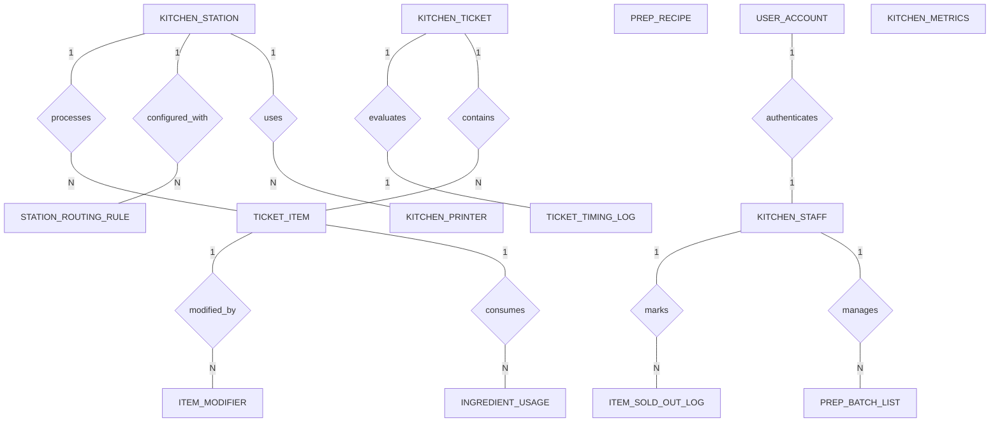

# Conceptual ERD — Kitchen Order Management System

## Mermaid Code

## Entity Description Table | Bang mo ta Entity

| # | Entity Name | Vietnamese Name | Description | Key Attributes | Main Relationships |
|---|-------------|-----------------|-------------|----------------|-------------------|
| 1 | KITCHEN_TICKET | Phieu don hang bep | Central kitchen ticket record parsed from POS/online orders, tracking table number, arrival time, and bump completion time. | ticket_id, pos_order_ref, table_number, order_type, received_at, bumped_at, ticket_status | One-to-Many with TICKET_ITEM; One-to-One with TICKET_TIMING_LOG |
| 2 | TICKET_ITEM | Mon an tren phieu | Line item on a kitchen ticket routed to a specific station KDS, tracking prep start/ready timestamps and status. | ticket_item_id, ticket_id, station_id, item_name, quantity, prep_status | Belongs to KITCHEN_TICKET, KITCHEN_STATION; One-to-Many with ITEM_MODIFIER, INGREDIENT_USAGE |
| 3 | KITCHEN_STATION | Tram bep che bien | Defines kitchen prep stations (Grill, Saute, Fryer, Cold Pantry, Bar) with network IP bindings and SLA thresholds. | station_id, station_name, ip_address, warning_sla_seconds, critical_sla_seconds | One-to-Many with TICKET_ITEM, STATION_ROUTING_RULE, KITCHEN_PRINTER |
| 4 | STATION_ROUTING_RULE | Quy tac phan luong tram | Configures automatic dish-to-station routing patterns based on category codes and item name rules. | rule_id, station_id, menu_category_code, item_code_pattern | Belongs to KITCHEN_STATION |
| 5 | ITEM_MODIFIER | Ghi chu tuy chon mon | Stores dish customization specs (No Onions, Extra Sauce, Medium Rare) and flags allergy warnings. | modifier_id, ticket_item_id, modifier_name, is_allergy_alert | Belongs to TICKET_ITEM |
| 6 | PREP_RECIPE | Cong thuc & Huong dan | Holds digital recipe instructions, plating assembly photos, target prep durations, and allergen notices. | recipe_id, item_name, prep_instructions, target_prep_seconds | Standalone reference table |
| 7 | INGREDIENT_USAGE | Tieu hao nguyen lieu | Logs raw ingredient depletion records generated per prepared ticket item. | usage_id, ticket_item_id, ingredient_name, quantity_used | Belongs to TICKET_ITEM |
| 8 | KITCHEN_STAFF | Nhan vien nha bep | Represents kitchen team members, station role assignments (Expeditor, Grill Cook, Pantry Chef), and duty status. | staff_id, user_id, full_name, station_role | Belongs to USER_ACCOUNT; One-to-Many with ITEM_SOLD_OUT_LOG, PREP_BATCH_LIST |
| 9 | TICKET_TIMING_LOG | Nhat ky thoi gian don | Logs total ticket preparation duration and records whether target SLA thresholds were breached. | log_id, ticket_id, total_prep_duration, is_sla_breached | One-to-One with KITCHEN_TICKET |
| 10 | ITEM_SOLD_OUT_LOG | Nhat ky mon het 86ed | Logs out-of-stock "86ed" declarations made by kitchen staff, tracking item names, reasons, and timestamps. | sold_out_id, staff_id, item_name, reason, marked_at | Belongs to KITCHEN_STAFF |
| 11 | KITCHEN_PRINTER | May in nhiet nha bep | Manages ESC/POS network thermal print stations bound to KDS screens for physical chit printing and failover. | printer_id, station_id, printer_name, ip_address | Belongs to KITCHEN_STATION |
| 12 | PREP_BATCH_LIST | Danh sach so che bep | Tracks daily pre-shift batch prep tasks (cutting vegetables, preparing stocks) and completion progress. | batch_id, staff_id, prep_item_name, target_quantity, completed_quantity | Belongs to KITCHEN_STAFF |
| 13 | USER_ACCOUNT | Tai khoan he thong | Holds login credentials and security role definitions (Station Cook, Head Chef, Kitchen Manager, Admin). | user_id, username, password_hash, role_name | One-to-One with KITCHEN_STAFF |
| 14 | KITCHEN_METRICS | Thong ke hieu suat bep | Aggregates daily performance statistics including total tickets processed, average prep time, and SLA breach rates. | metric_id, metric_date, total_tickets_handled, avg_ticket_duration, total_sla_breaches | Aggregated metrics table |

## Relationship Description | Mo ta Quan he

| # | From Entity | Cardinality | To Entity | Relationship Label | Business Explanation |
|---|-------------|-------------|-----------|-------------------|----------------------|
| 1 | USER_ACCOUNT | One-to-One | KITCHEN_STAFF | authenticates | Tai khoan he thong xac thuc va phan quyen cho nhan vien bep. |
| 2 | KITCHEN_STATION | One-to-Many | TICKET_ITEM | processes | Mot tram bep (Grill KDS) su ly nhieu mon an tren cac phieu duoc phan luong den. |
| 3 | KITCHEN_STATION | One-to-Many | STATION_ROUTING_RULE | configured_with | Mot tram bep duoc thiet lap nhieu quy tac phan luong mon an tuong ung. |
| 4 | KITCHEN_STATION | One-to-Many | KITCHEN_PRINTER | uses | Mot tram bep duoc ket noi voi mot hoac nhieu may in nhiet de in phieu du phong. |
| 5 | KITCHEN_TICKET | One-to-Many | TICKET_ITEM | contains | Mot phieu don hang bep chua nhieu mon an va do uong can che bien. |
| 6 | KITCHEN_TICKET | One-to-One | TICKET_TIMING_LOG | evaluates | Mot phieu don hang bep duoc ghi nhan va danh gia thoi gian che bien bang mot nhat ky SLA. |
| 7 | TICKET_ITEM | One-to-Many | ITEM_MODIFIER | modified_by | Mot mon an tren phieu co the co nhieu ghi chu tuy chon (Vi du: Khong hanh, Chin toi). |
| 8 | TICKET_ITEM | One-to-Many | INGREDIENT_USAGE | consumes | Mot mon an che bien xong tieu hao cac dinh muc nguyen lieu tuong ung. |
| 9 | KITCHEN_STAFF | One-to-Many | ITEM_SOLD_OUT_LOG | marks | Nhan vien bep ghi nhan cac luot bao het mon (86ed) vao nhat ky theo thoi gian. |
| 10 | KITCHEN_STAFF | One-to-Many | PREP_BATCH_LIST | manages | Nhan vien bep duoc phan cong quan ly va cap nhat tien do danh sach so che nguyen lieu truoc ca. |
