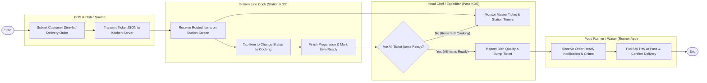

# Swimlane Diagram — Kitchen Order Management System

## Mermaid Code

## Flow Description | Mo ta luong

| Lane | Actor | Role in Flow |
|------|-------|-------------|
| **Lane 1** | POS & Order Source | Submits customer food order from front-of-house POS or online delivery app, transmitting structured order JSON payloads to the kitchen network server. |
| **Lane 2** | Station Line Cook (Station KDS) | Receives parsed item cards at station displays (Grill, Saute, Pantry), updates cooking status (`In Cooking`), prepares dishes, and flags items `Ready`. |
| **Lane 3** | Head Chef / Expeditor (Pass KDS) | Monitors real-time station prep timers on master screen, identifies bottlenecks, verifies plated dish quality, and bumps completed tickets at pass counter. |
| **Lane 4** | Food Runner / Waiter (Runner App) | Receives automated food-ready chime alerts on runner station or handheld POS, picks up prepared trays from pass counter, and confirms delivery to guest table. |

### Process Execution Steps | Cac buoc thuc hien quy trinh

1. **Order Transmission & Routing**: POS System submits customer order (`P1`, `P2`). Kitchen Order Management System parses order JSON and dispatches items to station screens (`K1`) and master expeditor display (`E1`).
2. **Station Cooking Workflow**: Station Line Cook views routed items, taps item to set status to `In Cooking` (`K2`), cooks according to specs, and taps `Ready` (`K3`).
3. **Expeditor Quality Check Loop**: Expeditor evaluates master ticket readiness status (`E2`).
   - If **No**: System displays pending items in yellow/red on master screen while cook finishes (`E1`).
   - If **Yes**: Head Chef inspects assembled dishes at pass counter, verifies order accuracy, and bumps ticket (`E3`).
4. **Food Dispatch & Delivery**: Bumping ticket triggers runner ready chime and mobile alert (`R1`). Food Runner picks up food tray at pass counter, confirms pickup (`R2`), and delivers meal to guest table, ending the kitchen process (`Finish`).
