# Action Tree — Kitchen Order Management System

## Mermaid Code

```mermaid
graph TD
    Root["Kitchen Order Management System"]

    Root --> M1["Ticket Ingestion & Station Routing"]
    Root --> M2["KDS Display & Ticket Card Operations"]
    Root --> M3["Prep Workflow & SLA Timer Tracking"]
    Root --> M4["Expedite Pass & Food Runner Dispatch"]
    Root --> M5["Item Availability & 86ing Control"]
    Root --> M6["Recipe Guides & Batch Preparation"]
    Root --> M7["Kitchen Analytics & KDS Administration"]

    M1 --> A11["Parse POS & Online Order Payloads"]
    M1 --> A12["Route Items to Station KDS Screens"]
    M1 --> A13["Handle Item Void & Mod Notifications"]
    M1 --> A14["Dispatch Failover Thermal Print Jobs"]

    M2 --> A21["Render Interactive Ticket Cards"]
    M2 --> A22["Consolidate All-Day Item Quantities"]
    M2 --> A23["Filter Ticket Cards by Station"]
    M2 --> A24["Toggle Card Layout & Font Scale"]

    M3 --> A31["Update Cooking Status In-Cooking/Ready"]
    M3 --> A32["Track Real-Time Station SLA Timers"]
    M3 --> A33["Highlight Overdue Red SLA Breaches"]
    M3 --> A34["Pause Order Timers on Hold"]

    M4 --> A41["Prioritize VIP & Rush Tickets"]
    M4 --> A42["Bump Completed Master Tickets"]
    M4 --> A43["Recall Recently Bumped Tickets"]
    M4 --> A44["Dispatch Chime Alerts to Food Runners"]

    M5 --> A51["Mark Item Sold Out 86ed"]
    M5 --> A52["Propagate 86 Lock to POS & Apps"]
    M5 --> A53["Restore Item Stock Availability"]
    M5 --> A54["Audit Kitchen Waste & Spoilage"]

    M6 --> A61["View Digital Recipe Plating Guides"]
    M6 --> A62["Display Allergen & Dietary Alerts"]
    M6 --> A63["Generate Daily Shift Prep Lists"]
    M6 --> A64["Track Pre-Shift Batch Cooking"]

    M7 --> A71["Analyze Average Ticket Prep Speed"]
    M7 --> A72["Identify Station Bottleneck Logs"]
    M7 --> A73["Configure Station Routing Rules"]
    M7 --> A74["Manage KDS IP Network Devices"]
```

## Module Description | Mo ta Module

| # | Module | Description | Actions |
|---|--------|-------------|---------|
| 1 | Ticket Ingestion & Station Routing | Ingests incoming orders from POS terminals and online delivery channels, parses item categories, routes items to designated station screens, handles void alerts, and manages print failovers. | Parse POS & Online Order Payloads, Route Items to Station KDS Screens, Handle Item Void & Mod Notifications, Dispatch Failover Thermal Print Jobs |
| 2 | KDS Display & Ticket Card Operations | Renders interactive digital ticket cards, consolidates all-day item counts across tickets, filters view by station role, and adjusts screen card layouts and font sizes. | Render Interactive Ticket Cards, Consolidate All-Day Item Quantities, Filter Ticket Cards by Station, Toggle Card Layout & Font Scale |
| 3 | Prep Workflow & SLA Timer Tracking | Manages line cook prep status transitions (`New` -> `In Cooking` -> `Ready`), tracks station prep SLA timers, highlights overdue ticket breaches in red, and handles held order timers. | Update Cooking Status In-Cooking/Ready, Track Real-Time Station SLA Timers, Highlight Overdue Red SLA Breaches, Pause Order Timers on Hold |
| 4 | Expedite Pass & Food Runner Dispatch | Enables Head Chef expeditor to reprioritize orders, bump completed tickets from screen, recall accidentally cleared cards, and trigger runner food pickup chimes. | Prioritize VIP & Rush Tickets, Bump Completed Master Tickets, Recall Recently Bumped Tickets, Dispatch Chime Alerts to Food Runners |
| 5 | Item Availability & 86ing Control | Allows kitchen staff to mark ingredients or dishes as sold out ("86ed"), propagating instant stock locks to POS terminals and delivery apps, and tracking kitchen waste logs. | Mark Item Sold Out 86ed, Propagate 86 Lock to POS & Apps, Restore Item Stock Availability, Audit Kitchen Waste & Spoilage |
| 6 | Recipe Guides & Batch Preparation | Displays step-by-step cooking instructions, plating photos, allergen warnings, daily pre-shift batch prep checklists, and batch progress tracking. | View Digital Recipe Plating Guides, Display Allergen & Dietary Alerts, Generate Daily Shift Prep Lists, Track Pre-Shift Batch Cooking |
| 7 | Kitchen Analytics & KDS Administration | Provides analytical reporting on ticket fulfillment speed, station bottlenecks, prep SLA compliance rates, station routing rule configurations, and KDS hardware network setups. | Analyze Average Ticket Prep Speed, Identify Station Bottleneck Logs, Configure Station Routing Rules, Manage KDS IP Network Devices |
