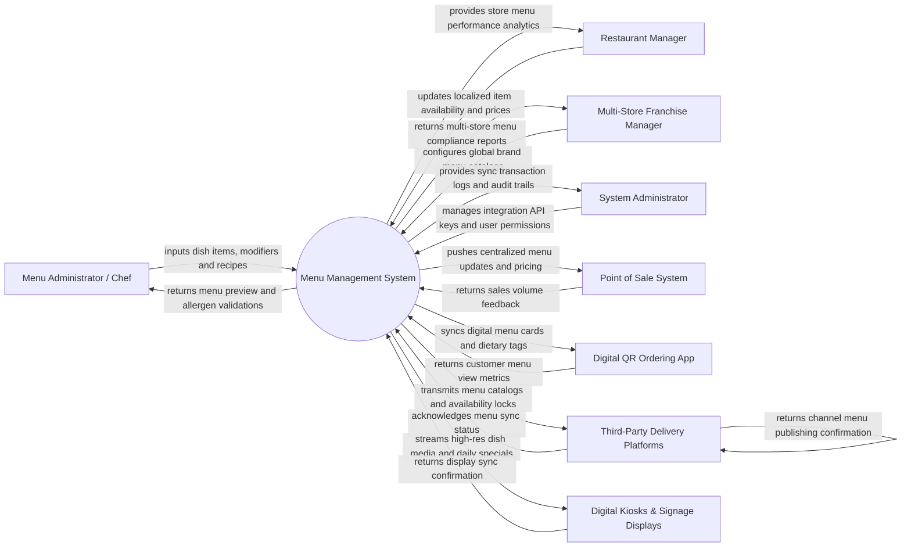

# Context Diagram — Menu Management System

## Mermaid Code

## Actor & Interaction Table | Bang Actor & Tuong tac

| # | Actor | Actor Type | Data Sent TO System | Data Received FROM System | Notes |
|---|-------|------------|---------------------|---------------------------|-------|
| 1 | Menu Administrator / Chef | Primary | Dish descriptions, pricing strategies, modifier options, recipe pairings, dietary tags | Visual menu preview, allergen warnings, missing pricing alerts | Configures dish creation, modifier groups, and culinary specifications. |
| 2 | Restaurant Manager | Primary | Localized item 86ing, store-level price overrides, operating hours | Store active menu catalog, sales contribution reports, stockout alerts | Manages day-to-day item availability and local store pricing rules. |
| 3 | Multi-Store Franchise Manager | Primary | Master brand catalogs, regional pricing tiers, mandatory core dishes | Franchise menu compliance reports, cross-store item velocity metrics | Oversees multi-unit franchise menu consistency and regional variations. |
| 4 | System Administrator | Primary | User credentials, security roles, API integration keys, system backup parameters | Omnichannel sync logs, API error alerts, security audit trails | Manages platform infrastructure and API connection credentials. |
| 5 | Point of Sale (POS) System | Supporting | Sales transaction item volume, raw cashier feedback | Centralized menu structure, price matrix, modifier rules, PLU codes | Integrates via REST or WebSocket to receive instantaneous menu syncs. |
| 6 | Digital QR Ordering App | Supporting | Customer menu view logs, search queries | Live digital menu catalogs, dietary filters, high-res photos, combo options | Mobile web and app guest ordering interfaces. |
| 7 | Third-Party Delivery Platforms | Supporting | Channel sync acknowledgments, platform publishing statuses | Channel-specific menus, delivery pricing markups, item stockout locks | Integrates with platforms like GrabFood, Foodpanda, UberEats via APIs. |
| 8 | Digital Kiosks & Signage Displays | Supporting | Display sync acknowledgments, screen telemetry status | High-definition dish photos, promotional videos, dayparting menus | Self-service ordering kiosks and digital overhead menu boards. |

## System Boundary Description | Mo ta Pham vi He thong

The **Menu Management System** serves as the single source of truth for restaurant menu engineering, multi-channel pricing, modifier group configurations, and omnichannel catalog synchronization. Inside its boundary, the system handles menu category structuring, item pricing matrices, daypart schedule automation (Breakfast/Lunch/Dinner), combo meal bundle rules, nutritional and allergen tagging, multilingual translations, and instant menu distribution to POS, QR apps, delivery APIs, and digital signage.

The system boundary excludes actual order transaction processing and cash collection (handled by POS Systems), physical kitchen preparation (handled by Kitchen Order Management Systems), and direct third-party delivery rider dispatching (handled by Delivery Platforms).
