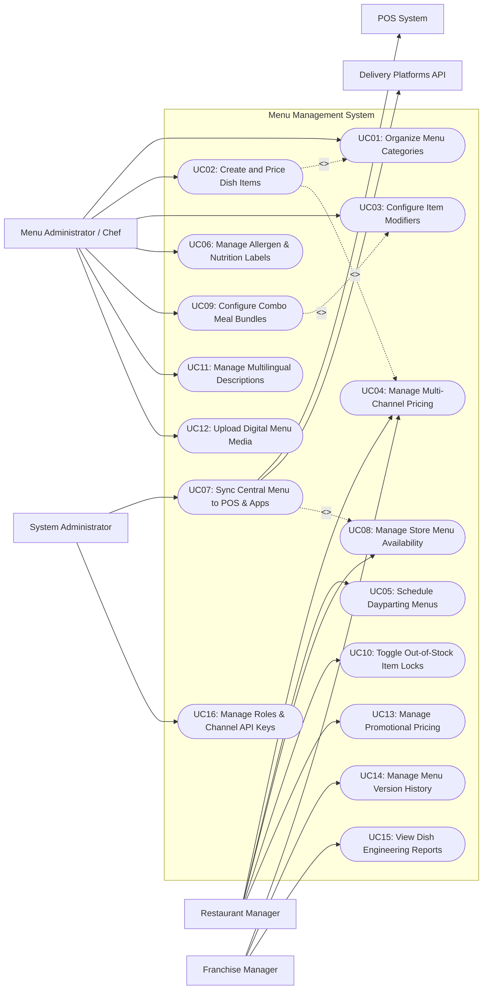

# Use Case Diagram — Menu Management System

## Mermaid Code

## Actor Table | Bang Actor

| # | Actor | Actor Type | Role Description | Related Use Cases |
|---|-------|------------|------------------|-------------------|
| 1 | Menu Administrator / Chef | Primary | Culinary lead responsible for defining dish concepts, categorizing menus, creating modifier groups, setting nutritional tags, and uploading dish photos. | UC01, UC02, UC03, UC06, UC09, UC11, UC12 |
| 2 | Restaurant Manager | Primary | Store manager configuring location pricing overrides, setting dayparting schedules, toggling 86ed items, and applying promotional discounts. | UC04, UC05, UC08, UC10, UC13 |
| 3 | Franchise Manager | Primary | Corporate brand manager maintaining master brand catalog integrity across multi-unit franchise stores, tracking version history, and analyzing dish margin performance. | UC04, UC14, UC15 |
| 4 | System Administrator | Primary | Technical admin managing channel API integrations, user role permissions, system configuration settings, and omnichannel sync triggers. | UC07, UC16 |
| 5 | Point of Sale (POS) System | Secondary System | Internal sales client receiving automated menu catalog updates, PLU mappings, price matrices, and modifier specifications. | UC07 |
| 6 | Delivery Platforms API | Secondary System | External third-party food delivery aggregators (GrabFood, Foodpanda, UberEats) receiving channel-specific menu catalog feeds and stockout locks. | UC07 |

## Use Case Table | Bang Use Case

| # | UC ID | Use Case Name | Primary Actor | Secondary Actor | Description | Priority |
|---|-------|---------------|---------------|-----------------|-------------|----------|
| 1 | UC01 | Organize Menu Categories | Menu Administrator | None | Creates logical menu sections (Appetizers, Mains, Drinks, Desserts) and configures display sort order. | High |
| 2 | UC02 | Create and Price Dish Items | Menu Administrator | None | Defines dish master records, item codes, base prices, tax rates, dish descriptions, and kitchen station tags. | High |
| 3 | UC03 | Configure Item Modifiers | Menu Administrator | None | Builds option groups (e.g., Meat Temperature, Side Options, Extra Toppings) with min/max selection rules. | High |
| 4 | UC04 | Manage Multi-Channel Pricing | Restaurant Manager | POS / Delivery API | Sets differential pricing matrices for Dine-In, Takeout, Drive-Thru, and Third-Party Delivery platforms. | High |
| 5 | UC05 | Schedule Dayparting Menus | Restaurant Manager | None | Sets time-based menu availability schedules (e.g., Breakfast 06:00-10:30, Lunch 11:00-14:00, Late Night). | High |
| 6 | UC06 | Manage Allergen & Nutrition Labels | Menu Administrator | None | Tags dishes with allergen warnings (Gluten, Nuts, Dairy) and caloric/nutritional specs for regulatory compliance. | Medium |
| 7 | UC07 | Sync Central Menu to POS & Apps | System Administrator | POS / Delivery API | Distributes centralized menu changes across all sales channels (POS, Mobile App, Web, Kiosks, Delivery APIs). | High |
| 8 | UC08 | Manage Store Menu Availability | Restaurant Manager | None | Enables or disables specific menu items or categories per store location based on local inventory. | High |
| 9 | UC09 | Configure Combo Meal Bundles | Menu Administrator | None | Builds multi-item combo deals (e.g., Burger + Fries + Drink) with bundle pricing and component choices. | High |
| 10 | UC10 | Toggle Out-of-Stock Item Locks | Restaurant Manager | Delivery API | Instantly flags sold-out items ("86ed"), locking item ordering across POS terminals and online apps. | High |
| 11 | UC11 | Manage Multilingual Descriptions | Menu Administrator | None | Translates dish names, descriptions, and modifier choices into multiple languages (English, Vietnamese, Chinese). | Medium |
| 12 | UC12 | Upload Digital Menu Media | Menu Administrator | None | Uploads high-resolution food photography, video assets, and digital signage banner graphics. | Medium |
| 13 | UC13 | Manage Promotional Pricing | Restaurant Manager | None | Configures Happy Hour discounts, seasonal promotions, percentage markdowns, and promo code eligibility. | Medium |
| 14 | UC14 | Manage Menu Version History | Franchise Manager | None | Tracks historical catalog revisions, audit logs, and allows one-click rollback to prior menu versions. | Medium |
| 15 | UC15 | View Dish Engineering Reports | Franchise Manager | None | Analyzes menu item profitability matrices (Stars, Workhorses, Puzzles, Dogs) using sales and cost data. | High |
| 16 | UC16 | Manage Roles & Channel API Keys | System Administrator | None | Configures user security access roles, channel integration API tokens, and webhook sync subscriptions. | High |

## Use Case Specification | Dac ta Use Case

---

### UC02 — Create and Price Dish Items

| Field | Detail |
|-------|--------|
| **UC ID** | UC02 |
| **Use Case Name** | Create and Price Dish Items |
| **Actor(s)** | Primary: Menu Administrator / Chef   Secondary: None |
| **Description** | Allows a menu administrator to create new dish master records, configure SKU/PLU codes, assign categories, set base pricing, define VAT tax groups, and attach kitchen station routing tags. |
| **Precondition** | 1. User is logged in with Menu Administrator privileges.   2. Target menu categories (UC01) are defined in the system. |
| **Main Flow** | 1. Menu Administrator accesses Dish Catalog module and clicks "Create New Dish".   2. Administrator enters dish master details: Dish Name, Internal PLU Code, Short Description, and assigns primary Category (e.g., Main Course).   3. Administrator sets Base Selling Price (e.g., $15.00) and selects applicable Tax Category (e.g., Standard VAT 8%).   4. Administrator selects assigned Kitchen Routing Station (e.g., Hot Kitchen / Grill) for KDS ticket dispatch.   5. Administrator attaches relevant Modifier Option Groups (e.g., Cooking Temp, Side Choice) (executing UC03).   6. Administrator clicks "Save Dish Item".   7. System validates PLU uniqueness, price formatting, and mandatory fields.   8. System saves dish record in `Draft` or `Active` state and generates a unique Dish Item ID. |
| **Alternative Flow** | **AF1** — Duplicate existing dish template:   1. At step 1, Administrator selects an existing dish (e.g., Cheeseburger) and clicks "Duplicate as Template".   2. System copies all category, modifier, and tax settings to a new draft item screen.   3. Administrator modifies dish name to "Double Cheeseburger", updates price, and saves (steps 6-8). |
| **Exception Flow** | **EX1** — Duplicate PLU Code error:   1. At step 7, System detects the entered PLU code is already assigned to another active dish.   2. System displays error message "PLU Code 1004 is already in use" and highlights the field for correction. |
| **Postcondition** | New dish item is recorded in the menu database and made available for channel pricing configuration. |
| **Business Rule** | **BR1**: Every dish item must be bound to at least one valid menu category and tax code before publishing.   **BR2**: PLU codes must be globally unique across the entire brand enterprise. |

---

### UC04 — Manage Multi-Channel Pricing

| Field | Detail |
|-------|--------|
| **UC ID** | UC04 |
| **Use Case Name** | Manage Multi-Channel Pricing |
| **Actor(s)** | Primary: Restaurant Manager / Franchise Manager   Secondary: POS System, Delivery Platforms API |
| **Description** | Enables managers to define differential price matrices and markup rules for specific sales channels (Dine-In, Takeout, Room Service, GrabFood, Foodpanda, UberEats). |
| **Precondition** | 1. Dish items (UC02) are active in the catalog.   2. Sales channels and store location profiles are configured. |
| **Main Flow** | 1. Manager opens Multi-Channel Pricing Matrix module on dashboard.   2. Manager selects target store location or franchise region.   3. System displays grid containing dish catalog items, base prices, and channel pricing columns (Dine-In, Takeout, GrabFood, Foodpanda).   4. Manager defines specific channel prices directly (e.g., Base Dine-In Price: $10.00; GrabFood Price: $12.50).   5. Alternatively, Manager sets automated channel markup rules (e.g., "Apply +15% automated markup for all Third-Party Delivery Channels").   6. System calculates and previews updated price matrix across all channels.   7. Manager clicks "Publish Price Matrix".   8. System validates price rules and dispatches updated channel pricing to POS terminals and delivery platform APIs (executing UC07). |
| **Alternative Flow** | **AF1** — Store-level price override:   1. Store Manager at Airport Branch needs higher prices due to local rent overhead.   2. Manager selects "Store Price Override", inputs custom price adjustments for Airport Branch only, and submits for regional manager approval.   3. Regional Manager approves override; System updates store price matrix. |
| **Exception Flow** | **EX1** — Delivery API price markup violation:   1. At step 7, System detects a channel price exceeds third-party delivery platform maximum markup cap (e.g., markup > 30%).   2. System flags warning alert "Price markup for UberEats exceeds platform contract threshold" and requires manager confirmation. |
| **Postcondition** | Channel-specific price matrices are active in database and synchronized to channel endpoints. |
| **Business Rule** | **BR1**: Delivery channel prices must automatically include channel-specific packaging fees if configured in channel policy settings.   **BR2**: Store-level price overrides override brand base prices but cannot violate corporate minimum margin floors. |

---

### UC05 — Schedule Dayparting Menus

| Field | Detail |
|-------|--------|
| **UC ID** | UC05 |
| **Use Case Name** | Schedule Dayparting Menus |
| **Actor(s)** | Primary: Restaurant Manager   Secondary: None |
| **Description** | Configures time-based menu availability rules (Breakfast, Lunch, Dinner, Late Night) that automatically switch visible menu categories and items on POS terminals and online apps based on time of day. |
| **Precondition** | 1. Menu categories and dish items exist in catalog.   2. System server time is synchronized via NTP. |
| **Main Flow** | 1. Manager opens Dayparting Schedule module on menu dashboard.   2. Manager clicks "Create Daypart Schedule" and names the daypart (e.g., "Breakfast Menu").   3. Manager defines operating time window (e.g., Monday to Sunday, 06:00 to 10:30 AM).   4. Manager assigns eligible menu categories and dish items to the daypart (e.g., Pancakes, Omelettes, Coffee).   5. Manager configures transition rules (e.g., "Switch automatically at 10:30 AM; allow 10-minute grace period for pending carts").   6. Manager clicks "Save and Activate Daypart".   7. System stores daypart schedule rules and pushes schedule automation triggers to POS client terminals and online web/app ordering endpoints.   8. At 10:30 AM daily, System automatically hides Breakfast category and displays Lunch menu across all Ordering channels. |
| **Alternative Flow** | **AF1** — Weekend special daypart schedule:   1. Manager creates a "Weekend Brunch" daypart operating exclusively Saturday and Sunday from 08:00 AM to 03:00 PM.   2. System overrides standard weekday lunch schedule on weekends automatically. |
| **Exception Flow** | **EX1** — Overlapping daypart schedule conflict:   1. At step 6, System detects two active daypart schedules with conflicting time ranges containing mutually exclusive menu items.   2. System displays conflict error "Schedule overlaps with Lunch Daypart (11:00 AM)" and prompts Manager to adjust time boundaries. |
| **Postcondition** | Daypart schedule is stored, and automatic time-based menu switching executes at specified schedule boundaries. |
| **Business Rule** | **BR1**: When a daypart ends, items exclusive to that daypart cannot be ordered, but active customer checkout carts initiated prior to cutoff are granted a 10-minute grace period.   **BR2**: POS terminals must support offline daypart switching using local client hardware time if network disconnects. |

---

### UC07 — Sync Central Menu to POS & Apps

| Field | Detail |
|-------|--------|
| **UC ID** | UC07 |
| **Use Case Name** | Sync Central Menu to POS & Apps |
| **Actor(s)** | Primary: System Administrator   Secondary: POS System, Delivery Platforms API |
| **Description** | Distributes updated master menu catalogs, pricing matrices, modifier groups, and availability states from the central menu database to all POS client terminals, mobile apps, kiosks, and third-party delivery APIs. |
| **Precondition** | 1. Menu updates (items, prices, dayparts) are saved in `Published` status.   2. Target POS terminals and channel API webhooks are registered. |
| **Main Flow** | 1. System Administrator initiates "Publish Omnichannel Sync" (or System triggers automated scheduled sync).   2. System compiles published menu delta payload (JSON schema) containing updated categories, items, PLUs, prices, modifiers, and media URLs.   3. System broadcasts menu update payload to registered internal clients (POS terminals, Self-Service Kiosks, Digital Signage).   4. Internal client endpoints receive payload, update local cache, and send HTTP 200 Success acknowledgment to System.   5. System serializes channel-specific payloads for external delivery platform APIs (GrabFood, Foodpanda, UberEats).   6. System calls third-party delivery partner Menu Integration APIs to push catalog updates.   7. Delivery platform APIs validate payload and return publishing status response (`Published / Success`).   8. System logs sync completion timestamp, target endpoint counts, and overall status `Sync Completed`. |
| **Alternative Flow** | **AF1** — Emergency instant item 86 sync:   1. Restaurant Manager marks an item as sold out (UC10).   2. System bypasses full catalog rebuild and dispatches a high-priority lightweight item status update payload to all endpoints within 2 seconds. |
| **Exception Flow** | **EX1** — Third-Party Delivery API sync failure:   1. At step 6, Foodpanda API returns `503 Service Unavailable / Timeout`.   2. System logs API sync failure, displays warning badge on admin dashboard "Foodpanda Menu Sync Failed", and queues automated retry every 5 minutes (up to 3 attempts). |
| **Postcondition** | Master menu updates are published and active across all connected POS terminals and digital ordering channels. |
| **Business Rule** | **BR1**: Full menu catalog syncs to POS terminals must complete within 5 seconds over local network.   **BR2**: High-priority item stockout locks (86ing) must propagate to all external delivery APIs within 10 seconds. |

---

### UC09 — Configure Combo Meal Bundles

| Field | Detail |
|-------|--------|
| **UC ID** | UC09 |
| **Use Case Name** | Configure Combo Meal Bundles |
| **Actor(s)** | Primary: Menu Administrator / Chef   Secondary: None |
| **Description** | Builds structured combo meal packages (e.g., Value Meal: Main Dish + Side Item + Beverage) with component selection groups, up-charge pricing rules, and bundle discount logic. |
| **Precondition** | 1. Standalone menu items (Burgers, Fries, Drinks) exist in catalog.   2. Combo bundle module is accessible. |
| **Main Flow** | 1. Menu Administrator clicks "Create New Combo Meal".   2. Administrator enters combo name (e.g., "Burger Deluxe Combo"), PLU code, base combo price (e.g., $12.00), and savings highlight text.   3. Administrator defines Component Selection Step 1: "Choose Main Dish" (e.g., Cheeseburger, Chicken Sandwich).   4. Administrator defines Component Selection Step 2: "Choose Side" (e.g., Small Fries, Side Salad; add +$1.00 up-charge for Large Fries).   5. Administrator defines Component Selection Step 3: "Choose Beverage" (e.g., Soft Drink, Iced Tea; add +$1.50 up-charge for Milkshake).   6. Administrator configures combo routing logic (splits items to respective Kitchen Stations: Burger -> Grill; Fries -> Fryer; Drink -> Bar).   7. Administrator clicks "Save Combo Bundle".   8. System validates component availability, calculates bundle margin, and saves combo meal record in catalog. |
| **Alternative Flow** | **AF1** — Fixed items combo meal:   1. At step 3, Administrator creates a fixed combo meal (e.g., "Family Feast: 2 Large Pizzas + 10 Wings + 2L Soda") with no guest component choices.   2. System locks combo items as a single fixed bundle. |
| **Exception Flow** | **EX1** — Combo component item deleted:   1. If an administrator attempts to delete a standalone dish that is part of an active combo meal, System blocks deletion.   2. System displays alert "Cannot delete item: Cheeseburger is used in 3 active Combo Bundles. Remove from combos first." |
| **Postcondition** | Combo meal bundle is created, component choices and up-charges are configured, and routing logic is saved. |
| **Business Rule** | **BR1**: Combo meal base price must be less than or equal to the sum of individual standalone item base prices.   **BR2**: When an individual dish component is marked sold out (86ed), any combo bundle relying on that component must automatically disable that choice option. |
