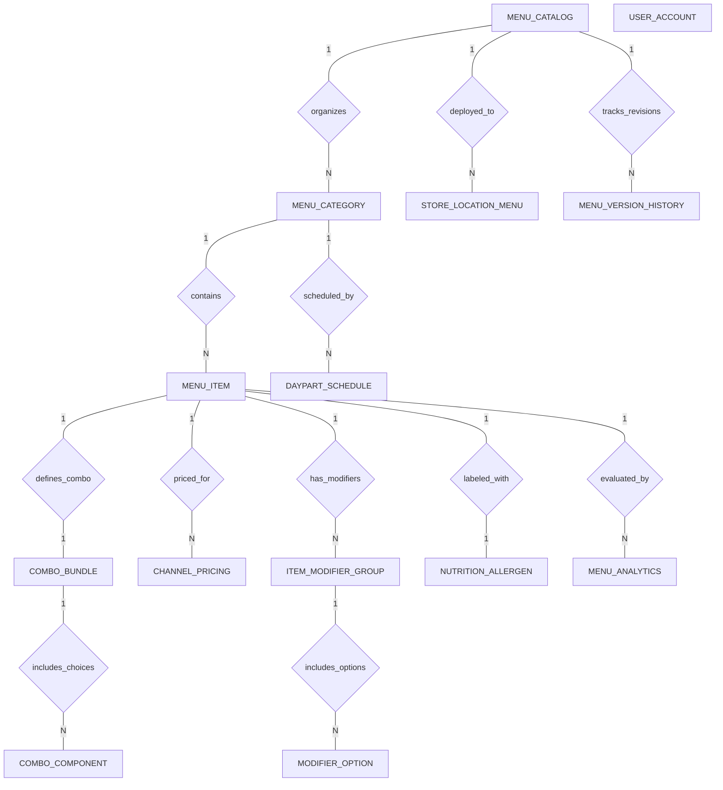

# Conceptual ERD — Menu Management System

## Mermaid Code

## Entity Description Table | Bang mo ta Entity

| # | Entity Name | Vietnamese Name | Description | Key Attributes | Main Relationships |
|---|-------------|-----------------|-------------|----------------|-------------------|
| 1 | MENU_CATALOG | Danh muc thuc don goc | Master brand catalog container organizing categories, items, and global pricing strategy. | catalog_id, catalog_name, brand_code, version_number, is_active | One-to-Many with MENU_CATEGORY, STORE_LOCATION_MENU, MENU_VERSION_HISTORY |
| 2 | MENU_CATEGORY | Nhom mon thuc don | Logical section groupings (Appetizers, Main Course, Drinks, Desserts) with display sort orders. | category_id, catalog_id, category_name, display_order | Belongs to MENU_CATALOG; One-to-Many with MENU_ITEM, DAYPART_SCHEDULE |
| 3 | MENU_ITEM | Mon an thuc don | Individual dish/beverage master records, PLU codes, base prices, descriptions, and availability. | item_id, category_id, plu_code, item_name, base_price, is_available | Belongs to MENU_CATEGORY; One-to-Many with ITEM_MODIFIER_GROUP, CHANNEL_PRICING, MENU_ANALYTICS; One-to-One with COMBO_BUNDLE, NUTRITION_ALLERGEN |
| 4 | ITEM_MODIFIER_GROUP | Nhom tuy chon / Gia vi | Option group definitions (e.g., Side Options, Meat Temp) specifying min/max selection rules. | group_id, item_id, group_name, min_selection, max_selection | Belongs to MENU_ITEM; One-to-Many with MODIFIER_OPTION |
| 5 | MODIFIER_OPTION | Chi tiet tuy chon | Specific selectable choices within a modifier group (e.g., Fries, Salad, Extra Cheese) and price deltas. | option_id, group_id, option_name, price_delta | Belongs to ITEM_MODIFIER_GROUP |
| 6 | CHANNEL_PRICING | Gia theo kenh ban | Differential price matrix records mapping items to sales channels (Dine-In, GrabFood, Foodpanda, Takeout). | pricing_id, item_id, sales_channel, channel_price, tax_rate | Belongs to MENU_ITEM |
| 7 | DAYPART_SCHEDULE | Lich thuc don theo ca | Time-based schedule rules controlling category and item availability by hour and day of week. | schedule_id, category_id, daypart_name, start_time, end_time | Belongs to MENU_CATEGORY |
| 8 | COMBO_BUNDLE | Gói mon Combo | Structuring entity for combo meal packages defining total bundle pricing and discount rules. | combo_id, item_id, combo_name, bundle_price | One-to-One with MENU_ITEM; One-to-Many with COMBO_COMPONENT |
| 9 | COMBO_COMPONENT | Mon thanh phan Combo | Individual choice choices within a combo meal step (e.g., Choice of Beverage) and up-charge pricing. | component_id, combo_id, target_item_id, step_number, upcharge_amount | Belongs to COMBO_BUNDLE |
| 10 | NUTRITION_ALLERGEN | Dinh duong & Di ung | Caloric specifications, dietary tags (Vegan, Halal), and mandatory allergen warning flags (Gluten, Nuts). | info_id, item_id, calories, contains_gluten, contains_nuts | One-to-One with MENU_ITEM |
| 11 | STORE_LOCATION_MENU | Thuc don theo cua hang | Store-specific deployment settings controlling location item availability toggles and local price overrides. | store_menu_id, catalog_id, store_id, is_item_enabled, local_price_override | Belongs to MENU_CATALOG |
| 12 | MENU_VERSION_HISTORY | Nhat ky phien ban | Historical audit log recording published catalog revisions, timestamps, and publisher user accounts. | version_id, catalog_id, version_tag, published_at | Belongs to MENU_CATALOG |
| 13 | USER_ACCOUNT | Tai khoan he thong | System login credentials and role definitions (Chef, Store Manager, Franchise Admin, System Admin). | user_id, username, password_hash, role_name | Standard user account reference |
| 14 | MENU_ANALYTICS | Thong ke thuc don | Aggregated daily metrics tracking dish views, sales volumes, gross revenue contribution, and margin class. | analytics_id, item_id, metric_date, view_count, sales_volume, gross_revenue | Belongs to MENU_ITEM |

## Relationship Description | Mo ta Quan he

| # | From Entity | Cardinality | To Entity | Relationship Label | Business Explanation |
|---|-------------|-------------|-----------|-------------------|----------------------|
| 1 | MENU_CATALOG | One-to-Many | MENU_CATEGORY | organizes | Danh muc thuc don goc chia thanh nhieu nhom mon thuc don (Appetizers, Mains, Drinks). |
| 2 | MENU_CATEGORY | One-to-Many | MENU_ITEM | contains | Mot nhom mon thuc don chua nhieu mon an va do uong cu the. |
| 3 | MENU_ITEM | One-to-Many | ITEM_MODIFIER_GROUP | has_modifiers | Mot mon an co the co nhieu nhom tuy chon (Vi du: Do chin thit, Mon an kem). |
| 4 | ITEM_MODIFIER_GROUP | One-to-Many | MODIFIER_OPTION | includes_options | Mot nhom tuy chon chua nhieu lua chon cu the voi chi phi cong/tru tuong ung. |
| 5 | MENU_ITEM | One-to-Many | CHANNEL_PRICING | priced_for | Mot mon an duoc thiet lap ma tran gia khac nhau cho cac kenh ban (Dine-In, Takeout, GrabFood). |
| 6 | MENU_CATEGORY | One-to-Many | DAYPART_SCHEDULE | scheduled_by | Mot nhom thuc don duoc thiet lap lich hien thi theo ca trong ngay (Sáng, Trua, Toi). |
| 7 | MENU_ITEM | One-to-One | COMBO_BUNDLE | defines_combo | Mot mon an loai Combo duoc dinh nghia cau truc goi qua bang Combo Bundle. |
| 8 | COMBO_BUNDLE | One-to-Many | COMBO_COMPONENT | includes_choices | Mot goi Combo bao gom nhieu buoc lua chon mon thanh phan (Mon chinh, Mon phu, Do uong). |
| 9 | MENU_ITEM | One-to-One | NUTRITION_ALLERGEN | labeled_with | Mot mon an duoc dinh kem thong tin dinh duong va canh bao di ung (Gluten, Hat, Sua). |
| 10 | MENU_CATALOG | One-to-Many | STORE_LOCATION_MENU | deployed_to | Danh muc thuc don goc duoc trien khai den nhieu chi nhanh voi tuy chinh gia dia phuong. |
| 11 | MENU_CATALOG | One-to-Many | MENU_VERSION_HISTORY | tracks_revisions | Danh muc thuc don goc duoc theo doi va ghi nhat ky qua cac phien ban xuat ban. |
| 12 | MENU_ITEM | One-to-Many | MENU_ANALYTICS | evaluated_by | Mot mon an duoc thong ke hieu suat ban hang va danh gia ti le loi nhuan dinh ky. |
