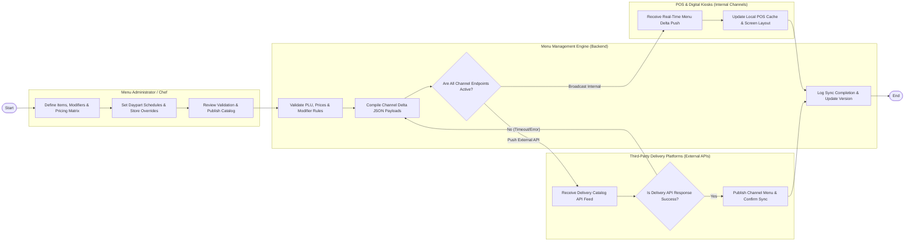

# Swimlane Diagram — Menu Management System

## Mermaid Code

## Flow Description | Mo ta luong

| Lane | Actor | Role in Flow |
|------|-------|-------------|
| **Lane 1** | Menu Administrator / Chef | Configures dish items, modifier groups, multi-channel pricing matrices, daypart schedules, store availability overrides, and publishes catalog updates. |
| **Lane 2** | Menu Management Engine | Validates PLU uniqueness and price rules, serializes channel-specific menu JSON payloads, dispatches sync payloads, and logs catalog version history. |
| **Lane 3** | POS & Digital Kiosks | Receives real-time menu delta pushes over local network, updates local memory caches, and updates cashier/kiosk screen displays. |
| **Lane 4** | Third-Party Delivery Platforms | Receives channel-specific catalog feeds via external integration webhooks, validates payload formats, and confirms online delivery menu publishing. |

### Process Execution Steps | Cac buoc thuc hien quy trinh

1. **Catalog Configuration & Pricing**: Menu Administrator defines dish items, PLU codes, modifier groups, and channel pricing matrices (`C1`). Administrator sets daypart schedules and store availability rules (`C2`).
2. **Validation & Payload Compilation**: Administrator clicks "Publish Catalog" (`C3`). Menu Management Engine validates PLU uniqueness and price boundaries (`S1`), compiling optimized channel JSON payloads (`S2`).
3. **Omnichannel Broadcast Decision**: Engine checks target endpoint channel types (`S3`).
   - For **Internal POS/Kiosks**: Engine pushes real-time delta via WebSocket (`P1`). POS updates local cache (`P2`).
   - For **External Delivery APIs**: Engine invokes third-party REST APIs (`D1`).
4. **External API Response Handling**: Delivery API evaluates catalog payload (`D2`).
   - If **No (Error/Timeout)**: Engine logs failure and triggers retry queue (`S2`).
   - If **Yes (Success)**: Delivery platform publishes menu (`D3`).
5. **Version Logging**: Engine logs final sync execution timestamp, updates active menu version tag (`S4`), and completes execution (`Finish`).
