# Action Tree — Menu Management System

## Mermaid Code

```mermaid
graph TD
    Root["Menu Management System"]

    Root --> M1["Menu Catalog & Item Management"]
    Root --> M2["Modifiers, Add-Ons & Combo Bundles"]
    Root --> M3["Multi-Channel & Dynamic Pricing"]
    Root --> M4["Dayparting & Schedule Automation"]
    Root --> M5["Nutritional, Allergen & Media Specs"]
    Root --> M6["Omnichannel Sync & Store Availability"]
    Root --> M7["Menu Analytics & Version Control"]

    M1 --> A11["Create & Structure Categories"]
    M1 --> A12["Define Dish Master Records & PLUs"]
    M1 --> A13["Set Kitchen Station Tags"]
    M1 --> A14["Manage Multilingual Translations"]

    M2 --> A21["Build Modifier Option Groups"]
    M2 --> A22["Set Min & Max Selection Rules"]
    M2 --> A23["Configure Combo Meal Packages"]
    M2 --> A24["Define Component Up-Charge Prices"]

    M3 --> A31["Configure Channel Price Matrices"]
    M3 --> A32["Set Store-Level Price Overrides"]
    M3 --> A33["Schedule Happy Hour Promotions"]
    M3 --> A34["Apply Dynamic Markup Rules"]

    M4 --> A41["Define Daypart Time Windows"]
    M4 --> A42["Assign Categories to Dayparts"]
    M4 --> A43["Configure Daypart Grace Periods"]
    M4 --> A44["Set Weekend Schedule Overrides"]

    M5 --> A51["Tag Allergen Warning Flags"]
    M5 --> A52["Record Caloric & Nutrition Data"]
    M5 --> A53["Upload High-Res Dish Photography"]
    M5 --> A54["Attach Digital Signage Media"]

    M6 --> A61["Broadcast Sync to POS Terminals"]
    M6 --> A62["Push Catalogs to Delivery APIs"]
    M6 --> A63["Toggle Store Item Stockout 86ing"]
    M6 --> A64["Manage Channel Integration Keys"]

    M7 --> A71["Analyze Dish Margin Engineering"]
    M7 --> A72["Track Sales Volume Contribution"]
    M7 --> A73["Manage Menu Version Revisions"]
    M7 --> A74["Audit Catalog Change Logs"]
```

## Module Description | Mo ta Module

| # | Module | Description | Actions |
|---|--------|-------------|---------|
| 1 | Menu Catalog & Item Management | Controls creation of menu categories, dish master items, unique PLU codes, kitchen station assignment tags, and multilingual text translations. | Create & Structure Categories, Define Dish Master Records & PLUs, Set Kitchen Station Tags, Manage Multilingual Translations |
| 2 | Modifiers, Add-Ons & Combo Bundles | Configures option groups (side options, cooking temperatures), selection boundary rules, combo meal package structures, and component up-charge pricing. | Build Modifier Option Groups, Set Min & Max Selection Rules, Configure Combo Meal Packages, Define Component Up-Charge Prices |
| 3 | Multi-Channel & Dynamic Pricing | Manages differential price matrices for sales channels (Dine-In, GrabFood, Foodpanda), store-level price overrides, Happy Hour discounts, and automated markups. | Configure Channel Price Matrices, Set Store-Level Price Overrides, Schedule Happy Hour Promotions, Apply Dynamic Markup Rules |
| 4 | Dayparting & Schedule Automation | Defines time-based menu availability windows (Breakfast, Lunch, Late Night), category scheduling, transition grace periods, and weekend schedule overrides. | Define Daypart Time Windows, Assign Categories to Dayparts, Configure Daypart Grace Periods, Set Weekend Schedule Overrides |
| 5 | Nutritional, Allergen & Media Specs | Tags mandatory allergen warnings (Gluten, Nuts), logs caloric specs, uploads high-resolution food photos, and attaches digital signage display media. | Tag Allergen Warning Flags, Record Caloric & Nutrition Data, Upload High-Res Dish Photography, Attach Digital Signage Media |
| 6 | Omnichannel Sync & Store Availability | Manages real-time catalog distribution to POS client terminals, external delivery platform API pushes, store-level 86ed stockout locks, and API key management. | Broadcast Sync to POS Terminals, Push Catalogs to Delivery APIs, Toggle Store Item Stockout 86ing, Manage Channel Integration Keys |
| 7 | Menu Analytics & Version Control | Provides menu engineering profitability analysis (Stars, Dogs, Workhorses), dish contribution metrics, catalog revision tracking, and audit change logs. | Analyze Dish Margin Engineering, Track Sales Volume Contribution, Manage Menu Version Revisions, Audit Catalog Change Logs |
