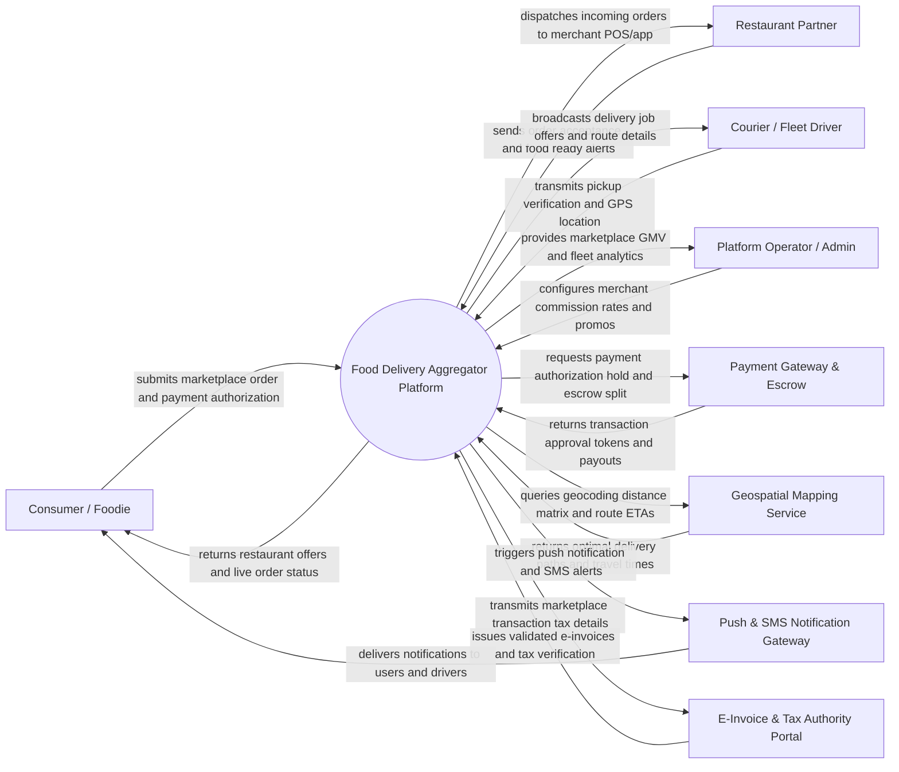

# Context Diagram — Food Delivery Aggregator Platform

## Mermaid Code

## Actor & Interaction Table | Bang Actor & Tuong tac

| # | Actor | Actor Type | Data Sent TO System | Data Received FROM System | Notes |
|---|-------|------------|---------------------|---------------------------|-------|
| 1 | Consumer / Foodie | Primary | Search queries, delivery addresses, food orders, payment details, ratings & reviews | Restaurant listings, live order status, real-time courier GPS tracking, digital receipts | Interacts via consumer mobile app (iOS/Android) or web marketplace portal. |
| 2 | Merchant | Primary | Menu items, prices, operating hours, order acceptance/rejection, prep completion alerts | Marketplace orders, courier ETA alerts, daily payout summaries | Interacts via merchant web dashboard, tablet app, or POS API integration. |
| 3 | Courier / Fleet Driver | Primary | Job acceptances, real-time GPS telemetry coordinates, food pickup proof, delivery PIN codes | Delivery job offers, navigation routes, pickup/drop-off details, wallet earnings | Uses driver mobile app for delivery logistics. |
| 4 | Platform Operator / Admin | Primary | Merchant onboarding approvals, commission structures, delivery surge rules, promo campaigns | Marketplace GMV reports, dispute logs, active fleet heatmaps, system health | Accesses central web administration and operations control tower. |
| 5 | Payment Gateway & Escrow | Supporting | Payment authorization status, charge success tokens, payout transfers | Payment charge holds, merchant/courier escrow split instructions | Handles online payment processing, split payouts, and refund execution. |
| 6 | Geospatial Mapping Service | Supporting | Geocoding data, route distance matrix, dynamic travel time predictions | Coordinate queries, address lookup requests, route optimization queries | Integrates with Google Maps API, Mapbox, or OpenStreetMap. |
| 7 | Push & SMS Notification Gateway | Supporting | Message delivery receipts, push token registrations | Push notification payloads, SMS templates, recipient contact numbers | Uses Firebase Cloud Messaging (FCM), Apple APNs, or Twilio SMS. |
| 8 | E-Invoice & Tax Authority Portal | Supporting | Validated tax invoice payloads, official tax verification codes | Marketplace sales transactions, platform commission data, VAT breakdowns | Ensures fiscal tax compliance for marketplace platform revenue. |

## System Boundary Description | Mo ta Pham vi He thong

The **Food Delivery Aggregator Platform** serves as a centralized multi-sided digital marketplace connecting consumers, independent restaurant merchants, and third-party delivery couriers. Inside its boundary, the system handles merchant onboarding, aggregated menu indexing, marketplace order placement, escrow payment splits, dynamic courier dispatch matching, real-time multi-stop GPS tracking, dispute resolution, and commission settlement.

The system boundary excludes physical food cooking (executed by restaurant kitchens), physical transit of meals (conducted by delivery drivers), raw payment clearing execution (delegated to external Payment Gateways), and map tile rendering (handled by third-party Geospatial Mapping Services).
