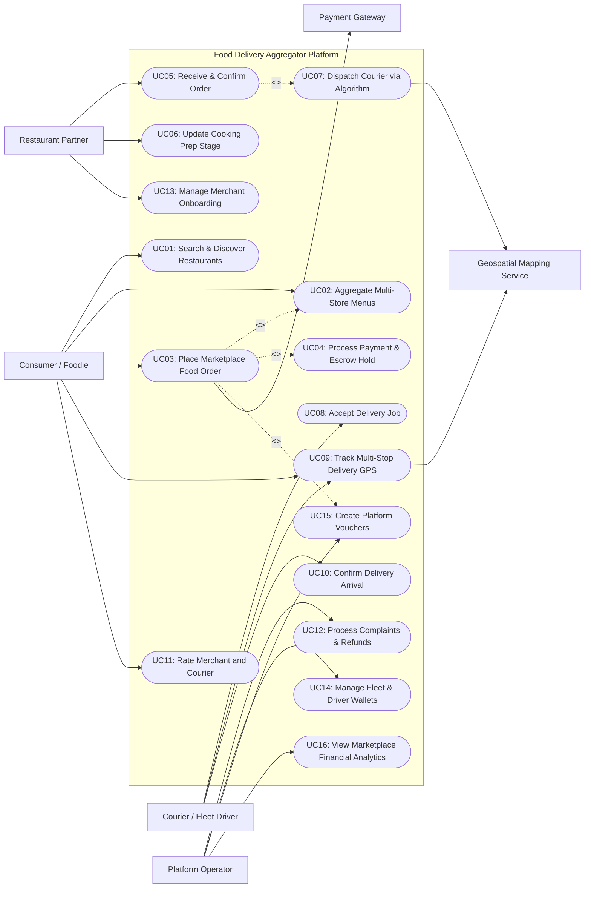

# Use Case Diagram — Food Delivery Aggregator Platform

## Mermaid Code

## Actor Table | Bang Actor

| # | Actor | Actor Type | Role Description | Related Use Cases |
|---|-------|------------|------------------|-------------------|
| 1 | Consumer / Foodie | Primary | End-user browsing restaurant merchants, adding dishes to cart, placing marketplace orders, tracking deliveries live, and reviewing experiences. | UC01, UC02, UC03, UC09, UC11 |
| 2 | Restaurant Partner | Primary | Restaurant merchant partner managing store profiles, receiving marketplace orders, preparing meals, and setting item availability. | UC05, UC06, UC13 |
| 3 | Courier / Fleet Driver | Primary | Independent gig driver receiving dispatch offers, picking up food orders from merchants, and completing deliveries. | UC08, UC09, UC10 |
| 4 | Platform Operator | Primary | Operations manager managing merchant onboarding approvals, fleet policies, dispute refunds, promotion vouchers, and marketplace analytics. | UC12, UC14, UC15, UC16 |
| 5 | Payment Gateway | Secondary System | Third-party payment provider holding customer funds in escrow and executing split payouts to merchants, drivers, and platform commission accounts. | UC03, UC04 |
| 6 | Geospatial Mapping Service | Secondary System | External mapping provider rendering interactive maps, calculating distance matrices, and estimating transit times. | UC07, UC09 |

## Use Case Table | Bang Use Case

| # | UC ID | Use Case Name | Primary Actor | Secondary Actor | Description | Priority |
|---|-------|---------------|---------------|-----------------|-------------|----------|
| 1 | UC01 | Search & Discover Restaurants | Consumer | Geospatial Mapping | Filters restaurant merchants by location radius, cuisine type, rating score, prep speed, and active promotions. | High |
| 2 | UC02 | Aggregate Multi-Store Menus | Consumer | None | Indexes and displays standardized digital menus, dish photos, modifier choices, and dietary tags across partner merchants. | High |
| 3 | UC03 | Place Marketplace Food Order | Consumer | Payment Gateway | Submits food cart, selects delivery destination, applies promotional codes, and authorizes escrow payment. | High |
| 4 | UC04 | Process Payment & Escrow Hold | Consumer | Payment Gateway | Pre-authorizes customer funds, holds money in escrow, and calculates merchant/courier/platform revenue splits. | High |
| 5 | UC05 | Receive & Confirm Order | Restaurant Partner | None | Transmits new marketplace order alerts to merchant POS/tablet and records estimated prep duration. | High |
| 6 | UC06 | Update Cooking Prep Stage | Restaurant Partner | None | Updates order stage (In Cooking, Food Ready) to notify dispatch algorithm and courier arrival timer. | Medium |
| 7 | UC07 | Dispatch Courier via Algorithm | System | Geospatial Mapping | Algorithmically selects top candidate courier based on GPS distance, vehicle type, and predicted cooking completion time. | High |
| 8 | UC08 | Accept Delivery Job | Courier | None | Displays delivery trip earnings, store pickup, and customer location to courier, who accepts or declines within 30 seconds. | High |
| 9 | UC09 | Track Multi-Stop Delivery GPS | Consumer | Geospatial Mapping | Renders live interactive map tracking courier GPS coordinates, multi-stop route progress, and dynamic arrival ETA. | High |
| 10 | UC10 | Confirm Delivery Arrival | Courier | None | Verifies food package handoff via PIN code or photo proof, marking order complete and releasing escrow funds. | High |
| 11 | UC11 | Rate Merchant and Courier | Consumer | None | Collects separate 1-5 star ratings and reviews for food quality (Merchant) and delivery service (Courier). | Medium |
| 12 | UC12 | Process Complaints & Refunds | Platform Operator | Payment Gateway | Investigates missing items, late deliveries, or damaged food complaints, issuing instant automated or manual refunds. | Medium |
| 13 | UC13 | Manage Merchant Onboarding | Restaurant Partner | None | Manages merchant application, business license verification, menu catalog upload, and store status toggles. | High |
| 14 | UC14 | Manage Fleet & Driver Wallets | Platform Operator | None | Manages courier driver registration, background checks, weekly payout runs, and earnings wallet withdrawals. | High |
| 15 | UC15 | Create Platform Vouchers | Platform Operator | None | Configures platform-funded discount vouchers, free delivery campaigns, merchant co-funded promotions, and minimum basket rules. | Medium |
| 16 | UC16 | View Marketplace Financial Analytics | Platform Operator | None | Displays Gross Merchandise Value (GMV), net platform commission revenue, order density heatmaps, and tax reports. | High |

## Use Case Specification | Dac ta Use Case

---

### UC03 — Place Marketplace Food Order

| Field | Detail |
|-------|--------|
| **UC ID** | UC03 |
| **Use Case Name** | Place Marketplace Food Order |
| **Actor(s)** | Primary: Consumer / Foodie   Secondary: Payment Gateway |
| **Description** | Allows a consumer to select dishes from a restaurant merchant menu, customize items, enter delivery location details, apply platform vouchers, and authorize an online payment hold. |
| **Precondition** | 1. Consumer is logged into an active account on the consumer mobile app.   2. Cart contains items from an active, open merchant within delivery range. |
| **Main Flow** | 1. Consumer opens cart review screen and verifies ordered dishes, modifier options, and special delivery instructions.   2. Consumer selects or pinpoints precise delivery destination on interactive map interface.   3. System calculates dynamic delivery fee based on GPS distance between merchant and destination, active demand surge multiplier, and weather conditions.   4. Consumer applies an eligible marketplace promo voucher (executing UC15).   5. System recalculates cart subtotal, delivery fee, platform service fee, applied discount, and grand total.   6. Consumer selects payment method (Credit Card, E-Wallet, Cash on Delivery).   7. Consumer taps "Place Delivery Order".   8. System sends payment pre-authorization request to Payment Gateway (executing UC04).   9. Payment Gateway approves transaction hold and returns authorization token.   10. System creates marketplace order record with status `Pending Merchant Confirmation` and dispatches notification to Merchant POS/app (executing UC05). |
| **Alternative Flow** | **AF1** — Applied promo code fails criteria:   1. At step 4, if voucher code fails criteria (e.g., minimum basket size $20 not met), System alerts Consumer "Voucher requires minimum order of $20".   2. Consumer adds more items to cart or removes voucher code.    **AF2** — Multi-merchant order cart (Group Ordering):   1. Consumer initiates a shared cart link with friends.   2. Multiple users add items to cart simultaneously; Consumer places consolidated order at step 7. |
| **Exception Flow** | **EX1** — Merchant closes or item goes out of stock during checkout:   1. At step 8, if merchant marks an ordered dish as sold out while consumer was checking out, System halts order placement.   2. System notifies Consumer "Item Cheeseburger became sold out" and prompts cart adjustment.    **EX2** — Payment pre-authorization declined:   1. At step 9, Payment Gateway returns card decline response.   2. System displays notification "Payment authorization failed" and maintains cart for payment method retry. |
| **Postcondition** | Marketplace order record is created with status `Pending Merchant Confirmation`, funds are held in escrow, and merchant alert is triggered. |
| **Business Rule** | **BR1**: Delivery fee algorithms must apply real-time demand surge pricing when active unassigned order volume exceeds active courier supply by 20%.   **BR2**: Cash on Delivery (COD) order placement is restricted to verified users with account age > 30 days and order value < $50. |

---

### UC05 — Receive & Confirm Order

| Field | Detail |
|-------|--------|
| **UC ID** | UC05 |
| **Use Case Name** | Receive & Confirm Order |
| **Actor(s)** | Primary: Restaurant Partner   Secondary: None |
| **Description** | Manages the transmission of incoming marketplace orders to the merchant's tablet app or POS integration, enabling the merchant to accept the order and estimate prep duration. |
| **Precondition** | 1. Order status is `Pending Merchant Confirmation`.   2. Merchant tablet app or POS integration interface is online. |
| **Main Flow** | 1. System sends high-priority audible order chime and displays new order pop-up card on Merchant tablet app (or pushes order payload to Merchant POS API).   2. Merchant reviews ordered dishes, item modifier notes, customer allergies, and total food value.   3. Merchant selects estimated food preparation duration (e.g., 15 mins, 25 mins).   4. Merchant taps "Accept & Start Prep".   5. System updates marketplace order status to `Merchant Accepted & In Cooking`.   6. System notifies Consumer: "Restaurant accepted your order and started cooking!".   7. System initiates algorithmic courier dispatch engine (executing UC07). |
| **Alternative Flow** | **AF1** — Merchant rejects order due to busy store:   1. At step 3, Merchant determines kitchen is overloaded and taps "Reject Order".   2. Merchant selects rejection reason (Kitchen Overloaded, Item Sold Out).   3. System updates order status to `Canceled by Merchant`.   4. System releases payment escrow hold to Consumer and logs merchant rejection event. |
| **Exception Flow** | **EX1** — Merchant acceptance timeout (No Response):   1. If Merchant fails to respond to order alert within 180 seconds, System automatically marks order as `Auto-Canceled (Merchant Unresponsive)`.   2. System releases customer payment escrow, sends apology voucher to Consumer, and temporarily sets Merchant status to `Auto-Offline`. |
| **Postcondition** | Order status changes to `Merchant Accepted & In Cooking`, prep timer starts, and courier dispatch algorithm is triggered. |
| **Business Rule** | **BR1**: Merchants must accept or reject incoming marketplace orders within 3 minutes before auto-cancellation occurs.   **BR2**: Automated order acceptance via POS API must occur within 10 seconds of payload transmission. |

---

### UC07 — Dispatch Courier via Algorithm

| Field | Detail |
|-------|--------|
| **UC ID** | UC07 |
| **Use Case Name** | Dispatch Courier via Algorithm |
| **Actor(s)** | Primary: System   Secondary: Geospatial Mapping Service |
| **Description** | Algorithmically queries active fleet courier locations, calculates proximity to merchant store, aligns arrival with estimated cooking completion, and offers job to the optimal courier. |
| **Precondition** | 1. Order status is `Merchant Accepted & In Cooking`.   2. Available online fleet drivers are active within merchant geofence zone. |
| **Main Flow** | 1. System dispatch engine queries active fleet drivers in `Online / Idle` status within 5 km radius of restaurant merchant.   2. System calls Geospatial Mapping Service to calculate route travel duration from courier position to store, targeting courier arrival at cooking completion time.   3. System computes multi-factor matching score for candidate couriers (Distance to Store, Courier Rating Score, Vehicle Type, Acceptance Rate, Batching Potential).   4. System dispatches delivery job offer notification (guaranteed payout earnings, store pickup, customer drop-off distance) to top-ranked courier driver mobile app.   5. System starts a 30-second acceptance countdown timer for the targeted courier.   6. Courier accepts delivery job offer (executing UC08).   7. System locks courier to order, updates status to `Rider Assigned`, and displays courier details to Consumer and Merchant. |
| **Alternative Flow** | **AF1** — Target courier declines or times out:   1. At step 5, targeted courier taps "Decline" or 30-second timer expires.   2. System immediately dispatches job offer to second-ranked candidate courier in queue.   3. Steps 4-6 repeat until a courier accepts. |
| **Exception Flow** | **EX1** — Unassigned order surge escalation:   1. If no courier accepts after 3 dispatch broadcast cycles (10 minutes), System flags order as `Surge Unassigned`.   2. System expands search radius to 10 km and attaches a platform-funded surge bonus incentive to the driver payout.   3. If unassigned after 15 minutes, System notifies Consumer offering full refund or extended wait option. |
| **Postcondition** | Courier is assigned to order, status updates to `Rider Assigned`, and live route tracking is enabled. |
| **Business Rule** | **BR1**: Dispatch matching priority must target courier store arrival within 2 minutes of estimated food cooking completion to prevent cold food.   **BR2**: Order batching (assigning 2 orders to 1 courier) is permitted only if pickup stores are within 500 meters and delivery destinations align along the same travel vector. |

---

### UC09 — Track Multi-Stop Delivery GPS

| Field | Detail |
|-------|--------|
| **UC ID** | UC09 |
| **Use Case Name** | Track Multi-Stop Delivery GPS |
| **Actor(s)** | Primary: Consumer / Foodie   Secondary: Geospatial Mapping Service |
| **Description** | Renders dynamic real-time map tracking of the assigned courier's location telemetry, milestone progress (Store Pickup -> Transit -> Destination), and calculated arrival ETA. |
| **Precondition** | 1. Order status is in progress (`Rider Assigned`, `At Merchant`, or `Delivering`).   2. Courier driver mobile app is transmitting GPS location coordinates. |
| **Main Flow** | 1. Consumer opens "Track Order" interface in marketplace mobile app.   2. System retrieves latest order milestone status and courier latitude/longitude coordinates.   3. System calls Geospatial Mapping Service to fetch map tiles, route polyline path, and dynamic ETA prediction.   4. System renders interactive map displaying store marker, destination pin, and moving courier icon.   5. As courier drives, driver mobile app transmits high-frequency GPS coordinate logs every 4 seconds, refreshing map display for Consumer.   6. System displays milestone status timeline: `Order Placed` -> `Cooking` -> `Courier Picked Up` -> `Near Destination`.   7. System provides masked in-app chat/call communication channel between Consumer and Courier. |
| **Alternative Flow** | **AF1** — Batched multi-stop order tracking view:   1. Courier is carrying 2 batched orders.   2. System displays clear status note to Consumer: "Courier is making a quick drop-off nearby before arriving at your location", rendering updated multi-stop ETA. |
| **Exception Flow** | **EX1** — Courier GPS telemetry loss:   1. If courier mobile app stops sending location updates for > 3 minutes (poor cellular tunnel), System displays map status message: "Updating driver location...".   2. System maintains last known coordinate position until telemetry resumes. |
| **Postcondition** | Consumer receives real-time visual tracking updates and dynamic arrival time predictions. |
| **Business Rule** | **BR1**: Courier GPS polling frequency must increase to 3-second intervals when courier is within 500 meters of the delivery destination.   **BR2**: In-app phone calls between consumer and courier must route through virtual masked proxy phone numbers. |

---

### UC10 — Confirm Delivery Arrival

| Field | Detail |
|-------|--------|
| **UC ID** | UC10 |
| **Use Case Name** | Confirm Delivery Arrival |
| **Actor(s)** | Primary: Courier / Fleet Driver   Secondary: None |
| **Description** | Verifies final delivery handoff at customer destination via 4-digit PIN code or contactless photo proof, updating order status to completed and triggering financial escrow payouts. |
| **Precondition** | 1. Order status is `Delivering`.   2. Courier driver has arrived at customer destination address coordinates. |
| **Main Flow** | 1. Courier arrives at delivery location and notifies Consumer via app or phone call.   2. Courier opens order completion screen on driver app and taps "Arrived at Destination".   3. Consumer receives food package and provides 4-digit Delivery PIN code (displayed on Consumer app).   4. Courier inputs 4-digit PIN code into driver app and taps "Complete Delivery".   5. System validates PIN code against order security record.   6. System updates order status to `Delivered / Completed`.   7. System triggers push notification to Consumer: "Order delivered! Enjoy your meal. Rate your experience."   8. System releases payment escrow: credits merchant bank balance with net food sales, credits courier wallet with trip earnings, and logs platform commission revenue. |
| **Alternative Flow** | **AF1** — Contactless photo proof delivery:   1. Consumer selected "Contactless Delivery / Leave at door" preference.   2. At step 3, Courier places food bag at door, captures photo proof via driver app camera, and submits photo.   3. System validates photo payload, marks delivery complete, and sends photo notification to Consumer. |
| **Exception Flow** | **EX1** — Incorrect PIN entry:   1. At step 4, Courier enters incorrect PIN code.   2. System displays error "Invalid PIN code. Please verify with customer" and blocks order completion.    **EX2** — Consumer unreachable at destination:   1. Courier arrives but Consumer does not answer door or phone after 3 call attempts.   2. Courier taps "Customer Unreachable" on app, initiating a 10-minute automated countdown timer while System sends emergency SMS alerts.   3. If Consumer fails to respond when timer expires, System authorizes Courier to leave food at safe location or dispose, marking order as `Undeliverable (No-Show)` with full charge retained. |
| **Postcondition** | Order status is set to `Delivered / Completed`, escrow funds are split and credited to respective wallets, and rating request prompt is unlocked for consumer. |
| **Business Rule** | **BR1**: PIN code verification is mandatory for all high-value orders (> $50) and Cash on Delivery transactions.   **BR2**: Validated delivery completions must trigger instant credit transfers to courier wallet balances within 5 seconds. |
