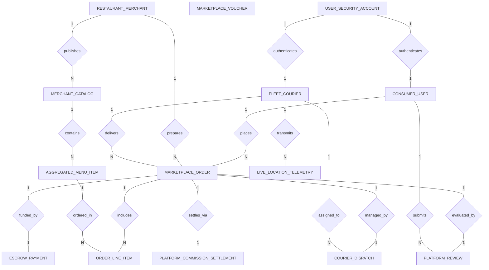

# Conceptual ERD — Food Delivery Aggregator Platform

## Mermaid Code

## Entity Description Table | Bang mo ta Entity

| # | Entity Name | Vietnamese Name | Description | Key Attributes | Main Relationships |
|---|-------------|-----------------|-------------|----------------|-------------------|
| 1 | CONSUMER_USER | Nguoi dung dat mon | Consumer marketplace profile, primary delivery addresses, and accumulated reward points. | consumer_id, user_id, full_name, phone_number, loyalty_points | Belongs to USER_SECURITY_ACCOUNT; One-to-Many with MARKETPLACE_ORDER, PLATFORM_REVIEW |
| 2 | RESTAURANT_MERCHANT | Doi tac nha hang | Merchant store profile, cuisine category, physical location, commission rate, and rating score. | merchant_id, store_name, cuisine_category, rating_score, commission_rate | One-to-Many with MERCHANT_CATALOG, MARKETPLACE_ORDER |
| 3 | FLEET_COURIER | Taixai giao hang | Gig delivery courier driver profile, vehicle details, current online status, and wallet earnings balance. | courier_id, user_id, vehicle_type, current_status, wallet_balance | Belongs to USER_SECURITY_ACCOUNT; One-to-Many with MARKETPLACE_ORDER, COURIER_DISPATCH, LIVE_LOCATION_TELEMETRY |
| 4 | MERCHANT_CATALOG | Danh muc thuc don goc | Master merchant catalog structure organizing food categories and menu items for marketplace listing. | catalog_id, merchant_id, catalog_name, is_published | Belongs to RESTAURANT_MERCHANT; One-to-Many with AGGREGATED_MENU_ITEM |
| 5 | AGGREGATED_MENU_ITEM | Mon an san thu pham | Individual menu dish records, base prices, delivery markup prices, and real-time stock availability. | item_id, catalog_id, item_name, base_price, delivery_price, is_in_stock | Belongs to MERCHANT_CATALOG; One-to-Many with ORDER_LINE_ITEM |
| 6 | MARKETPLACE_ORDER | Don hang san giao thuc pham | Central marketplace delivery order record, capturing financial breakdown, status stages, and order timestamp. | order_id, consumer_id, merchant_id, courier_id, grand_total, order_status | Belongs to CONSUMER_USER, RESTAURANT_MERCHANT, FLEET_COURIER; One-to-Many with ORDER_LINE_ITEM; One-to-One with ESCROW_PAYMENT, COURIER_DISPATCH, PLATFORM_REVIEW, PLATFORM_COMMISSION_SETTLEMENT |
| 7 | ORDER_LINE_ITEM | Chi tiet don hang san | Line items included in a marketplace order, capturing dish choices, quantities, and modifier options. | line_item_id, order_id, item_id, quantity, unit_price, item_options | Belongs to MARKETPLACE_ORDER, AGGREGATED_MENU_ITEM |
| 8 | ESCROW_PAYMENT | Thanh toan tam giu | Pre-authorization payment hold record, payment gateway tokens, charge timestamps, and escrow statuses. | escrow_id, order_id, payment_method, amount_held, escrow_status | One-to-One with MARKETPLACE_ORDER |
| 9 | COURIER_DISPATCH | Nhiem vu phan cong | Tracks algorithmic courier dispatch offers, acceptance timestamps, pickup/delivery times, and trip pay. | dispatch_id, order_id, courier_id, offer_sent_at, trip_earning | One-to-One with MARKETPLACE_ORDER; Belongs to FLEET_COURIER |
| 10 | LIVE_LOCATION_TELEMETRY | Dinh vi GPS taixai | High-frequency GPS latitude and longitude telemetry logs broadcast by driver mobile applications. | telemetry_id, courier_id, latitude, longitude, timestamp | Belongs to FLEET_COURIER |
| 11 | PLATFORM_REVIEW | Danh gia & Binh luan san | Post-delivery star ratings and written reviews evaluating food quality (Merchant) and delivery service (Courier). | review_id, order_id, consumer_id, merchant_id, courier_id, merchant_stars, courier_stars | One-to-One with MARKETPLACE_ORDER; Belongs to CONSUMER_USER |
| 12 | MARKETPLACE_VOUCHER | Ma giam gia san | Promotional discount campaigns, promo codes, minimum order value rules, and active validity periods. | voucher_id, promo_code, discount_value, min_order_value, is_active | Applied to MARKETPLACE_ORDER |
| 13 | USER_SECURITY_ACCOUNT | Tai khoan bao mat | Core authentication credentials, security password hashes, role types (Consumer, Driver, Operator), and verification states. | user_id, email, password_hash, role_type, is_verified | One-to-One with CONSUMER_USER, FLEET_COURIER |
| 14 | PLATFORM_COMMISSION_SETTLEMENT | Quyet toan hoa hong | Financial settlement record splitting order revenue into net merchant payout, courier fee, and net platform commission. | settlement_id, order_id, merchant_payout, courier_payout, net_platform_commission | One-to-One with MARKETPLACE_ORDER |

## Relationship Description | Mo ta Quan he

| # | From Entity | Cardinality | To Entity | Relationship Label | Business Explanation |
|---|-------------|-------------|-----------|-------------------|----------------------|
| 1 | USER_SECURITY_ACCOUNT | One-to-One | CONSUMER_USER | authenticates | Tai khoan bao mat xac thuc nguoi dung dat mon tren san. |
| 2 | USER_SECURITY_ACCOUNT | One-to-One | FLEET_COURIER | authenticates | Tai khoan bao mat xac thuc va phan quyen taixai giao hang. |
| 3 | RESTAURANT_MERCHANT | One-to-Many | MERCHANT_CATALOG | publishes | Mot doi tac nha hang xuat ban mot hoac nhieu danh muc thuc don tren san. |
| 4 | MERCHANT_CATALOG | One-to-Many | AGGREGATED_MENU_ITEM | contains | Mot danh muc thuc don san chua nhieu mon an va do uong cu the. |
| 5 | CONSUMER_USER | One-to-Many | MARKETPLACE_ORDER | places | Mot nguoi dung co the dat nhieu don hang thuc pham qua san marketplace. |
| 6 | RESTAURANT_MERCHANT | One-to-Many | MARKETPLACE_ORDER | prepares | Mot nha hang doi tac tiep nhan va che bien nhieu don hang tu san. |
| 7 | FLEET_COURIER | One-to-Many | MARKETPLACE_ORDER | delivers | Mot taixai giao hang thuc hien va giao nhieu don hang den khach hang. |
| 8 | MARKETPLACE_ORDER | One-to-Many | ORDER_LINE_ITEM | includes | Mot don hang san bao gom nhieu dong chi tiet mon an va tuy chon. |
| 9 | AGGREGATED_MENU_ITEM | One-to-Many | ORDER_LINE_ITEM | ordered_in | Mot mon an co the duoc dat nhieu lan trong nhieu don hang khac nhau. |
| 10 | MARKETPLACE_ORDER | One-to-One | ESCROW_PAYMENT | funded_by | Mot don hang duoc dam bao bang mot thanh toan tam giu escrow tuong ung. |
| 11 | MARKETPLACE_ORDER | One-to-One | COURIER_DISPATCH | managed_by | Mot don hang duoc dieu hanh phan cong qua mot nhiem vu giao hang cu the. |
| 12 | FLEET_COURIER | One-to-Many | LIVE_LOCATION_TELEMETRY | transmits | Mot taixai phat dinh vi GPS dinh ky ghi vao nhat ky toan do telemetry. |
| 13 | MARKETPLACE_ORDER | One-to-One | PLATFORM_REVIEW | evaluated_by | Mot don hang hoan thanh tao dieu kien cho khach hang gui danh gia san. |
| 14 | MARKETPLACE_ORDER | One-to-One | PLATFORM_COMMISSION_SETTLEMENT | settles_via | Mot don hang hoan thanh duoc quyet toan chia doanh thu hoa hong cho cac ben. |
