# Swimlane Diagram — Food Delivery Aggregator Platform

## Mermaid Code

```mermaid
flowchart LR
    Start(["Start"])

    subgraph Lane1["Consumer (Marketplace App)"]
        C1["Search Merchants & Customize Cart"]
        C2["Place Order & Authorize Escrow Hold"]
        C3["Track Multi-Stop Courier GPS Live"]
        C4["Verify Delivery PIN Code & Receive Food"]
        C5["Rate Merchant and Courier Service"]
    end

    subgraph Lane2["Restaurant Partner (Merchant POS/App)"]
        M1["Receive Order Alert on Tablet/POS"]
        M2["Accept Order & Set Prep Duration"]
        M3["Package Food & Mark Ready for Pickup"]
    end

    subgraph Lane3["Fleet Courier (Driver App)"]
        R1["Receive Algorithmic Dispatch Offer"]
        R2["Accept Job & Navigate to Store"]
        R3["Pick Up Food Bag & Verify Items"]
        R4["Drive to Destination & Verify PIN"]
    end

    subgraph Lane4["Aggregator Platform Engine"]
        S1["Verify Escrow Hold & Alert Merchant"]
        S2["Calculate Courier Matching Score"]
        S3{"Did Courier Accept Offer?"}
        S4["Stream Real-Time Telemetry & Route ETA"]
        S5["Release Escrow Payout to Merchant & Driver"]
    end

    Finish(["End"])

    Start --> C1 --> C2 --> S1 --> M1 --> M2 --> M3
    M2 --> S2 --> R1 --> S3
    S3 -->|"Yes"| R2 --> R3 --> S4 --> C3 --> R4 --> C4 --> S5 --> C5 --> Finish
    S3 -->|"No (Declined/Timeout)"| S2
```

## Flow Description | Mo ta luong

| Lane | Actor | Role in Flow |
|------|-------|-------------|
| **Lane 1** | Consumer (Marketplace App) | Searches nearby partner restaurants, customizes food items, authorizes payment hold in escrow, tracks courier route live on interactive map, verifies arrival PIN code, and rates service. |
| **Lane 2** | Restaurant Partner | Receives order notification on tablet/POS API, confirms order with prep duration, cooks meals according to specs, and packages order for courier pickup. |
| **Lane 3** | Fleet Courier | Receives targeted dispatch job offer, accepts assignment within 30 seconds, drives to merchant store, verifies order contents, delivers food package to consumer address, and inputs PIN code. |
| **Lane 4** | Aggregator Platform Engine | Validates escrow payment pre-authorization, matches optimal nearby courier based on proximity and SLA, streams live GPS telemetry, splits order revenue, and releases merchant/courier payouts. |

### Process Execution Steps | Cac buoc thuc hien quy trinh

1. **Discovery & Escrow Order**: Consumer searches marketplace, customizes cart, and places order (`C1`, `C2`). Aggregator Engine validates escrow payment hold and alerts merchant (`S1`).
2. **Merchant Prep**: Merchant receives order alert on POS/tablet (`M1`), accepts order with prep duration (`M2`), cooks food, and marks packaging ready (`M3`).
3. **Algorithmic Dispatch Matching**: Platform Engine calculates driver proximity matching scores (`S2`). Targeted Courier receives dispatch job offer notification (`R1`).
4. **Dispatch Decision Loop**: Platform Engine evaluates courier job acceptance (`S3`).
   - If **No (Declined/Timeout)**: Engine reroutes offer to second-ranked driver (`S2`).
   - If **Yes**: Courier accepts job and drives to restaurant (`R2`).
5. **Pickup & Real-Time Tracking**: Courier verifies food bag items at store and marks picked up (`R3`). Backend activates dynamic GPS telemetry stream (`S4`) for consumer map (`C3`).
6. **Delivery Handoff & Escrow Payout**: Courier arrives at destination and verifies 4-digit PIN code (`R4`, `C4`). Platform Engine releases escrow payouts to merchant account and driver wallet (`S5`). Consumer submits rating review (`C5`), ending the workflow (`Finish`).
