# Action Tree — Food Delivery Aggregator Platform

## Mermaid Code

```mermaid
graph TD
    Root["Food Delivery Aggregator Platform"]

    Root --> M1["Marketplace Discovery & Search"]
    Root --> M2["Merchant Management & Menu Aggregation"]
    Root --> M3["Order Processing & Escrow Payments"]
    Root --> M4["Algorithmic Courier Dispatch & Fleet Matching"]
    Root --> M5["Real-Time Geospatial Tracking"]
    Root --> M6["Customer Care, Ratings & Promotions"]
    Root --> M7["Platform Financials & Analytics"]

    M1 --> A11["Search & Filter Restaurants"]
    M1 --> A12["Aggregate Multi-Store Menus"]
    M1 --> A13["Select Delivery Destination Pin"]
    M1 --> A14["Submit Marketplace Cart"]

    M2 --> A21["Onboard Merchant Stores"]
    M2 --> A22["Configure Menu Item Pricing"]
    M2 --> A23["Toggle Out-of-Stock 86 Locks"]
    M2 --> A24["Set Store Operating Hours"]

    M3 --> A31["Pre-Authorize Escrow Payment"]
    M3 --> A32["Transmit Orders to Merchant POS"]
    M3 --> A33["Calculate Surge Delivery Fees"]
    M3 --> A34["Process Split Payout Transfers"]

    M4 --> A41["Score Candidate Drivers"]
    M4 --> A42["Broadcast Delivery Job Offers"]
    M4 --> A43["Batch Multi-Store Pickup Orders"]
    M4 --> A44["Verify Delivery via PIN Code"]

    M5 --> A51["Stream High-Frequency Driver GPS"]
    M5 --> A52["Calculate Dynamic Route ETAs"]
    M5 --> A53["Render Interactive Map Paths"]
    M5 --> A54["Mask Contact Phone Numbers"]

    M6 --> A61["Apply Marketplace Promo Vouchers"]
    M6 --> A62["Submit Merchant & Driver Reviews"]
    M6 --> A63["Process Complaint & Refund Claims"]
    M6 --> A64["Award Loyalty Reward Points"]

    M7 --> A71["Monitor Marketplace GMV"]
    M7 --> A72["Calculate Merchant Commission Fees"]
    M7 --> A73["Audit Driver Wallet Withdrawals"]
    M7 --> A74["Export Fiscal Tax Reports"]
```

## Module Description | Mo ta Module

| # | Module | Description | Actions |
|---|--------|-------------|---------|
| 1 | Marketplace Discovery & Search | Manages consumer restaurant searches, filter criteria (cuisine, rating, speed), multi-store menu indexing, delivery pin selection, and cart submissions. | Search & Filter Restaurants, Aggregate Multi-Store Menus, Select Delivery Destination Pin, Submit Marketplace Cart |
| 2 | Merchant Management & Menu Aggregation | Controls restaurant store onboarding verification, menu catalog publishing, store-level 86ed stockout locks, and operating hours. | Onboard Merchant Stores, Configure Menu Item Pricing, Toggle Out-of-Stock 86 Locks, Set Store Operating Hours |
| 3 | Order Processing & Escrow Payments | Manages pre-authorization escrow holds, order payload transmission to merchant POS systems, dynamic surge pricing calculations, and split payout transfers. | Pre-Authorize Escrow Payment, Transmit Orders to Merchant POS, Calculate Surge Delivery Fees, Process Split Payout Transfers |
| 4 | Algorithmic Courier Dispatch & Fleet Matching | Controls driver proximity scoring, delivery job offer broadcasts, multi-order batching rules, and PIN code delivery confirmations. | Score Candidate Drivers, Broadcast Delivery Job Offers, Batch Multi-Store Pickup Orders, Verify Delivery via PIN Code |
| 5 | Real-Time Geospatial Tracking | Streams high-frequency driver GPS coordinates, calculates dynamic route ETAs, renders interactive map polylines, and masks contact phone numbers. | Stream High-Frequency Driver GPS, Calculate Dynamic Route ETAs, Render Interactive Map Paths, Mask Contact Phone Numbers |
| 6 | Customer Care, Ratings & Promotions | Manages platform promo voucher campaigns, dual merchant/driver 1-5 star reviews, automated customer complaint refunds, and loyalty points. | Apply Marketplace Promo Vouchers, Submit Merchant & Driver Reviews, Process Complaint & Refund Claims, Award Loyalty Reward Points |
| 7 | Platform Financials & Analytics | Provides central management analytics on Gross Merchandise Value (GMV), net platform commission revenue, driver wallet balances, and fiscal tax compliance. | Monitor Marketplace GMV, Calculate Merchant Commission Fees, Audit Driver Wallet Withdrawals, Export Fiscal Tax Reports |
