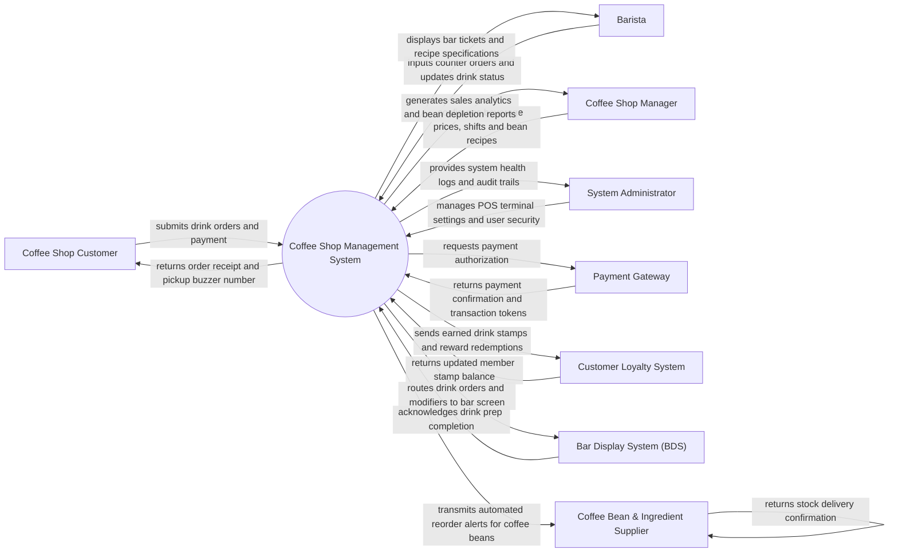

# Context Diagram — Coffee Shop Management System

## Mermaid Code

## Actor & Interaction Table | Bang Actor & Tuong tac

| # | Actor | Actor Type | Data Sent TO System | Data Received FROM System | Notes |
|---|-------|------------|---------------------|---------------------------|-------|
| 1 | Coffee Shop Customer | Primary | Drink order choices, customization specs (sweetness, ice, milk), payment, loyalty phone number | Printed receipt, pickup buzzer call, earned loyalty stamps | Interacts at counter POS, self-service kiosk, or mobile QR code portal. |
| 2 | Barista | Primary | Counter order entries, drink prep stage updates (Brewing, Ready), bean waste logs | Bar ticket queue, beverage recipe ratios, modifier instructions | Uses counter POS terminal and Bar Display System (BDS) screen. |
| 3 | Manager | Primary | Beverage pricing, seasonal recipe setup, shift schedules, stock reorders, discounts | Daily store revenue, top-selling drinks, coffee bean usage reports | Accesses web-based coffee shop administration dashboard. |
| 4 | System Administrator | Primary | User credentials, POS terminal IP bindings, role access security, backup settings | System event logs, hardware disconnect alerts, security audit trails | Manages store IT hardware, POS terminals, and system configurations. |
| 5 | Payment Gateway | Supporting | Payment authorization tokens, transaction approval status | Charge requests, order subtotals, tender method types | Integrates via APIs for e-wallet QR codes, contactless credit cards, and cash drawers. |
| 6 | Customer Loyalty System | Supporting | Member tier status, available free drink rewards, stamp counts | Earned transaction stamps, redeemed reward tokens | Manages digital stamp cards and member point accumulation. |
| 7 | Bar Display System (BDS) | Supporting | Drink completion acknowledgments, prep timing logs | Live drink ticket queue, cup label printing payloads, modifier details | Renders real-time beverage tickets for baristas at espresso bar. |
| 8 | Coffee Bean Supplier | Supporting | Stock shipment notifications, purchase order confirmations | Automated raw coffee bean reorder requests, delivery receipts | Receives automated purchase orders when bean inventory drops below threshold. |

## System Boundary Description | Mo ta Pham vi He thong

The **Coffee Shop Management System** controls specialized coffee house retail operations, counter POS transaction processing, espresso bar display workflows, beverage recipe management, and raw coffee bean inventory depletion. Inside its boundary, the system handles drink customization options (milk choices, sweetness levels, espresso shot counts), barcode/cup label printing, barista prep queuing, digital stamp loyalty tracking, and shift cash float balancing.

The system boundary excludes physical coffee extraction execution by baristas, raw credit card processing (handled by external Payment Gateways), and physical coffee bean farming and shipping logistics (handled by external Coffee Bean Suppliers).
