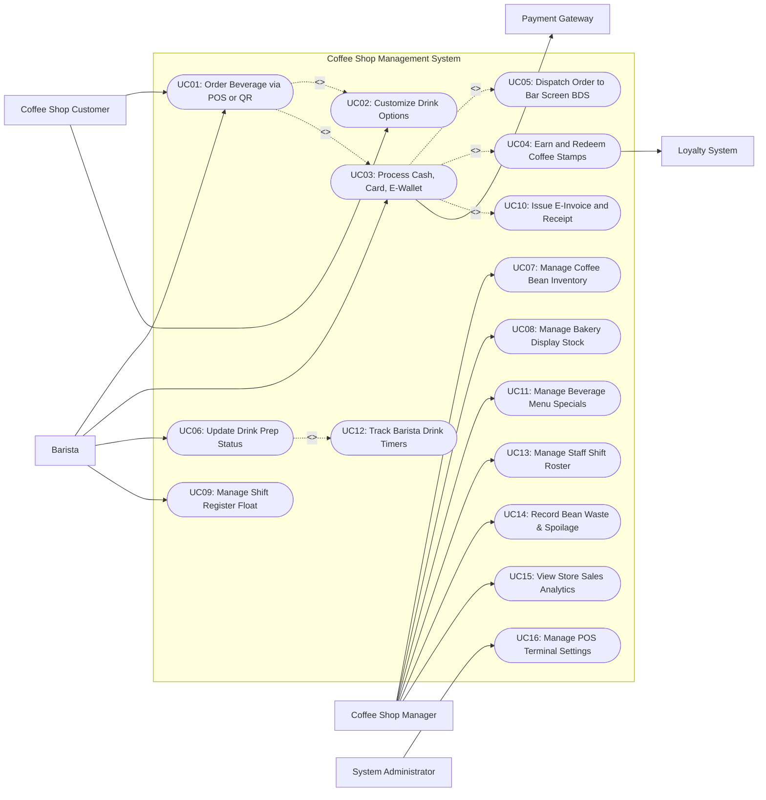

# Use Case Diagram — Coffee Shop Management System

## Mermaid Code

## Actor Table | Bang Actor

| # | Actor | Actor Type | Role Description | Related Use Cases |
|---|-------|------------|------------------|-------------------|
| 1 | Coffee Shop Customer | Primary | Guest placing beverage orders at counter or via mobile QR code, choosing customization options, paying, and earning loyalty stamps. | UC01, UC02 |
| 2 | Barista | Primary | Store employee taking orders at counter POS, processing payments, preparing espresso drinks at the bar, and updating order pickup statuses. | UC01, UC03, UC06, UC09 |
| 3 | Coffee Shop Manager | Primary | Store lead overseeing coffee bean inventory, bakery stock, recipe ratios, staff shift rosters, bean waste logs, and sales reports. | UC07, UC08, UC11, UC13, UC14, UC15 |
| 4 | System Administrator | Primary | Technical manager configuring POS terminal settings, hardware peripherals, user security roles, and system parameters. | UC16 |
| 5 | Payment Gateway | Secondary System | External service provider handling credit card authorizations, e-wallet QR payments, and cash drawer triggers. | UC03 |
| 6 | Loyalty System | Secondary System | Digital loyalty service managing member coffee stamp card accumulations and free reward drink redemptions. | UC04 |

## Use Case Table | Bang Use Case

| # | UC ID | Use Case Name | Primary Actor | Secondary Actor | Description | Priority |
|---|-------|---------------|---------------|-----------------|-------------|----------|
| 1 | UC01 | Order Beverage via POS or QR | Customer / Barista | None | Allows customers or baristas to select beverages and food items at the counter POS or mobile QR portal. | High |
| 2 | UC02 | Customize Drink Options | Customer | None | Configures beverage modifiers such as milk type (Oat, Almond, Whole), sweetness (0%, 50%, 100%), ice level, and extra espresso shots. | High |
| 3 | UC03 | Process Cash, Card, E-Wallet | Barista | Payment Gateway | Accepts multi-tender payments, calculates change, opens cash drawer, and completes order checkout. | High |
| 4 | UC04 | Earn and Redeem Coffee Stamps | Customer | Loyalty System | Scans member barcode to add digital stamps (e.g., Buy 9 get 1 Free) or redeem free reward vouchers. | Medium |
| 5 | UC05 | Dispatch Order to Bar Screen BDS | System | None | Routes paid drink orders to Bar Display System (BDS) screens and prints sticky cup labels for baristas. | High |
| 6 | UC06 | Update Drink Prep Status | Barista | None | Updates beverage status (`Brewing` -> `Ready for Pickup`) and triggers buzzer call or screen notification. | High |
| 7 | UC07 | Manage Coffee Bean Inventory | Coffee Shop Manager | None | Tracks raw coffee bean inventory (Arabica, Robusta), monitors shot extraction weights, and triggers reorders. | High |
| 8 | UC08 | Manage Bakery Display Stock | Coffee Shop Manager | None | Tracks daily fresh bakery items (Croissants, Muffins, Cakes), setting stock counts and end-of-day markdowns. | Medium |
| 9 | UC09 | Manage Shift Register Float | Barista | None | Opens and closes cashier shift registers, auditing opening cash float, cash sales, and float variance. | High |
| 10 | UC10 | Issue E-Invoice and Receipt | Barista | None | Prints paper receipt or issues digital e-invoice with tax breakdown for customer purchase. | Medium |
| 11 | UC11 | Manage Beverage Menu Specials | Coffee Shop Manager | None | Creates, updates, or disables coffee menu items, seasonal drinks (e.g., Pumpkin Spice Latte), and prices. | High |
| 12 | UC12 | Track Barista Drink Timers | System | None | Monitors espresso extraction time and total drink preparation duration on BDS to measure service speed. | Medium |
| 13 | UC13 | Manage Staff Shift Roster | Coffee Shop Manager | None | Schedules barista work shifts, assigns peak-hour positions (Register, Bar, Food Station), and tracks attendance. | Medium |
| 14 | UC14 | Record Bean Waste & Spoilage | Coffee Shop Manager | None | Logs spilled coffee beans, expired milk cartons, or failed espresso extractions to waste expense accounts. | Medium |
| 15 | UC15 | View Store Sales Analytics | Coffee Shop Manager | None | Generates analytical reports on daily revenue, peak sales hours, top beverage categories, and average order value. | High |
| 16 | UC16 | Manage POS Terminal Settings | System Admin | None | Configures POS hardware connections, cup label printers, barcode scanners, and security user permissions. | High |

## Use Case Specification | Dac ta Use Case

---

### UC01 — Order Beverage via POS or QR

| Field | Detail |
|-------|--------|
| **UC ID** | UC01 |
| **Use Case Name** | Order Beverage via POS or QR |
| **Actor(s)** | Primary: Coffee Shop Customer / Barista   Secondary: None |
| **Description** | Allows a customer (via mobile QR code) or cashier barista (via counter POS) to browse coffee categories, select drinks, apply customizations, and build an order ticket. |
| **Precondition** | 1. POS terminal or mobile QR ordering portal is active and online.   2. Active beverage menu and stock availability are loaded. |
| **Main Flow** | 1. Customer approaches counter or scans table/counter QR code.   2. User selects beverage category (Espresso Bar, Cold Brew, Teas, Pastries).   3. User selects specific drink item (e.g., Iced Caramel Macchiato) and selects size (Small, Medium, Large).   4. User opens drink customization interface (executing UC02) to adjust sweetness, ice, milk type, and add-ons.   5. User adds item to order ticket.   6. User reviews order summary, item quantity, customized options, and total price.   7. User proceeds to payment checkout screen (executing UC03). |
| **Alternative Flow** | **AF1** — Quick order repeat for regular customer:   1. Customer scans loyalty member barcode at counter.   2. System retrieves customer profile and displays "Favorite Drink: Large Oat Milk Latte, 50% Sweetness".   3. Barista taps "Order Favorite" to add item to ticket instantly with 1 click. |
| **Exception Flow** | **EX1** — Milk or bean option out of stock:   1. At step 4, User selects "Oat Milk".   2. System detects Oat Milk inventory is depleted and displays notification "Oat Milk Sold Out".   3. User selects alternative milk option (Almond or Whole Milk). |
| **Postcondition** | Order ticket is created with customized drink choices and ready for payment processing. |
| **Business Rule** | **BR1**: Beverage size modifications automatically adjust recipe espresso shot counts and syrup pump defaults.   **BR2**: Specialty milk options (Oat Milk, Almond Milk) automatically apply standard up-charge fees ($0.75). |

---

### UC02 — Customize Drink Options

| Field | Detail |
|-------|--------|
| **UC ID** | UC02 |
| **Use Case Name** | Customize Drink Options |
| **Actor(s)** | Primary: Coffee Shop Customer   Secondary: None |
| **Description** | Allows customers to personalize beverage parameters including milk preferences, sweetness levels, ice amounts, espresso shot counts, and flavor syrup add-ons. |
| **Precondition** | 1. A customizable beverage item is selected in the active order cart.   2. Modifier options for the beverage are configured in the system. |
| **Main Flow** | 1. User taps "Customize" on selected drink item.   2. System displays customization option groups: Milk Type, Sweetness Level, Ice Level, Espresso Shots, Toppings/Syrups.   3. User selects Milk Type (e.g., Whole Milk, Skim Milk, Oat Milk, Soy Milk).   4. User selects Sweetness Level (e.g., 0% Extra Dry, 30% Less Sweet, 100% Standard, 120% Extra Sweet).   5. User selects Ice Amount (e.g., No Ice, Less Ice, Regular Ice, Extra Ice).   6. User selects additional options (e.g., +1 Extra Espresso Shot, Vanilla Syrup, Whipped Cream).   7. System calculates any price deltas associated with selected add-ons (+ $0.75 for Oat Milk; + $1.00 for Extra Shot).   8. User confirms customization and returns to order ticket. |
| **Alternative Flow** | **AF1** — Temperature selection for dual drinks:   1. User selects a drink available hot or iced (e.g., Latte).   2. System prompts "Hot or Iced?".   3. User selects "Hot"; System hides ice customization options and shows milk foam choices. |
| **Exception Flow** | **EX1** — Incompatible modifier combination:   1. User attempts to select "Whipped Cream" on a 0% Fat Clear Tea.   2. System displays warning "Whipped cream is not available for clear tea items" and unchecks choice. |
| **Postcondition** | Customized parameters and price deltas are bound to the beverage line item. |
| **Business Rule** | **BR1**: Customization choices must print in prominent bold text on cup sticky labels to guide barista preparation.   **BR2**: Extra espresso shot add-ons increment recipe coffee bean usage metrics automatically. |

---

### UC03 — Process Cash, Card, and E-Wallet Payments

| Field | Detail |
|-------|--------|
| **UC ID** | UC03 |
| **Use Case Name** | Process Cash, Card, and E-Wallet Payments |
| **Actor(s)** | Primary: Barista   Secondary: Payment Gateway |
| **Description** | Processes customer payment for counter orders via cash, credit/debit card, or e-wallet QR code, opening the cash drawer and completing checkout. |
| **Precondition** | 1. Order ticket is finalized with customized items and subtotals.   2. POS payment hardware terminal and cash drawer are connected. |
| **Main Flow** | 1. Barista reviews order total with customer and asks for payment method.   2. Customer chooses payment method (Cash, Credit Card, or E-Wallet QR).   3. If **Cash**: Barista enters tender amount (e.g., $20 cash for $14 bill); System calculates change ($6), opens cash drawer, and Barista hands change to customer.   4. If **Credit Card**: Barista prompts customer to tap/insert card on terminal; System sends charge request to Payment Gateway and receives authorization success.   5. If **E-Wallet QR**: System displays payment QR code on customer-facing display screen; Customer scans QR code; Payment Gateway returns transaction confirmation.   6. System updates order status to `Paid`.   7. System triggers order dispatch to Bar Display System (BDS) and sticky cup label printer (executing UC05).   8. System prints receipt (executing UC10) and hands pickup buzzer ticket to customer. |
| **Alternative Flow** | **AF1** — Split tender payment:   1. Customer requests to pay part in cash ($5) and remaining balance on card ($9).   2. Barista selects "Split Payment", accepts $5 cash, and processes $9 on card terminal (steps 3-6). |
| **Exception Flow** | **EX1** — Card decline:   1. At step 4, Payment Gateway returns `Transaction Declined`.   2. System displays alert popup on POS screen.   3. Barista requests alternative payment method from customer.    **EX2** — E-Wallet payment timeout:   1. At step 5, E-Wallet transaction times out after 60 seconds without customer payment.   2. System prompts Barista to regenerate QR code or switch payment method. |
| **Postcondition** | Order payment status is `Paid`, cash drawer transaction is logged, and order dispatches to bar display. |
| **Business Rule** | **BR1**: Cash drawer pop events must log barista ID and shift timestamp to audit logs.   **BR2**: Paid orders automatically trigger real-time raw coffee bean inventory deduction. |

---

### UC06 — Update Beverage Preparation & Pickup Status

| Field | Detail |
|-------|--------|
| **UC ID** | UC06 |
| **Use Case Name** | Update Beverage Preparation & Pickup Status |
| **Actor(s)** | Primary: Barista   Secondary: None |
| **Description** | Allows baristas at the espresso bar display screen to update drink statuses from `Queued` to `Brewing` and `Ready for Pickup`, notifying customers via screen or buzzer. |
| **Precondition** | 1. Paid drink orders are displayed on the Bar Display System (BDS) screen.   2. Barista is working at the coffee extraction station. |
| **Main Flow** | 1. Barista views incoming drink tickets on BDS screen and reads cup sticky label specs.   2. Barista starts brewing drink and taps ticket on BDS screen to change status to `Brewing`.   3. Barista completes drink preparation (grinding beans, pulling espresso shot, steaming milk, applying lid).   4. Barista places completed drink at pickup counter and taps ticket on BDS screen (or presses bump button).   5. System updates drink status to `Ready for Pickup`.   6. System triggers pickup notification: displays order number on overhead TV display screen and activates customer wireless pickup buzzer chime.   7. Customer arrives at pickup counter, presents receipt/buzzer, and receives drink.   8. Barista taps "Completed" on BDS, clearing ticket from screen. |
| **Alternative Flow** | **AF1** — Remake drink due to error:   1. Barista notices wrong milk was steamed (e.g., Whole Milk instead of requested Oat Milk).   2. Barista taps "Remake Drink" on BDS.   3. System logs drink remake event, updates waste log (executing UC14), and maintains order at top of queue. |
| **Exception Flow** | **EX1** — Customer fails to pick up drink (Cold Drink Alert):   1. If completed drink remains uncollected at pickup counter for > 15 minutes, System displays warning alert on BDS "Order #104 uncollected (15 mins)".   2. Barista verifies order and calls customer name over PA system. |
| **Postcondition** | Beverage status updates to `Ready for Pickup`, pickup notifications trigger, and prep speed metrics log. |
| **Business Rule** | **BR1**: Target barista prep speed for espresso drinks is <= 180 seconds from order payment to pickup ready.   **BR2**: Drink remake events require selecting a mandatory reason code (Wrong Milk, Wrong Sweetness, Spilled). |

---

### UC07 — Manage Coffee Bean Inventory

| Field | Detail |
|-------|--------|
| **UC ID** | UC07 |
| **Use Case Name** | Manage Coffee Bean Inventory |
| **Actor(s)** | Primary: Coffee Shop Manager   Secondary: None |
| **Description** | Tracks raw coffee bean inventory (in kilograms/grams), monitors espresso shot extraction usage, records bean shipments, and triggers automated reorder notifications. |
| **Precondition** | 1. Manager is logged into inventory management module.   2. Coffee bean items (e.g., House Blend Arabica, Single Origin Espresso) and recipe shot weights (18g per double shot) are configured. |
| **Main Flow** | 1. Manager accesses Coffee Bean Inventory screen on administration dashboard.   2. System displays real-time stock levels for all coffee bean varieties (Current Weight, Reorder Threshold, Estimated Days Remaining).   3. As drinks are sold at POS, System automatically decrements coffee bean stock based on recipe shot weights (e.g., Double Shot Espresso deducts 18 grams).   4. Manager receives new coffee bean shipment from supplier and enters stock receipt document (Supplier Name, Batch Number, Quantity in kg, Roast Date, Unit Cost).   5. System updates coffee bean stock balance and recalculates weighted average unit cost.   6. When bean stock falls below minimum safety reorder threshold (e.g., < 5 kg), System generates automated reorder alert notification.   7. Manager reviews reorder alert and approves purchase order to supplier. |
| **Alternative Flow** | **AF1** — Bean hopper dial-in calibration adjustment:   1. Head Barista dials in espresso grinder in the morning, using 90g of beans for test shots.   2. Barista logs 90g under "Grinder Calibration Usage".   3. System deducts 90g from active inventory balance without charging to customer sales. |
| **Exception Flow** | **EX1** — Negative stock balance warning:   1. System detects calculated coffee bean stock balance is negative due to unrecorded delivery.   2. System flags high-priority inventory audit alert on Manager dashboard "Inventory Discrepancy: House Blend Arabica". |
| **Postcondition** | Coffee bean inventory balances are updated, recipe usage is tracked, and reorder alerts are managed. |
| **Business Rule** | **BR1**: Coffee bean depletion is calculated perpetually in real time based on active recipe shot weights per sold beverage.   **BR2**: Coffee bean batches past 30 days from roast date generate freshness alerts on manager dashboard. |
