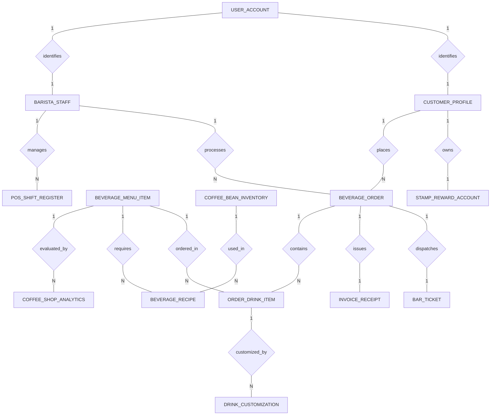

# Conceptual ERD — Coffee Shop Management System

## Mermaid Code

## Entity Description Table | Bang mo ta Entity

| # | Entity Name | Vietnamese Name | Description | Key Attributes | Main Relationships |
|---|-------------|-----------------|-------------|----------------|-------------------|
| 1 | CUSTOMER_PROFILE | Ho so Khach hang | Stores coffee shop guest profiles, phone numbers, member tiers, and total accumulated stamps. | customer_id, user_id, full_name, phone_number, total_stamps | Belongs to USER_ACCOUNT; One-to-Many with BEVERAGE_ORDER; One-to-One with STAMP_REWARD_ACCOUNT |
| 2 | BEVERAGE_ORDER | Don hang do uong | Central counter/mobile order record, capturing order timestamps, subtotals, discounts, and payment status. | order_id, customer_id, staff_id, grand_total, order_status | Belongs to CUSTOMER_PROFILE, BARISTA_STAFF; One-to-Many with ORDER_DRINK_ITEM; One-to-One with BAR_TICKET, INVOICE_RECEIPT |
| 3 | ORDER_DRINK_ITEM | Chi tiet do uong order | Specific beverage items ordered within a ticket, capturing drink sizes, quantities, and line item prices. | order_item_id, order_id, item_id, drink_size, quantity, unit_price | Belongs to BEVERAGE_ORDER, BEVERAGE_MENU_ITEM; One-to-Many with DRINK_CUSTOMIZATION |
| 4 | BEVERAGE_MENU_ITEM | Mon do uong thuc don | Beverage catalog master items (Espresso, Latte, Cold Brew), categories, base prices, and availability flags. | item_id, item_name, category_name, base_price, is_available | One-to-Many with ORDER_DRINK_ITEM, BEVERAGE_RECIPE, COFFEE_SHOP_ANALYTICS |
| 5 | DRINK_CUSTOMIZATION | Tuy chinh do uong | Specific customized modifier parameters (Milk Type, Sweetness Level, Ice Level, Extra Shots, Price Delta). | customization_id, order_item_id, milk_type, sweetness_level, extra_shots | Belongs to ORDER_DRINK_ITEM |
| 6 | BARISTA_STAFF | Nhan vien Pha che | Represents coffee shop barista employees, job roles (Head Barista, Cashier), and active shift status. | staff_id, user_id, full_name, job_role, is_on_shift | Belongs to USER_ACCOUNT; One-to-Many with BEVERAGE_ORDER, POS_SHIFT_REGISTER |
| 7 | BAR_TICKET | Phieu pha che Bar | Manages espresso bar screen tickets, station numbers, prep dispatch times, ready times, and statuses. | ticket_id, order_id, bar_station_number, dispatched_at, ready_at | One-to-One with BEVERAGE_ORDER |
| 8 | COFFEE_BEAN_INVENTORY | Ton kho Hat ca phe | Tracks raw coffee bean varieties (Arabica, Robusta), roast profiles, stock weights in kg, and reorder levels. | bean_id, bean_variety, roast_type, current_stock_kg, reorder_level_kg | One-to-Many with BEVERAGE_RECIPE |
| 9 | BEVERAGE_RECIPE | Cong thuc pha che | Maps menu drinks to raw coffee bean usage (shot weight in grams), milk volume, and syrup pumps. | recipe_id, item_id, bean_id, shot_weight_grams, milk_volume_ml | Belongs to BEVERAGE_MENU_ITEM, COFFEE_BEAN_INVENTORY |
| 10 | STAMP_REWARD_ACCOUNT | Tai khoan Tich tem | Tracks member digital stamp card balances (e.g., 7/10 stamps) and total free drink rewards earned. | reward_id, customer_id, active_stamps, total_free_drinks_earned | One-to-One with CUSTOMER_PROFILE |
| 11 | POS_SHIFT_REGISTER | Ca lam viec Thu ngan | Audits cashier register shift floats, opening/closing cash balances, cash sales, and float variance. | shift_id, staff_id, shift_open_time, opening_float, closing_cash, cash_variance | Belongs to BARISTA_STAFF |
| 12 | INVOICE_RECEIPT | Hoa don ban hang | Stores printed customer receipt numbers, payment methods, transaction timestamps, and VAT breakdowns. | receipt_id, order_id, receipt_number, payment_method, printed_at | One-to-One with BEVERAGE_ORDER |
| 13 | USER_ACCOUNT | Tai khoan he thong | Core authentication account holding usernames, password hashes, and security role definitions. | user_id, username, password_hash, role_name | One-to-One with CUSTOMER_PROFILE, BARISTA_STAFF |
| 14 | COFFEE_SHOP_ANALYTICS | Thong ke cua hang | Daily analytical metrics tracking total orders, revenue, total drinks sold, and average barista prep speed. | analytics_id, metric_date, total_orders, total_revenue, avg_prep_time_seconds | Aggregated metrics table |

## Relationship Description | Mo ta Quan he

| # | From Entity | Cardinality | To Entity | Relationship Label | Business Explanation |
|---|-------------|-------------|-----------|-------------------|----------------------|
| 1 | USER_ACCOUNT | One-to-One | CUSTOMER_PROFILE | identifies | Tai khoan he thong xac thuc ho so khach hang tich diem cua hang. |
| 2 | USER_ACCOUNT | One-to-One | BARISTA_STAFF | identifies | Tai khoan he thong xac thuc nhan vien pha che va phan quyen chuc nang. |
| 3 | CUSTOMER_PROFILE | One-to-Many | BEVERAGE_ORDER | places | Mot khach hang co the dat nhieu don hang do uong qua thoi gian. |
| 4 | BARISTA_STAFF | One-to-Many | BEVERAGE_ORDER | processes | Mot nhan vien thu ngan/pha che xu ly va ghi nhan nhieu don hang. |
| 5 | BEVERAGE_ORDER | One-to-Many | ORDER_DRINK_ITEM | contains | Mot don hang bao gom nhieu dong chi tiet do uong va banh ngot duoc goi. |
| 6 | BEVERAGE_MENU_ITEM | One-to-Many | ORDER_DRINK_ITEM | ordered_in | Mot mon do uong trong thuc don co the duoc dat nhieu lan trong cac don hang. |
| 7 | ORDER_DRINK_ITEM | One-to-Many | DRINK_CUSTOMIZATION | customized_by | Mot ly do uong co the co nhieu tuy chinh (Loai sua, Muc duong, Muc da, Shot them). |
| 8 | BEVERAGE_ORDER | One-to-One | BAR_TICKET | dispatches | Mot don hang da thanh toan duoc chuyen thanh mot phieu pha che tai quay bar. |
| 9 | BEVERAGE_ORDER | One-to-One | INVOICE_RECEIPT | issues | Mot don hang duoc xuat mot hoa don ban hang duy nhat cho khach hang. |
| 10 | CUSTOMER_PROFILE | One-to-One | STAMP_REWARD_ACCOUNT | owns | Mot ho so khach hang so huu mot tai khoan the tich tem doi qua duy nhat. |
| 11 | BEVERAGE_MENU_ITEM | One-to-Many | BEVERAGE_RECIPE | requires | Mot mon do uong duoc dinh nghia dinh muc cong thuc (luong hat ca phe, sua, syrup). |
| 12 | COFFEE_BEAN_INVENTORY | One-to-Many | BEVERAGE_RECIPE | used_in | Mot loai hat ca phe (Arabica/Robusta) duoc su dung trong cong thuc cua nhieu do uong. |
| 13 | BARISTA_STAFF | One-to-Many | POS_SHIFT_REGISTER | manages | Nhan vien thu ngan quan ly va chot ca lam viec tren ket tien POS. |
| 14 | BEVERAGE_MENU_ITEM | One-to-Many | COFFEE_SHOP_ANALYTICS | evaluated_by | Mot mon do uong duoc thong ke va danh gia doanh so ban hang hang ngay. |
