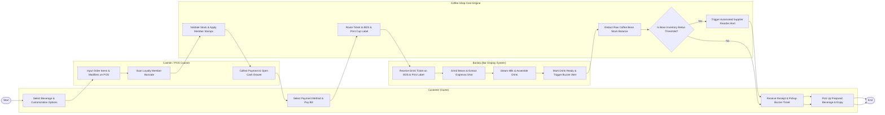

# Swimlane Diagram — Coffee Shop Management System

## Mermaid Code

## Flow Description | Mo ta luong

| Lane | Actor | Role in Flow |
|------|-------|-------------|
| **Lane 1** | Customer (Guest) | Selects coffee beverages, specifies customization parameters (milk, sweetness, ice, shots), completes payment checkout, receives pickup buzzer ticket, and collects completed drink. |
| **Lane 2** | Cashier / POS Counter | Enters drink items and custom modifiers into counter POS, scans customer loyalty barcode, accepts cash/card/QR payments, and opens cash drawer. |
| **Lane 3** | Barista (Bar Display System) | Reads drink specifications on BDS display and sticky cup label, grinds coffee beans, pulls espresso shots, steams milk, assembles drink, and triggers pickup buzzer when ready. |
| **Lane 4** | Coffee Shop Core Engine | Validates menu item stock availability, adds loyalty member stamps, routes drink tickets to BDS screens, decrements raw coffee bean balances perpetually, and triggers reorder alerts. |

### Process Execution Steps | Cac buoc thuc hien quy trinh

1. **Ordering & Customization**: Customer selects coffee items and custom options (`C1`). Cashier inputs choices into counter POS (`K1`) and scans customer loyalty barcode (`K2`).
2. **Loyalty & Payment Checkout**: System checks member stamp balance (`S1`). Customer selects tender method and completes payment (`K3`, `C2`).
3. **Bar Dispatch & Extraction**: System routes paid order to Bar Display System (BDS) screen and prints sticky cup label (`S2`). Barista reads ticket (`B1`), grinds fresh beans, pulls espresso shots (`B2`), steams milk, and finishes assembly (`B3`).
4. **Pickup Alert & Inventory Depletion**: Barista taps BDS marking drink `Ready` (`B4`), triggering customer pickup buzzer. System decrements raw coffee bean inventory based on recipe shot weights (`S3`).
5. **Reorder Check & Completion**: System checks coffee bean inventory against minimum reorder safety thresholds (`S4`).
   - If **Yes**: System sends automated reorder alert to bean supplier (`S5`).
   - Customer collects drink at pickup counter (`C3`, `C4`), completing the store workflow (`Finish`).
