# Action Tree — Coffee Shop Management System

## Mermaid Code

```mermaid
graph TD
    Root["Coffee Shop Management System"]

    Root --> M1["Counter POS & Mobile QR Ordering"]
    Root --> M2["Beverage Customization & Modifiers"]
    Root --> M3["Bar Display System BDS & Prep Workflow"]
    Root --> M4["Coffee Bean & Ingredient Inventory"]
    Root --> M5["Customer Loyalty & Digital Stamp Card"]
    Root --> M6["Cashier Register & Shift Float Management"]
    Root --> M7["Store Analytics & System Administration"]

    M1 --> A11["Process Counter POS Orders"]
    M1 --> A12["Scan Mobile QR Customer Orders"]
    M1 --> A13["Process Card, E-Wallet & Cash"]
    M1 --> A14["Print Sticky Cup Labels"]

    M2 --> A21["Configure Milk Type Choices"]
    M2 --> A22["Adjust Sweetness & Ice Levels"]
    M2 --> A23["Add Extra Espresso Shots"]
    M2 --> A24["Set Up-Charge Price Deltas"]

    M3 --> A31["Receive Ticket Dispatch on BDS"]
    M3 --> A32["Update Drink Status Brewing/Ready"]
    M3 --> A33["Trigger Customer Pickup Buzzer"]
    M3 --> A34["Track Barista Prep Speed Timers"]

    M4 --> A41["Track Coffee Bean Stock Levels"]
    M4 --> A42["Log Espresso Shot Recipe Depletion"]
    M4 --> A43["Record Bean Waste & Dial-In Spoilage"]
    M4 --> A44["Generate Supplier Reorder Alerts"]

    M5 --> A51["Scan Loyalty Member Barcode"]
    M5 --> A52["Accumulate Digital Drink Stamps"]
    M5 --> A53["Redeem Free Beverage Vouchers"]
    M5 --> A54["Track Member Tier Upgrades"]

    M6 --> A61["Open Cashier Shift Float"]
    M6 --> A62["Audit Cash Drawer Transactions"]
    M6 --> A63["Perform Mid-Shift Cash Drops"]
    M6 --> A64["Close Shift & Reconcile Variance"]

    M7 --> A71["Monitor Real-Time Store Revenue"]
    M7 --> A72["Analyze Top-Selling Drink Categories"]
    M7 --> A73["Configure Beverage Menu Specials"]
    M7 --> A74["Manage POS Terminal Permissions"]
```

## Module Description | Mo ta Module

| # | Module | Description | Actions |
|---|--------|-------------|---------|
| 1 | Counter POS & Mobile QR Ordering | Handles counter sales transactions, mobile QR ordering sessions, multi-tender payment processing, cash drawer pops, and sticky cup label printing. | Process Counter POS Orders, Scan Mobile QR Customer Orders, Process Card, E-Wallet & Cash, Print Sticky Cup Labels |
| 2 | Beverage Customization & Modifiers | Controls drink personalization settings (Oat/Almond milk, sweetness percentages, ice levels, extra espresso shots), and up-charge price adjustments. | Configure Milk Type Choices, Adjust Sweetness & Ice Levels, Add Extra Espresso Shots, Set Up-Charge Price Deltas |
| 3 | Bar Display System BDS & Prep Workflow | Manages real-time espresso bar screen ticket queues, barista preparation status updates (`Brewing` -> `Ready`), customer pickup buzzer calls, and prep timers. | Receive Ticket Dispatch on BDS, Update Drink Status Brewing/Ready, Trigger Customer Pickup Buzzer, Track Barista Prep Speed Timers |
| 4 | Coffee Bean & Ingredient Inventory | Tracks raw coffee bean inventory (in kg), monitors recipe shot extraction depletion, logs grinder dial-in waste, and generates automated supplier reorder alerts. | Track Coffee Bean Stock Levels, Log Espresso Shot Recipe Depletion, Record Bean Waste & Dial-In Spoilage, Generate Supplier Reorder Alerts |
| 5 | Customer Loyalty & Digital Stamp Card | Manages member barcode scanning, digital stamp card accumulation (e.g., 9 stamps = 1 free drink), free voucher redemptions, and member tier benefits. | Scan Loyalty Member Barcode, Accumulate Digital Drink Stamps, Redeem Free Beverage Vouchers, Track Member Tier Upgrades |
| 6 | Cashier Register & Shift Float Management | Controls opening shift cash float entries, cash drawer audit logs, mid-shift cash drops, and end-of-shift reconciliation variance reports. | Open Cashier Shift Float, Audit Cash Drawer Transactions, Perform Mid-Shift Cash Drops, Close Shift & Reconcile Variance |
| 7 | Store Analytics & System Administration | Provides executive dashboards on daily store sales, beverage category contribution metrics, menu special configurations, and POS terminal hardware security. | Monitor Real-Time Store Revenue, Analyze Top-Selling Drink Categories, Configure Beverage Menu Specials, Manage POS Terminal Permissions |
