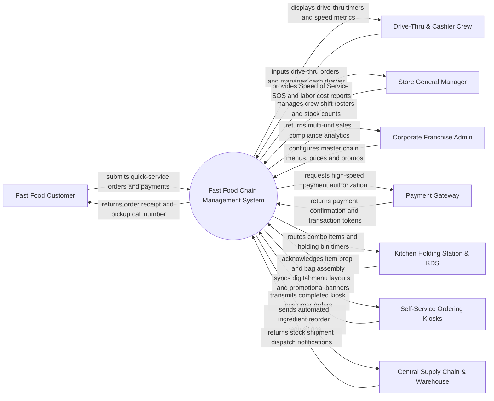

# Context Diagram — Fast Food Chain Management System

## Mermaid Code

## Actor & Interaction Table | Bang Actor & Tuong tac

| # | Actor | Actor Type | Data Sent TO System | Data Received FROM System | Notes |
|---|-------|------------|---------------------|---------------------------|-------|
| 1 | Fast Food Customer | Primary | Self-service kiosk selections, drive-thru orders, payments, loyalty barcodes | Order receipts, pickup number displays, promotional value meal options | Interacts via touchscreen kiosks, drive-thru speakers, or mobile app. |
| 2 | Crew | Primary | Counter order entries, drive-thru window payments, cash drawer balances | Speed of Service (SOS) timers, drive-thru lane queues, order prep alerts | Uses high-speed counter POS terminals and drive-thru headset systems. |
| 3 | Store General Manager | Primary | Crew shift rosters, local inventory receipts, fryer oil waste logs, local discounts | Speed of Service (SOS) reports, labor percentage metrics, stockout alerts | Accesses web-based store management operational dashboard. |
| 4 | Corporate Franchise Admin | Primary | Master menu catalog, national pricing matrices, campaign promos, franchise rules | Chain GMV analytics, multi-store sales comparisons, margin compliance reports | Manages multi-unit brand enterprise operations across all chain stores. |
| 5 | Payment Gateway | Supporting | High-speed payment tokens, card approvals, contactless QR authorizations | Credit card charge requests, e-wallet authorizations, split payments | Handles rapid payment processing for high-volume transactions (< 2 seconds). |
| 6 | Kitchen Holding Station & KDS | Supporting | Item holding bin expiration alerts, tray prep completions | Routed combo item tickets, patty holding timers, batch prep targets | Monitors cooked food holding bins (burger patties, fried chicken, fries). |
| 7 | Self-Service Ordering Kiosks | Supporting | Customer cart selections, payment status, kiosk health telemetry | Active menu catalogs, upsell suggestions, daypart schedules, high-res photos | Standalone customer-facing Ordering Touchscreens. |
| 8 | Central Supply Chain & Warehouse | Supporting | Shipment dispatch advice, transfer delivery notes, ingredient unit costs | Automated stock replenishment requisitions, stock transfer requests | Manages central commissary manufacturing and distribution logisitcs. |

## System Boundary Description | Mo ta Pham vi He thong

The **Fast Food Chain Management System** orchestrates high-volume multi-unit quick-service restaurant (QSR) operations, drive-thru order sequencing, self-service kiosk integrations, kitchen holding bin timers, and central supply chain inventory replenishment. Inside its boundary, the system handles sub-second POS order processing, drive-thru Speed of Service (SOS) timing, value meal combo routing, automated holding bin expiration tracking, corporate-level menu management, and multi-store labor cost analytics.

The system boundary excludes physical cooking by kitchen crew, physical vehicle drive-thru lane traffic control sensors, credit card payment clearing execution (handled by Payment Gateways), and central warehouse logistics shipping (handled by Central Supply Chain Systems).
