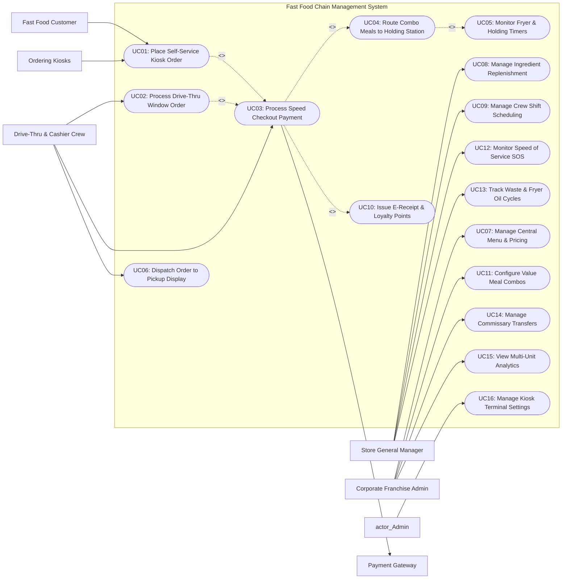

# Use Case Diagram — Fast Food Chain Management System

## Mermaid Code

## Actor Table | Bang Actor

| # | Actor | Actor Type | Role Description | Related Use Cases |
|---|-------|------------|------------------|-------------------|
| 1 | Fast Food Customer | Primary | Consumer ordering quick-service food via touchscreen kiosks or drive-thru lanes, customizing combo meals, and paying. | UC01 |
| 2 | Drive-Thru & Cashier Crew | Primary | Store front-of-house staff taking drive-thru window orders, processing high-speed checkout payments, and bagging orders for customer pickup. | UC02, UC03, UC06 |
| 3 | Store General Manager | Primary | On-site manager supervising store speed of service (SOS), crew shift schedules, ingredient replenishment, and waste tracking. | UC08, UC09, UC12, UC13 |
| 4 | Corporate Franchise Admin | Primary | Enterprise administrator maintaining brand master catalogs, multi-channel prices, promotional combos, commissary transfers, and chain analytics. | UC07, UC11, UC14, UC15 |
| 5 | Payment Gateway | Secondary System | High-speed payment provider processing credit cards, contactless QR codes, and e-wallets under 2 seconds. | UC03 |
| 6 | Ordering Kiosks | Secondary System | Self-service touchscreen hardware devices rendering menu catalogs, accepting customer selections, and sending orders to POS. | UC01, UC16 |

## Use Case Table | Bang Use Case

| # | UC ID | Use Case Name | Primary Actor | Secondary Actor | Description | Priority |
|---|-------|---------------|---------------|-----------------|-------------|----------|
| 1 | UC01 | Place Self-Service Kiosk Order | Customer | Ordering Kiosks | Allows guests to browse digital menus on touchscreen kiosks, select combo meals, customize ingredients, and pay. | High |
| 2 | UC02 | Process Drive-Thru Window Order | Crew | None | Captures drive-thru vehicle orders via headset system, sequences orders by lane queue, and sends to kitchen. | High |
| 3 | UC03 | Process Speed Checkout Payment | Crew | Payment Gateway | Processes high-volume customer payments in under 2 seconds using cash, card tap, or e-wallet QR codes. | High |
| 4 | UC04 | Route Combo Meals to Holding Station | System | None | Splits combo order items and dispatches components to kitchen holding bins (Burger Line, Fryer, Drink Bar). | High |
| 5 | UC05 | Monitor Fryer & Holding Timers | System | None | Tracks holding bin freshness countdown timers (e.g., 10 mins for French fries) and triggers discard alarms when expired. | High |
| 6 | UC06 | Dispatch Order to Pickup Display | Crew | None | Renders order numbers on overhead customer pickup TV screens (`Preparing` -> `Ready for Pickup`). | High |
| 7 | UC07 | Manage Central Menu & Pricing | Corporate Admin | None | Configures brand master menu items, PLU codes, regional pricing tiers, and tax rules across all chain stores. | High |
| 8 | UC08 | Manage Ingredient Replenishment | Store Manager | Central Supply Chain | Monitors raw food inventory stock (patties, buns, cheese), sending automated purchase requisitions to commissary. | High |
| 9 | UC09 | Manage Crew Shift Scheduling | Store Manager | None | Schedules crew work shifts, manages labor hour budgets, tracks clock-in attendance, and enforces break rules. | Medium |
| 10 | UC10 | Issue E-Receipt & Loyalty Points | Crew | None | Prints fast-receipt chits or issues digital e-receipts with instant loyalty rewards accumulation. | Medium |
| 11 | UC11 | Configure Value Meal Combos | Corporate Admin | None | Builds promotional value meal bundles (Main + Side + Drink) with discount rules and up-sell choices. | High |
| 12 | UC12 | Monitor Speed of Service SOS | Store Manager | None | Measures store order fulfillment velocity across Order Entry, Kitchen Prep, and Window Handoff stages against target SLAs. | High |
| 13 | UC13 | Track Waste & Fryer Oil Cycles | Store Manager | None | Logs discarded expired food, patty drops, and tracks deep fryer oil filtration and replacement schedules. | Medium |
| 14 | UC14 | Manage Commissary Transfers | Corporate Admin | Central Supply Chain | Oversees raw ingredient batch distribution from central commissaries to regional fast food store outlets. | Medium |
| 15 | UC15 | View Multi-Unit Analytics | Corporate Admin | None | Displays real-time chain Gross Merchandise Value (GMV), store sales rankings, labor cost percentages, and margin compliance. | High |
| 16 | UC16 | Manage Kiosk Terminal Settings | System Admin | None | Configures kiosk device IP network bindings, printer hardware status, screen saver videos, and UI themes. | Medium |

## Use Case Specification | Dac ta Use Case

---

### UC01 — Place Self-Service Kiosk Order

| Field | Detail |
|-------|--------|
| **UC ID** | UC01 |
| **Use Case Name** | Place Self-Service Kiosk Order |
| **Actor(s)** | Primary: Fast Food Customer   Secondary: Ordering Kiosks |
| **Description** | Allows a fast food customer to interact with a self-service touchscreen kiosk, select items or combo value meals, customize ingredients, pay via card/QR, and receive an order pickup receipt. |
| **Precondition** | 1. Self-service kiosk terminal is powered on and running active kiosk software.   2. Active store menu catalog and item availability are synced. |
| **Main Flow** | 1. Customer taps kiosk screen to start order and selects dining option ("Eat In" or "Take Out").   2. Kiosk displays visual menu categories (Burgers, Chicken, Fries & Sides, Drinks, Desserts, Value Meals).   3. Customer selects a combo meal (e.g., Double Cheeseburger Value Meal).   4. Kiosk opens combo customization wizard: step 1 select burger modifiers (No Pickle, Extra Cheese); step 2 select side (Large Fries); step 3 select beverage (Iced Tea).   5. Kiosk displays dynamic up-sell suggestion popup (e.g., "Add Apple Pie for $1.00?").   6. Customer accepts or declines up-sell and proceeds to cart checkout.   7. Customer selects payment method (Card Tap or E-Wallet QR Code) and completes payment (executing UC03).   8. Kiosk prints paper thermal order receipt displaying Order Pickup Number (e.g., #402).   9. Kiosk sends order payload to POS server, which routes items to kitchen holding stations (executing UC04) and updates overhead pickup screen (`Preparing: #402`). |
| **Alternative Flow** | **AF1** — Cash payment at counter option:   1. At step 7, Customer selects "Pay Cash at Counter".   2. Kiosk prints a pending order chit.   3. Customer takes chit to cashier crew at counter, pays cash, and cashier releases order to kitchen. |
| **Exception Flow** | **EX1** — Kiosk card reader timeout / decline:   1. At step 7, card reader fails to process payment within 30 seconds or declines card.   2. Kiosk alerts Customer "Payment declined. Please try another card or pay at counter" and preserves cart.    **EX2** — Kiosk printer out of paper:   1. At step 8, kiosk built-in receipt printer senses end-of-paper roll.   2. Kiosk displays order pickup number prominently on screen, sends alert to manager, and sends receipt via SMS/QR. |
| **Postcondition** | Kiosk order is paid, pickup number is issued to customer, and order items route to kitchen holding stations. |
| **Business Rule** | **BR1**: Kiosk orders must automatically reset to home screens if inactive for > 45 seconds during cart browsing.   **BR2**: Value meal combo suggestions must prioritize high-margin promotional items configured by corporate admin. |

---

### UC02 — Process Drive-Thru Window Order

| Field | Detail |
|-------|--------|
| **UC ID** | UC02 |
| **Use Case Name** | Process Drive-Thru Window Order |
| **Actor(s)** | Primary: Drive-Thru & Cashier Crew   Secondary: None |
| **Description** | Captures fast food orders from vehicle drivers at the drive-thru order speaker post, sequences orders by vehicle lane arrival, processes payment at Window 1, and hands food at Window 2. |
| **Precondition** | 1. Drive-thru POS terminal and headset system are active.   2. Vehicle detector loop triggers order speaker alert chime. |
| **Main Flow** | 1. Vehicle arrives at drive-thru order speaker; Crew headset sounds arrival chime.   2. Crew greets customer: "Welcome to QuickBurger! May I take your order?".   3. Customer speaks order into speaker post. Crew inputs order items into drive-thru POS screen in real time.   4. Drive-thru POS updates customer-facing outdoor Order Confirmation Board (OCB) showing item list, customizations, and total price.   5. Crew confirms order total and directs driver: "Please drive ahead to Window 1 for payment."   6. POS sends order items to kitchen holding station KDS (executing UC04) and assigns vehicle sequence ID (e.g., DT-12).   7. Driver arrives at Window 1. Cashier Crew confirms order DT-12 and processes payment (executing UC03).   8. Driver moves to Window 2. Presenter Crew verifies order contents, bags food, and hands order to driver within target Speed of Service SLA (<= 120 seconds total). |
| **Alternative Flow** | **AF1** — Single-window drive-thru operation:   1. Off-peak hours use 1 window for both payment and food handoff.   2. Cashier processes payment and presents food at Window 1 sequentially.    **AF2** — Parked vehicle holding strategy (Delayed Order):   1. At Window 2, a large custom order is not yet ready, threatening lane bottleneck.   2. Presenter Crew directs driver to park in reserved "Drive-Thru Holding Bay 1".   3. Runner crew delivers food to parked vehicle once ready, freeing Window 2 for next vehicles. |
| **Exception Flow** | **EX1** — Driver changes order at payment window:   1. At Window 1, driver requests to add 2 milkshakes.   2. Cashier inputs additional items, updates order total, and triggers rush ticket alert to kitchen bar KDS. |
| **Postcondition** | Drive-thru order is taken, paid, assembled, and handed off while vehicle transit time metrics are recorded. |
| **Business Rule** | **BR1**: Drive-Thru total Speed of Service SLA from speaker loop to Window 2 handoff must target <= 180 seconds.   **BR2**: Outdoor Order Confirmation Boards must display order items within 500 milliseconds of crew POS touch entry. |

---

### UC03 — Process Speed Checkout Payment

| Field | Detail |
|-------|--------|
| **UC ID** | UC03 |
| **Use Case Name** | Process Speed Checkout Payment |
| **Actor(s)** | Primary: Drive-Thru & Cashier Crew   Secondary: Payment Gateway |
| **Description** | Processes high-volume counter and drive-thru customer payments in under 2 seconds using cash, credit card tap, or e-wallet QR code scan to maximize throughput. |
| **Precondition** | 1. Order ticket is finalized on POS screen.   2. POS payment terminal and high-speed card reader are connected. |
| **Main Flow** | 1. Cashier Crew prompts customer for payment method.   2. Customer presents tender (Cash, Contactless Credit Card Tap, Apple Pay, or E-Wallet QR).   3. If **Cash**: Cashier taps quick-cash button (e.g., "$20 Quick Cash"); POS opens cash drawer, displays change due ($4.50), and Cashier hands change to customer.   4. If **Contactless Card / Apple Pay**: Customer taps card/phone on high-speed NFC reader; POS sends authorization token to Payment Gateway.   5. Payment Gateway processes transaction approval in < 1.5 seconds and returns success response.   6. POS marks order as `Paid`.   7. POS triggers automatic order dispatch to kitchen holding KDS (executing UC04).   8. POS prints fast-receipt chit (executing UC10) and completes checkout. |
| **Alternative Flow** | **AF1** — Integrated e-wallet barcode scan:   1. Customer presents e-wallet payment QR code on smartphone.   2. Cashier scans code using 2D barcode scanner; POS completes payment clearance automatically in < 1 second. |
| **Exception Flow** | **EX1** — Payment authorization timeout:   1. At step 5, Payment Gateway fails to respond within 3 seconds due to network lag.   2. POS automatically switches to offline pre-authorization mode for transactions < $25, completing checkout and queuing settlement for network restoration. |
| **Postcondition** | Payment is approved, cash drawer drawer pop is logged, order is marked paid, and kitchen dispatch triggers. |
| **Business Rule** | **BR1**: Card/NFC payment authorizations must process and complete in under 2.0 seconds during peak rush hours.   **BR2**: Cash drawers must trigger automated security alarms if left open for > 20 seconds. |

---

### UC05 — Monitor Fryer & Holding Timers

| Field | Detail |
|-------|--------|
| **UC ID** | UC05 |
| **Use Case Name** | Monitor Fryer & Holding Timers |
| **Actor(s)** | Primary: System   Secondary: None |
| **Description** | Tracks cooked food holding bin freshness timers (e.g., 10 mins for French fries, 20 mins for beef patties) and triggers discard alarms when product holding times expire. |
| **Precondition** | 1. Kitchen holding station monitors and product holding timers (fries, patties, nuggets) are active.   2. Cooked food holding bin SLA limits are configured in system parameters. |
| **Main Flow** | 1. Kitchen crew cooks a batch of food (e.g., 12 beef patties) and transfers cooked batch into heated holding bin.   2. Crew presses holding bin timer button (e.g., "Bin 2 - Beef Patties") on holding station display.   3. System initializes product holding countdown timer (e.g., 20:00 minutes) for Bin 2.   4. Holding station screen displays active timer in Green counting down.   5. As items are assembled for customer orders, System decrements estimated remaining batch quantity.   6. When holding timer reaches 3 minutes remaining, display header changes to **Yellow / Warning**.   7. If holding timer reaches 00:00 (expiration) before batch is fully sold, System changes display header to **Blinking Red** and sounds audible discard chime alert.   8. Crew discards expired food from Bin 2, presses "Discard Product", and System logs discarded quantity to food waste audit database (executing UC13). |
| **Alternative Flow** | **AF1** — Batch sold out before timer expiration:   1. All patties in Bin 2 are used for customer orders at minute 12:00 of 20:00 timer.   2. Crew presses "Bin Empty"; System clears active holding timer. |
| **Exception Flow** | **EX1** — Discard alarm ignored by crew:   1. Holding timer reaches 00:00 expired, but crew fails to press discard button within 2 minutes.   2. System flags holding SLA breach alert on Store Manager dashboard and blocks order assignment from that bin. |
| **Postcondition** | Product holding bin freshness is monitored, expiration discard alarms trigger, and food waste metrics log. |
| **Business Rule** | **BR1**: Cooked products reaching holding timer expiration MUST be discarded immediately per brand food safety compliance.   **BR2**: Holding bin timers must reset automatically whenever a new cooked batch is added to the bin. |

---

### UC07 — Manage Central Menu & Pricing

| Field | Detail |
|-------|--------|
| **UC ID** | UC07 |
| **Use Case Name** | Manage Central Menu & Pricing |
| **Actor(s)** | Primary: Corporate Franchise Admin   Secondary: None |
| **Description** | Allows corporate franchise administrators to manage master brand menu catalogs, set global PLU codes, configure regional store pricing tiers, and deploy menu updates to all chain stores. |
| **Precondition** | 1. User is authenticated with Corporate Franchise Admin privileges.   2. Enterprise Menu Management module is open. |
| **Main Flow** | 1. Corporate Admin accesses Central Menu Management console.   2. Admin creates or edits master fast food items (e.g., Big Spicy Burger), assigning global PLU codes, item categories, VAT tax classes, and default base prices.   3. Admin configures regional store pricing tiers (e.g., Tier 1: Standard Stores; Tier 2: Airport / Premium Location Stores with +15% pricing).   4. Admin maps items to master kitchen station routing categories (Grill Line, Fryer Station, Beverage Bar, Soft Serve).   5. Admin attaches allergen disclosures (Gluten, Dairy, Soy) and caloric specs (550 kcal) to dish records.   6. Admin selects target store deployment scope (All Stores, Region North, or Franchise Group A).   7. Admin clicks "Publish Central Menu Catalog".   8. System validates PLU codes and price matrices, generates channel payloads, and dispatches updates to store POS servers, self-service kiosks, and mobile apps nationwide. |
| **Alternative Flow** | **AF1** — Schedule seasonal menu roll-out:   1. Admin configures a new LTO (Limited Time Offer) menu item (e.g., "Summer Mango Smoothie") to launch on June 1st at 06:00 AM.   2. System schedules automated deployment; menu item activates across kiosks and POS terminals on specified launch date. |
| **Exception Flow** | **EX1** — Store POS sync disconnection:   1. Store #104 POS server is offline during menu broadcast at step 8.   2. System logs sync failure, flags store as `Menu Pending Sync`, and automatically retries transmission upon store server reconnection. |
| **Postcondition** | Central menu catalog and pricing matrices are saved and deployed to store POS terminals and kiosks across the enterprise. |
| **Business Rule** | **BR1**: Core brand menu items cannot be deleted or price-modified by individual store managers without corporate approval.   **BR2**: Central menu updates must sync to all store POS client terminals within 10 seconds of broadcast deployment. |
