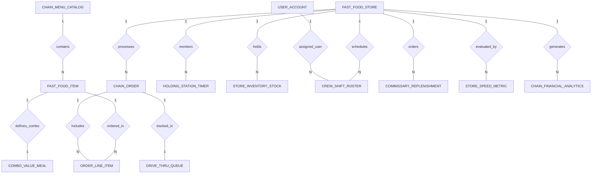

# Conceptual ERD — Fast Food Chain Management System

## Mermaid Code

## Entity Description Table | Bang mo ta Entity

| # | Entity Name | Vietnamese Name | Description | Key Attributes | Main Relationships |
|---|-------------|-----------------|-------------|----------------|-------------------|
| 1 | FAST_FOOD_STORE | Cua hang thuc an nhanh | Represents individual fast food chain store outlets, store codes, pricing tiers, and drive-thru status. | store_id, store_code, store_name, pricing_tier, is_drive_thru_active | One-to-Many with CHAIN_ORDER, STORE_INVENTORY_STOCK, CREW_SHIFT_ROSTER, COMMISSARY_REPLENISHMENT, HOLDING_STATION_TIMER, STORE_SPEED_METRIC, CHAIN_FINANCIAL_ANALYTICS |
| 2 | CHAIN_MENU_CATALOG | Danh muc thuc don chuoi | Master corporate menu catalog container organizing menu items, pricing rules, and version tags. | catalog_id, catalog_name, brand_code, version_tag, is_active | One-to-Many with FAST_FOOD_ITEM |
| 3 | FAST_FOOD_ITEM | Mon an thuc an nhanh | Individual fast food menu dishes, PLU codes, base prices, and kitchen station routing tags (Grill, Fryer, Drinks). | item_id, plu_code, item_name, base_price, station_routing_tag | Belongs to CHAIN_MENU_CATALOG; One-to-Many with ORDER_LINE_ITEM; One-to-One with COMBO_VALUE_MEAL |
| 4 | COMBO_VALUE_MEAL | Goi gia tri Combo | Structures combo meal bundles (Main + Side + Drink), defining total package pricing and discount rules. | combo_id, item_id, combo_name, combo_price | One-to-One with FAST_FOOD_ITEM |
| 5 | CHAIN_ORDER | Don hang cua hang | Central fast food transaction record, capturing channel source (Kiosk, POS, Drive-Thru), grand totals, and pickup numbers. | order_id, store_id, staff_id, order_channel, grand_total, order_status, pickup_number | Belongs to FAST_FOOD_STORE; One-to-Many with ORDER_LINE_ITEM; One-to-One with DRIVE_THRU_QUEUE |
| 6 | ORDER_LINE_ITEM | Chi tiet don hang | Individual menu items included in an order, capturing line quantities, unit prices, and customization modifiers. | line_item_id, order_id, item_id, quantity, unit_price, custom_modifiers | Belongs to CHAIN_ORDER, FAST_FOOD_ITEM |
| 7 | HOLDING_STATION_TIMER | Dem thoi gian khay giu | Tracks cooked food holding bin freshness timers (fries, patties, nuggets), fill times, and discard expiration states. | timer_id, store_id, bin_identifier, product_name, max_holding_seconds, timer_status | Belongs to FAST_FOOD_STORE |
| 8 | DRIVE_THRU_QUEUE | Hang cho Drive-Thru | Tracks drive-thru vehicle sequence tags, speaker order times, payment times, handoff times, and Speed of Service (SOS) seconds. | queue_id, order_id, store_id, vehicle_sequence_tag, total_sos_seconds | One-to-One with CHAIN_ORDER; Belongs to FAST_FOOD_STORE |
| 9 | STORE_INVENTORY_STOCK | Ton kho cua hang | Tracks raw ingredient stock levels (patties, buns, cheese, oil) and minimum safety stock reorder thresholds. | stock_id, store_id, ingredient_code, current_quantity, min_safety_stock | Belongs to FAST_FOOD_STORE |
| 10 | CREW_SHIFT_ROSTER | Lich ca nhan vien | Schedules crew employee work shifts, assigned operational positions (Kiosk, Cashier, Drive-Thru, Kitchen), and hours. | roster_id, store_id, staff_id, shift_start, shift_end, position_assigned | Belongs to FAST_FOOD_STORE, USER_ACCOUNT |
| 11 | COMMISSARY_REPLENISHMENT | Yeu cau kho trung tam | Manages stock replenishment requisitions sent from store outlets to central commissaries and shipment statuses. | requisition_id, store_id, requested_at, shipment_status, total_cost | Belongs to FAST_FOOD_STORE |
| 12 | STORE_SPEED_METRIC | Thong ke toc do phuc vu | Aggregates daily Speed of Service (SOS) metrics including average kiosk checkout times and drive-thru window SLAs. | metric_id, store_id, metric_date, avg_kiosk_sos_seconds, avg_drive_thru_sos_seconds | Belongs to FAST_FOOD_STORE |
| 13 | USER_ACCOUNT | Tai khoan nguoi dung | Core user account holding credentials, password hashes, and security role definitions (Crew, Store Manager, Corporate Admin). | user_id, username, password_hash, role_name | One-to-Many with CREW_SHIFT_ROSTER |
| 14 | CHAIN_FINANCIAL_ANALYTICS | Thong ke taichinh chuoi | Aggregates store daily sales revenue, labor cost percentages, food waste cost figures, and operating margins. | analytics_id, store_id, metric_date, total_sales_revenue, labor_cost_percentage, food_waste_cost | Belongs to FAST_FOOD_STORE |

## Relationship Description | Mo ta Quan he

| # | From Entity | Cardinality | To Entity | Relationship Label | Business Explanation |
|---|-------------|-------------|-----------|-------------------|----------------------|
| 1 | FAST_FOOD_STORE | One-to-Many | CHAIN_ORDER | processes | Mot cua hang thuc an nhanh xu ly nhieu don hang tu cac kenh POS, Kiosk, Drive-Thru. |
| 2 | FAST_FOOD_STORE | One-to-Many | STORE_INVENTORY_STOCK | holds | Mot cua hang luu tru va quan ly kho nguyen lieu thuc pham tai cho. |
| 3 | FAST_FOOD_STORE | One-to-Many | CREW_SHIFT_ROSTER | schedules | Mot cua hang thiet lap va quan ly lich ca lam viec cho doi ngu nhan vien. |
| 4 | FAST_FOOD_STORE | One-to-Many | COMMISSARY_REPLENISHMENT | orders | Mot cua hang gui cac yeu cau tai cung cap nguyen lieu ve kho trung tam commissary. |
| 5 | CHAIN_MENU_CATALOG | One-to-Many | FAST_FOOD_ITEM | contains | Danh muc thuc don goc cua chuoi chua nhieu mon an va combo gia tri. |
| 6 | FAST_FOOD_ITEM | One-to-Many | ORDER_LINE_ITEM | ordered_in | Mot mon an duoc dat nhieu lan trong cac don hang cua khach hang. |
| 7 | CHAIN_ORDER | One-to-Many | ORDER_LINE_ITEM | includes | Mot don hang chuoi bao gom nhieu dong chi tiet mon an va tuy chon combo. |
| 8 | FAST_FOOD_ITEM | One-to-One | COMBO_VALUE_MEAL | defines_combo | Mot mon an loai Combo duoc dinh nghia cau truc goi gia tri tuong ung. |
| 9 | FAST_FOOD_STORE | One-to-Many | HOLDING_STATION_TIMER | monitors | Mot cua hang theo doi nhieu bo dem thoi gian khay giu do an nong tai bep. |
| 10 | CHAIN_ORDER | One-to-One | DRIVE_THRU_QUEUE | tracked_in | Mot don hang Drive-Thru duoc theo doi qua mot ban ghi hang cho xe va toc do phuc vu. |
| 11 | FAST_FOOD_STORE | One-to-Many | STORE_SPEED_METRIC | evaluated_by | Mot cua hang duoc thong ke va danh gia toc do phuc vu SOS dinh ky. |
| 12 | USER_ACCOUNT | One-to-Many | CREW_SHIFT_ROSTER | assigned_user | Mot tai khoan nguoi dung nhan vien duoc phan cong vao cac ca lam viec. |
| 13 | FAST_FOOD_STORE | One-to-Many | CHAIN_FINANCIAL_ANALYTICS | generates | Mot cua hang phat sinh va ghi nhan cac bao cao thong ke tai chinh va chi phi nhan cong. |
