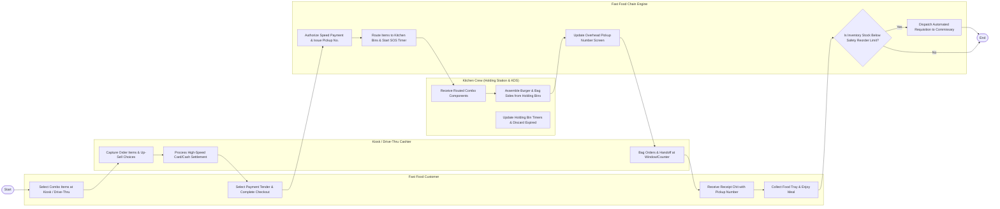

# Swimlane Diagram — Fast Food Chain Management System

## Mermaid Code

## Flow Description | Mo ta luong

| Lane | Actor | Role in Flow |
|------|-------|-------------|
| **Lane 1** | Fast Food Customer | Selects combo value meals at self-service kiosks or drive-thru speakers, completes high-speed payment, receives pickup number receipt, and collects food tray. |
| **Lane 2** | Kiosk / Drive-Thru Cashier | Captures order items and up-sell choices, processes sub-second card tap/cash settlements, bags assembled food, and hands order to customer. |
| **Lane 3** | Kitchen Crew (Holding Station & KDS) | Receives routed order components on KDS screens, assembles burgers and packs sides from pre-cooked heated holding bins, and manages product holding bin freshness timers. |
| **Lane 4** | Fast Food Chain Engine | Authorizes speed payments, issues order pickup numbers, routes items to kitchen stations, tracks Speed of Service (SOS) timers, updates overhead pickup displays, and manages commissary stock requisitions. |

### Process Execution Steps | Cac buoc thuc hien quy trinh

1. **High-Speed Ordering & Up-Sell**: Customer selects combo meal options at touchscreen kiosk or drive-thru speaker (`C1`). Cashier or kiosk captures choices and suggests up-sells (`K1`).
2. **Speed Settlement & Pickup Issuance**: Customer selects tender method (`C2`). Cashier processes sub-second checkout payment (`K2`). Chain Engine authorizes payment, assigns pickup number (`S1`), and starts Speed of Service (SOS) timer (`S2`).
3. **Kitchen Assembly from Holding Bins**: Chain Engine routes items to Kitchen KDS (`S2`). Kitchen Crew receives order (`B1`), packs burgers and fries from heated holding bins (`B2`), and updates bin timers (`B3`).
4. **Handoff & Screen Dispatch**: Chain Engine updates overhead pickup screen to `Ready` (`S3`). Cashier/Presenter bags order and hands tray to customer (`K3`, `C3`, `C4`).
5. **Perpetual Inventory & Supply Chain Reorder**: Chain Engine updates raw ingredient inventory balances perpetually and evaluates safety reorder thresholds (`S4`).
   - If **Yes**: Engine dispatches automated replenishment requisition to central commissary warehouse (`S5`), completing execution (`Finish`).
   - If **No**: Execution ends cleanly (`Finish`).
