# Action Tree — Fast Food Chain Management System

## Mermaid Code

```mermaid
graph TD
    Root["Fast Food Chain Management System"]

    Root --> M1["High-Speed POS & Self-Service Kiosks"]
    Root --> M2["Drive-Thru Lane Management"]
    Root --> M3["Kitchen Holding Station & KDS Dispatch"]
    Root --> M4["Supply Chain & Commissary Replenishment"]
    Root --> M5["Multi-Store Menu & Promotion Control"]
    Root --> M6["Labor Scheduling & Speed of Service SOS"]
    Root --> M7["Enterprise Analytics & POS Administration"]

    M1 --> A11["Process Touchscreen Kiosk Orders"]
    M1 --> A12["Process Sub-Second Card & QR Payments"]
    M1 --> A13["Prompt Automated Up-Sell Suggestions"]
    M1 --> A14["Print Fast-Receipt Pickup Chits"]

    M2 --> A21["Sequence Drive-Thru Speaker Orders"]
    M2 --> A22["Update Outdoor Confirmation Boards"]
    M2 --> A23["Manage Drive-Thru Window Payments"]
    M2 --> A24["Track Parked Vehicle Holding Bays"]

    M3 --> A31["Route Combo Components to Kitchen KDS"]
    M3 --> A32["Monitor Holding Bin Freshness Timers"]
    M3 --> A33["Trigger Product Expiration Discard Alarms"]
    M3 --> A34["Update Overhead Pickup Screen Numbers"]

    M4 --> A41["Track Raw Stock Inventory Balances"]
    M4 --> A42["Generate Commissary Reorder Requisitions"]
    M4 --> A43["Process Store Stock Transfer Receipts"]
    M4 --> A44["Audit Food Spoilage & Oil Waste"]

    M5 --> A51["Configure Central Master Menu Catalogs"]
    M5 --> A52["Set Regional Store Pricing Tiers"]
    M5 --> A53["Configure Promotional Value Meal Combos"]
    M5 --> A54["Deploy Catalog Sync to Stores"]

    M6 --> A61["Schedule Crew Work Shift Rosters"]
    M6 --> A62["Track Time & Attendance Clock-In"]
    M6 --> A63["Monitor Real-Time Speed of Service SOS"]
    M6 --> A64["Enforce Labor Cost Budget Limits"]

    M7 --> A71["Monitor Chain Gross Merchandise Value GMV"]
    M7 --> A72["Compare Multi-Unit Store Sales Rankings"]
    M7 --> A73["Manage Kiosk & POS Network Devices"]
    M7 --> A74["Export Corporate Tax Audit Reports"]
```

## Module Description | Mo ta Module

| # | Module | Description | Actions |
|---|--------|-------------|---------|
| 1 | High-Speed POS & Self-Service Kiosks | Controls customer touchscreen ordering, sub-second payment settlements, automated up-sell prompts, and fast-receipt pickup chit printing. | Process Touchscreen Kiosk Orders, Process Sub-Second Card & QR Payments, Prompt Automated Up-Sell Suggestions, Print Fast-Receipt Pickup Chits |
| 2 | Drive-Thru Lane Management | Manages drive-thru speaker headset order entry, outdoor confirmation board displays, payment window checkouts, and parked vehicle holding bays. | Sequence Drive-Thru Speaker Orders, Update Outdoor Confirmation Boards, Manage Drive-Thru Window Payments, Track Parked Vehicle Holding Bays |
| 3 | Kitchen Holding Station & KDS Dispatch | Handles combo item routing to station KDS displays, heated product holding bin timers, product expiration discard alerts, and overhead pickup screens. | Route Combo Components to Kitchen KDS, Monitor Holding Bin Freshness Timers, Trigger Product Expiration Discard Alarms, Update Overhead Pickup Screen Numbers |
| 4 | Supply Chain & Commissary Replenishment | Tracks perpetual ingredient stock levels, generates automated replenishment requisitions to central commissaries, logs store transfers, and audits oil waste. | Track Raw Stock Inventory Balances, Generate Commissary Reorder Requisitions, Process Store Stock Transfer Receipts, Audit Food Spoilage & Oil Waste |
| 5 | Multi-Store Menu & Promotion Control | Configures corporate master menu catalogs, regional pricing tiers, promotional value meal bundles, and instant multi-unit catalog broadcasts. | Configure Central Master Menu Catalogs, Set Regional Store Pricing Tiers, Configure Promotional Value Meal Combos, Deploy Catalog Sync to Stores |
| 6 | Labor Scheduling & Speed of Service (SOS) | Manages crew work rosters, time clock attendance, real-time Speed of Service (SOS) SLA tracking, and labor budget percentage controls. | Schedule Crew Work Shift Rosters, Track Time & Attendance Clock-In, Monitor Real-Time Speed of Service SOS, Enforce Labor Cost Budget Limits |
| 7 | Enterprise Analytics & POS Administration | Provides corporate executive dashboards on chain GMV, multi-unit store sales rankings, kiosk hardware network management, and tax compliance audits. | Monitor Chain Gross Merchandise Value GMV, Compare Multi-Unit Store Sales Rankings, Manage Kiosk & POS Network Devices, Export Corporate Tax Audit Reports |
