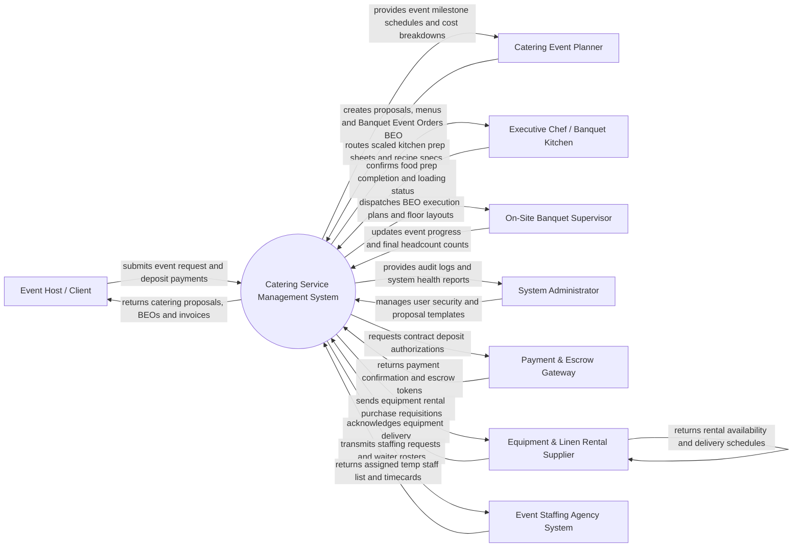

# Context Diagram — Catering Service Management System

## Mermaid Code

## Actor & Interaction Table | Bang Actor & Tuong tac

| # | Actor | Actor Type | Data Sent TO System | Data Received FROM System | Notes |
|---|-------|------------|---------------------|---------------------------|-------|
| 1 | Event Host / Client | Primary | Event details (date, guest count, venue), menu package choices, dietary restrictions, deposit payments | Custom catering proposals, Banquet Event Orders (BEO), contract invoices | Interacts via online client portal, proposal links, or email. |
| 2 | Catering Event Planner | Primary | Proposal creation, menu customizations, BEO parameters, staff rosters, equipment requisitions | Margin calculations, availability matrix, BEO documents, contract status | Manages end-to-end event planning and client relations. |
| 3 | Executive Chef / Banquet Kitchen | Primary | Kitchen prep status, ingredient shortage alerts, recipe scaling confirmations | Scaled ingredient prep sheets, batch cooking schedules, packing lists | Uses kitchen management dashboard or tablet screens. |
| 4 | On-Site Banquet Supervisor | Primary | Actual guest headcount, event timeline milestones, on-site add-on charges, staff attendance | Master BEO document, venue floor plans, equipment checklists, server schedules | Oversees live banquet execution at the event venue. |
| 5 | System Administrator | Primary | User accounts, security roles, document templates, API integration keys | Audit trail logs, system error alerts, security monitoring metrics | Manages IT infrastructure, user permissions, and template settings. |
| 6 | Payment & Escrow Gateway | Supporting | Deposit authorization status, milestone payment holds, final charge approvals | Charge requests, contract milestone subtotals, refund instructions | Processes credit card deposits, wire transfers, and escrow holds. |
| 7 | Equipment & Linen Rental Supplier | Supporting | Equipment availability, rental delivery schedules, item replacement costs | Rental orders (tables, chairs, china, silverware, linens), delivery locations | External vendor providing specialized event hardware and linens. |
| 8 | Event Staffing Agency System | Supporting | Assigned temp staff rosters, waiter credentials, hourly timecards | Temporary staffing requests (servers, bartenders, busboys), event specs | External agency supplying supplemental event personnel. |

## System Boundary Description | Mo ta Pham vi He thong

The **Catering Service Management System** automates off-site and on-site banquet catering operations, proposal generation, contract management, Banquet Event Order (BEO) publishing, and kitchen batch ingredient scaling. Inside its boundary, the system handles event lead tracking, custom menu package engineering, automated recipe scaling based on guest headcount, equipment rental logistics, temporary staffing dispatching, venue site surveys, and multi-stage contract billing.

The system boundary excludes physical food cooking by chefs, physical transportation of catering vans, raw credit card clearing execution (handled by Payment Gateways), and physical event equipment manufacturing (handled by Rental Suppliers).
