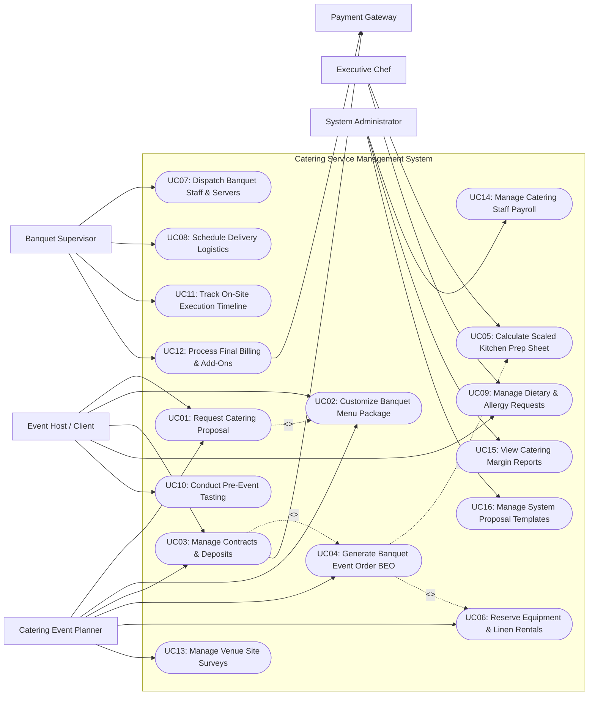

# Use Case Diagram — Catering Service Management System

## Mermaid Code

## Actor Table | Bang Actor

| # | Actor | Actor Type | Role Description | Related Use Cases |
|---|-------|------------|------------------|-------------------|
| 1 | Event Host / Client | Primary | Individual or corporate client requesting catering quotes, customizing banquet menus, signing contracts, and making deposit payments. | UC01, UC02, UC03, UC09, UC10 |
| 2 | Catering Event Planner | Primary | Account manager who negotiates contracts, designs custom menu proposals, generates BEOs, reserves rental equipment, and conducts site surveys. | UC01, UC02, UC03, UC04, UC06, UC13 |
| 3 | Executive Chef | Primary | Culinary lead who receives BEO requirements, generates scaled batch prep sheets, manages recipe portions, and oversees kitchen preparation. | UC05, UC09 |
| 4 | On-Site Banquet Supervisor | Primary | Field operational supervisor managing event setup, dispatching servers/bartenders, monitoring event timelines, and logging final headcounts. | UC07, UC08, UC11, UC12 |
| 5 | System Administrator | Primary | Technical admin managing user accounts, security permissions, document templates, and financial analytics. | UC14, UC15, UC16 |
| 6 | Payment Gateway | Secondary System | Third-party financial provider authorizing credit card deposit holds, wire transfers, and processing final event balances. | UC03, UC12 |

## Use Case Table | Bang Use Case

| # | UC ID | Use Case Name | Primary Actor | Secondary Actor | Description | Priority |
|---|-------|---------------|---------------|-----------------|-------------|----------|
| 1 | UC01 | Request Catering Proposal | Client / Planner | None | Submits event specifications (date, location, guest count, event style) and generates formal catering proposals. | High |
| 2 | UC02 | Customize Banquet Menu Package | Client / Planner | None | Selects buffet/plated menu packages, hors d'oeuvres, bar packages, and premium food upgrades. | High |
| 3 | UC03 | Manage Contracts & Deposits | Client / Planner | Payment Gateway | Issues legally binding catering contracts, secures non-refundable booking deposits, and tracks payment schedules. | High |
| 4 | UC04 | Generate Banquet Event Order BEO | Planner | None | Creates the master BEO document detailing event timeline, room setup, menu specs, bar details, and staff assignments. | High |
| 5 | UC05 | Calculate Scaled Kitchen Prep Sheet | Executive Chef | None | Automatically scales ingredient quantities based on BEO guest headcount and outputs kitchen batch prep sheets. | High |
| 6 | UC06 | Reserve Equipment & Linen Rentals | Planner | Rental Supplier | Calculates required tables, chairs, china, glassware, and linens based on guest count, sending rental requisitions. | High |
| 7 | UC07 | Dispatch Banquet Staff & Servers | Supervisor | Staff Agency | Schedules head captains, floor servers, bartenders, and kitchen porters based on guest-to-staff ratios. | High |
| 8 | UC08 | Schedule Delivery Logistics | Supervisor | None | Coordinates refrigerated transport vans, loading dock schedules, hot-box transport, and venue unload timing. | Medium |
| 9 | UC09 | Manage Dietary & Allergy Requests | Client / Chef | None | Logs special guest dietary needs (Vegan, Gluten-Free, Kosher, Severe Nut Allergy) and tracks customized meal plates. | High |
| 10 | UC10 | Conduct Pre-Event Tasting | Client | None | Schedules pre-event menu tasting sessions, capturing client feedback and dish recipe adjustments. | Medium |
| 11 | UC11 | Track On-Site Execution Timeline | Supervisor | None | Monitors real-time event milestones (Cocktail Hour, Grand Entrance, Dinner Service, Toast, Teardown). | Medium |
| 12 | UC12 | Process Final Billing & Add-Ons | Supervisor | Payment Gateway | Calculates final invoice adjustments (actual guest headcount, over-time labor hours, extra bar tab) and collects final balance. | High |
| 13 | UC13 | Manage Venue Site Surveys | Planner | None | Records venue layout measurements, electrical power capacity, kitchen loading access, and water supply availability. | Medium |
| 14 | UC14 | Manage Catering Staff Payroll | System Admin | None | Calculates event server hourly pay, overtime hours, and tip distribution per event assignment. | Medium |
| 15 | UC15 | View Catering Margin Reports | System Admin | None | Generates analytical reports on event profitability, food cost percentages, labor ratios, and venue performance. | High |
| 16 | UC16 | Manage System Proposal Templates | System Admin | None | Configures branded proposal templates, default terms and conditions, menu pricing rules, and contract clauses. | High |

## Use Case Specification | Dac ta Use Case

---

### UC01 — Request Catering Proposal

| Field | Detail |
|-------|--------|
| **UC ID** | UC01 |
| **Use Case Name** | Request Catering Proposal |
| **Actor(s)** | Primary: Event Host / Client   Secondary: Catering Event Planner |
| **Description** | Allows a client or event planner to input event parameters (event type, date, guest headcount, budget, venue location) and generate a customized formal catering proposal with itemized pricing. |
| **Precondition** | 1. Catering portal is online.   2. Master catering menu packages and pricing rules (UC16) are active. |
| **Main Flow** | 1. Client accesses online catering inquiry portal or Event Planner opens "New Lead Proposal" screen.   2. User inputs event details: Event Title (e.g., Annual Corporate Gala), Event Date, Start/End Time, Expected Guest Count (e.g., 250 guests), Venue Address, and Service Style (Plated Dinner, Buffet, Cocktail Reception, Family Style).   3. User selects menu package options (executing UC02) and bar service tiers (Beer/Wine, Full Open Bar).   4. User selects additional service options (Staffing, Rentals, Linen Upgrades, Cake Cutting).   5. System calculates subtotal, service charges (e.g., 20%), estimated sales tax, and total estimated cost.   6. System generates a branded digital catering proposal PDF/interactive link containing itemized costs, menu photos, and payment terms.   7. Planner reviews proposal and sends interactive link to Client via email.   8. System logs proposal record with status `Proposal Sent` and sets a 14-day expiration countdown. |
| **Alternative Flow** | **AF1** — Multi-option proposal generation:   1. Client requests 2 budget options (Standard Buffet vs Premium Plated Dinner).   2. Planner builds Option A and Option B within the same proposal document.   3. Client compares options side-by-side on interactive link. |
| **Exception Flow** | **EX1** — Event date blackout / double booking:   1. At step 2, System detects catering team has already reached maximum capacity for requested date.   2. System alerts Planner "Event capacity full for selected date" and prompts manager override or date adjustment. |
| **Postcondition** | Catering proposal record is created, status set to `Proposal Sent`, and client link is delivered. |
| **Business Rule** | **BR1**: Proposals automatically expire after 14 days if contract is not executed, releasing hold on date inventory.   **BR2**: Minimum guest headcount rules (e.g., min 30 guests for plated dinners) apply automatically to proposal calculations. |

---

### UC03 — Manage Contracts & Deposits

| Field | Detail |
|-------|--------|
| **UC ID** | UC03 |
| **Use Case Name** | Manage Contracts & Deposits |
| **Actor(s)** | Primary: Event Host / Client, Catering Event Planner   Secondary: Payment Gateway |
| **Description** | Converts an accepted catering proposal into a legally binding contract, captures digital signature from the client, processes the non-refundable booking deposit, and confirms event date lock. |
| **Precondition** | 1. Catering proposal status is `Client Accepted`.   2. Payment Gateway is online and configured for deposit pre-authorizations. |
| **Main Flow** | 1. Client opens interactive proposal link and clicks "Accept Proposal & Sign Contract".   2. System converts proposal payload into a formal Catering Contract Document containing terms, cancellation policies, payment milestones, and force majeure clauses.   3. Client reviews contract and applies e-signature via integrated digital signing tool.   4. System prompts Client for mandatory non-refundable booking deposit payment (e.g., 30% of total estimated proposal value).   5. Client inputs payment details (Credit Card or ACH Bank Transfer) and submits payment.   6. System sends charge authorization request to Payment Gateway.   7. Payment Gateway approves transaction and returns authorization code.   8. System updates contract status to `Contract Executed / Deposit Paid`, locks event date in master calendar, and sends signed contract PDF and payment receipt to Client and Planner.   9. System automatically generates draft Banquet Event Order (executing UC04). |
| **Alternative Flow** | **AF1** — Corporate Purchase Order (PO) payment milestone:   1. Corporate client requests payment via corporate invoice PO instead of credit card.   2. Planner verifies corporate credit check and approves "PO Deposit" option.   3. System marks deposit as `PO Pending (Net 30)` and locks event date. |
| **Exception Flow** | **EX1** — Deposit Payment Declined:   1. At step 7, Payment Gateway returns credit card decline response.   2. System alerts Client "Deposit authorization failed" and maintains 48-hour temporary hold before releasing event date. |
| **Postcondition** | Signed contract is archived, 30% booking deposit is collected, event date is locked, and draft BEO is created. |
| **Business Rule** | **BR1**: Booking deposits are 100% non-refundable upon contract execution.   **BR2**: Final balance payments are automatically scheduled for collection 14 days prior to event date. |

---

### UC04 — Generate Banquet Event Order (BEO)

| Field | Detail |
|-------|--------|
| **UC ID** | UC04 |
| **Use Case Name** | Generate Banquet Event Order (BEO) |
| **Actor(s)** | Primary: Catering Event Planner   Secondary: None |
| **Description** | Creates the master operational document (Banquet Event Order / BEO) detailing event timelines, venue floor setup, menu specifications, bar details, rental specs, and staffing roles. |
| **Precondition** | 1. Event contract status is `Contract Executed / Deposit Paid`.   2. Venue site survey details and menu customizations are finalized. |
| **Main Flow** | 1. Event Planner opens "Generate BEO" wizard for confirmed event.   2. System populates event header data: BEO Number, Client Name, Event Title, Date, Venue, Contact Phone, and Final Headcount.   3. Planner configures Event Timeline Schedule (e.g., Load-In: 14:00; Vendor Access: 15:00; Guests Arrive: 17:00; Cocktail Hour: 17:30; Dinner Service: 18:30; Bar Close: 22:00; Teardown: 23:00).   4. Planner defines Room & Table Setup specifications (e.g., 25 Round Tables of 10, Ivory Linens, Mahogany Chivari Chairs, Head Table Setup, Stage Location).   5. Planner details Menu & Bar Specifications: Hors d'oeuvres items, Plated Course specs, Dessert station, Dietary plates, Special drink signatures, and Wine list.   6. System automatically calculates scaled ingredient prep requirements (executing UC05) and equipment rental requisitions (executing UC06).   7. Planner reviews complete BEO document and clicks "Publish & Distribute BEO".   8. System publishes BEO document, sends notification alerts to Kitchen, Logistics, Staffing, and venue leads, and requests client sign-off. |
| **Alternative Flow** | **AF1** — Late BEO revision / amendment:   1. Client requests guest count change (+20 guests) 5 days before event.   2. Planner opens published BEO and selects "Create BEO Revision (Rev 2)".   3. System highlights modified fields in bold yellow, updates scaled prep sheets (UC05), and re-distributes `BEO Rev 2` to all team leads. |
| **Exception Flow** | **EX1** — Unconfirmed guest headcount past deadline:   1. Client fails to submit final guaranteed guest count 10 days before event.   2. System flags warning alert to Planner and automatically uses original estimated headcount + 10% safety buffer for BEO generation. |
| **Postcondition** | Master BEO document is published, operational departments receive action items, and kitchen prep scaling is triggered. |
| **Business Rule** | **BR1**: BEO revisions made within 72 hours of event date require verbal sign-off from Executive Chef and Banquet Supervisor.   **BR2**: The BEO serves as the sole authoritative operational blueprint for all catering departments. |

---

### UC05 — Calculate Scaled Kitchen Prep Sheet

| Field | Detail |
|-------|--------|
| **UC ID** | UC05 |
| **Use Case Name** | Calculate Scaled Kitchen Prep Sheet |
| **Actor(s)** | Primary: Executive Chef   Secondary: None |
| **Description** | Automatically calculates total raw ingredient quantities required for an event by scaling standard dish recipes by the BEO guaranteed guest headcount, generating kitchen prep sheets. |
| **Precondition** | 1. BEO document is published with confirmed guest headcount.   2. Master recipe portion standards (e.g., 180g Salmon fillet per portion + 5% waste factor) are configured. |
| **Main Flow** | 1. System receives published BEO payload containing event date, menu item selections, and final guest headcount (e.g., 300 guests).   2. System queries recipe database for all selected menu items (Appetizers, Salad, Entree, Dessert).   3. For each recipe ingredient, System multiplies base portion weight by guest headcount plus configurable kitchen waste/overage factor (e.g., 300 guests x 180g salmon + 5% overage = 56.7 kg Salmon).   4. System checks special dietary requests (UC09) (e.g., 15 Gluten-Free meals) and creates separate preparation line items.   5. System generates formatted Kitchen Batch Prep Sheet organized by kitchen station (Cold Prep, Hot Line, Bakery, Packing Station).   6. Executive Chef accesses prep sheet on kitchen tablet display, reviews batch scaling, and assigns prep tasks to station cooks.   7. As prep work is completed, Chef marks items as `Prepped & Packed in Hot Boxes`. |
| **Alternative Flow** | **AF1** — Multi-event consolidated prep sheet:   1. Chef needs to prepare food for 3 separate catering events occurring on the same Saturday.   2. Chef selects "Consolidate Daily Prep", System aggregates identical ingredients across all 3 BEOs (e.g., Total 120 kg Chicken Breast needed), and outputs a unified master prep sheet. |
| **Exception Flow** | **EX1** — Raw ingredient shortage alert:   1. At step 3, System compares calculated required ingredient weight against current walk-in cooler stock balance.   2. System detects raw salmon inventory is insufficient (need 56.7 kg, stock has 20 kg) and highlights red shortage alert to Chef. |
| **Postcondition** | Scaled kitchen batch prep sheet is generated, station prep tasks are assigned, and ingredient depletion is logged. |
| **Business Rule** | **BR1**: Recipe scaling calculations must include a mandatory 5% overage factor for plated meals and 10% overage factor for buffets.   **BR2**: Special dietary meals must be prepped in designated allergen-safe kitchen zones to prevent cross-contamination. |

---

### UC07 — Dispatch Banquet Staff & Servers

| Field | Detail |
|-------|--------|
| **UC ID** | UC07 |
| **Use Case Name** | Dispatch Banquet Staff & Servers |
| **Actor(s)** | Primary: On-Site Banquet Supervisor   Secondary: Event Staffing Agency System |
| **Description** | Schedules and dispatches event captains, floor servers, bartenders, and kitchen porters based on required guest-to-staff ratios, broadcasting shift rosters and tracking arrival timecards. |
| **Precondition** | 1. BEO document is published specifying event date, guest count, service style, and bar requirements.   2. Staffing ratio rules (e.g., 1 server per 15 guests for plated; 1 per 25 for buffet) are configured. |
| **Main Flow** | 1. Banquet Supervisor opens "Staffing Roster" module for upcoming BEO event.   2. System evaluates BEO service style and headcount (e.g., 200 guest plated dinner) and calculates required staffing positions: 1 Event Captain, 14 Floor Servers, 2 Bartenders, 2 Kitchen Porters.   3. Supervisor reviews internal staff roster availability and assigns qualified staff members to roles.   4. If internal staff count is insufficient, Supervisor taps "Request Agency Temp Staff" to transmit staffing request to Staffing Agency System.   5. System dispatches shift assignment notifications (event location, dress code, call time, uniform specs) to staff mobile app.   6. Assigned staff confirm shift acceptance on mobile app.   7. On event date, staff report to venue loading area and clock in via GPS mobile timecard on Supervisor tablet.   8. Supervisor tracks attendance, verifies uniform compliance, conducts pre-shift briefing, and assigns floor service stations. |
| **Alternative Flow** | **AF1** — Staff call-out replacement:   1. Assigned server calls out sick 4 hours before event call time.   2. System flags position as `Vacant` and automatically sends standby shift alert to off-duty servers.   3. Replacement server accepts shift and system updates roster. |
| **Exception Flow** | **EX1** — Staff tardiness alert:   1. At step 7, staff member fails to clock in 15 minutes past designated call time.   2. System alerts Supervisor "Server John Doe overdue", allowing Supervisor to dispatch standby replacement. |
| **Postcondition** | Event staffing roster is fully assigned, staff receive shift specifications, and call time attendance is recorded. |
| **Business Rule** | **BR1**: Plated VIP dinners require a minimum staffing ratio of 1 server per 12 guests; buffet service requires 1 server per 25 guests.   **BR2**: All bartenders must have active state alcohol service certification cards uploaded to their profile before dispatch. |
