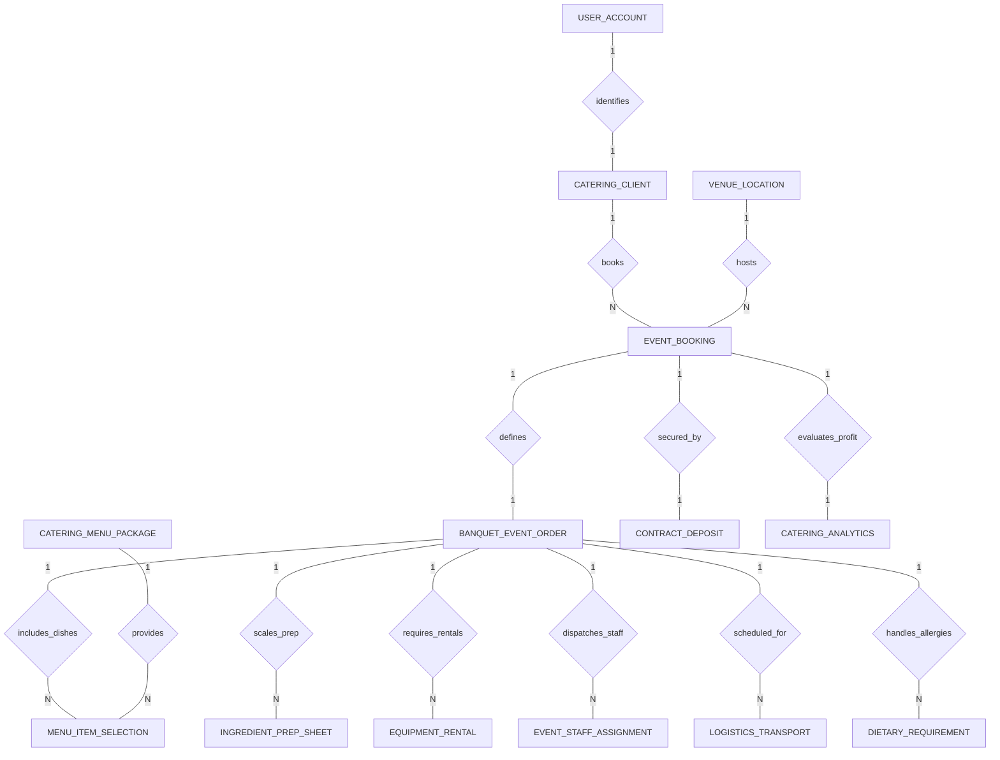

# Conceptual ERD — Catering Service Management System

## Mermaid Code

## Entity Description Table | Bang mo ta Entity

| # | Entity Name | Vietnamese Name | Description | Key Attributes | Main Relationships |
|---|-------------|-----------------|-------------|----------------|-------------------|
| 1 | CATERING_CLIENT | Khach hang dat tiec | Represents corporate or individual catering client profile, company details, contact info, and credit status. | client_id, user_id, company_name, contact_name, phone_number | Belongs to USER_ACCOUNT; One-to-Many with EVENT_BOOKING |
| 2 | EVENT_BOOKING | Don dat tiec | Central booking record storing event title, event date, guest headcount, service style, and status stages. | booking_id, client_id, venue_id, event_title, event_date, guest_headcount, booking_status | Belongs to CATERING_CLIENT, VENUE_LOCATION; One-to-One with BANQUET_EVENT_ORDER, CONTRACT_DEPOSIT, CATERING_ANALYTICS |
| 3 | BANQUET_EVENT_ORDER | Lenh to chuc tiec BEO | Master operational blueprint document specifying timelines, room setup, menu specs, staff rosters, and revisions. | beo_id, booking_id, beo_number, revision_number, call_time, dinner_time, is_published | One-to-One with EVENT_BOOKING; One-to-Many with MENU_ITEM_SELECTION, INGREDIENT_PREP_SHEET, EQUIPMENT_RENTAL, EVENT_STAFF_ASSIGNMENT, LOGISTICS_TRANSPORT, DIETARY_REQUIREMENT |
| 4 | CATERING_MENU_PACKAGE | Goi thuc don tiec | Pre-designed catering buffet/plated menu packages, per-head pricing tiers, and service type categories. | package_id, package_name, service_type, price_per_head, is_active | One-to-Many with MENU_ITEM_SELECTION |
| 5 | MENU_ITEM_SELECTION | Mon an chon phuc vu | Specific food items selected for the event, scaled portion quantities, per-head pricing, and prep notes. | selection_id, beo_id, item_id, portion_quantity, unit_price | Belongs to BANQUET_EVENT_ORDER, CATERING_MENU_PACKAGE |
| 6 | INGREDIENT_PREP_SHEET | Bang so che nguyen lieu | Scaled batch prep sheet calculated from BEO headcount, tracking raw ingredient quantities and completion status. | prep_id, beo_id, ingredient_name, total_scaled_quantity, unit_of_measure | Belongs to BANQUET_EVENT_ORDER |
| 7 | EQUIPMENT_RENTAL | Thiet bi thue ngoai | Hardware and linen rental items reserved for the event (tables, chairs, china, linens) and supplier statuses. | rental_id, beo_id, equipment_name, quantity_reserved, rental_cost | Belongs to BANQUET_EVENT_ORDER |
| 8 | EVENT_STAFF_ASSIGNMENT | Phan cong nhan vien tiec | Shift dispatch records for banquet staff (Captains, Servers, Bartenders), clock-in times, and hourly pay rates. | assignment_id, beo_id, staff_id, role_assigned, clock_in_time, hourly_rate | Belongs to BANQUET_EVENT_ORDER |
| 9 | LOGISTICS_TRANSPORT | Vanchuyen van kho | Delivery transport van scheduling, departure/arrival times, vehicle license plates, and loading statuses. | transport_id, beo_id, vehicle_plate, departure_time, arrival_time | Belongs to BANQUET_EVENT_ORDER |
| 10 | CONTRACT_DEPOSIT | Hop dong & Dat coc | Legally binding catering contract record, total contract value, non-refundable deposit amounts, and payment status. | contract_id, booking_id, total_contract_value, deposit_amount, payment_status | One-to-One with EVENT_BOOKING |
| 11 | DIETARY_REQUIREMENT | Yeu cau che do an kien | Special guest dietary restriction tags (Vegan, Gluten-Free, Kosher, Severe Allergies) and headcount counts. | dietary_id, beo_id, restriction_type, guest_count, special_instructions | Belongs to BANQUET_EVENT_ORDER |
| 12 | VENUE_LOCATION | Dia diem to chuc | Event venue profile, physical address, maximum guest capacity, kitchen facility access, and loading dock specs. | venue_id, venue_name, address, max_capacity, has_kitchen | One-to-Many with EVENT_BOOKING |
| 13 | USER_ACCOUNT | Tai khoan he thong | Core security authentication account holding credentials, password hashes, and user role definitions. | user_id, username, password_hash, role_name | One-to-One with CATERING_CLIENT |
| 14 | CATERING_ANALYTICS | Thong ke hieu qua tiec | Post-event financial analysis tracking food cost totals, labor cost totals, revenue subtotals, and net event margin %. | analytics_id, booking_id, event_date, food_cost_total, labor_cost_total, net_event_margin | One-to-One with EVENT_BOOKING |

## Relationship Description | Mo ta Quan he

| # | From Entity | Cardinality | To Entity | Relationship Label | Business Explanation |
|---|-------------|-------------|-----------|-------------------|----------------------|
| 1 | USER_ACCOUNT | One-to-One | CATERING_CLIENT | identifies | Tai khoan he thong xac thuc ho so khach hang dat tiec. |
| 2 | CATERING_CLIENT | One-to-Many | EVENT_BOOKING | books | Mot khach hang co the dat nhieu don to chuc tiec qua thoi gian. |
| 3 | VENUE_LOCATION | One-to-Many | EVENT_BOOKING | hosts | Mot dia diem co thể duoc thue de to chuc nhieu su kien tiec khac nhau. |
| 4 | EVENT_BOOKING | One-to-One | BANQUET_EVENT_ORDER | defines | Mot don dat tiec khoi tao va dinh nghia mot lenh to chuc tiec BEO duy nhat. |
| 5 | EVENT_BOOKING | One-to-One | CONTRACT_DEPOSIT | secured_by | Mot don dat tiec duoc dam bao bang mot hop dong va giao dich dat coc. |
| 6 | BANQUET_EVENT_ORDER | One-to-Many | MENU_ITEM_SELECTION | includes_dishes | Mot lenh BEO bao gom nhieu mon an duoc lua chon trong thuc don tiec. |
| 7 | CATERING_MENU_PACKAGE | One-to-Many | MENU_ITEM_SELECTION | provides | Mot goi thuc don goc cung cap danh sach cac mon an lua chon. |
| 8 | BANQUET_EVENT_ORDER | One-to-Many | INGREDIENT_PREP_SHEET | scales_prep | Mot lenh BEO quy doi va tinh toan dinh muc nguyen lieu so che cho bep. |
| 9 | BANQUET_EVENT_ORDER | One-to-Many | EQUIPMENT_RENTAL | requires_rentals | Mot lenh BEO yeu cau danh sach cac thiet bi va khan ban thue ngoai. |
| 10 | BANQUET_EVENT_ORDER | One-to-Many | EVENT_STAFF_ASSIGNMENT | dispatches_staff | Mot lenh BEO phan cong va dieu dong nhieu nhan vien phuc vu tiec. |
| 11 | BANQUET_EVENT_ORDER | One-to-Many | LOGISTICS_TRANSPORT | scheduled_for | Mot lenh BEO duoc len lich van chuyen va dieu xe giao hang theo khung gio. |
| 12 | BANQUET_EVENT_ORDER | One-to-Many | DIETARY_REQUIREMENT | handles_allergies | Mot lenh BEO ghi nhan cac yeu cau che do an kien va di ung cua khach. |
| 13 | EVENT_BOOKING | One-to-One | CATERING_ANALYTICS | evaluates_profit | Mot su kien hoan thanh duoc thong ke va danh gia chi phi, loi nhuan chi tiet. |
